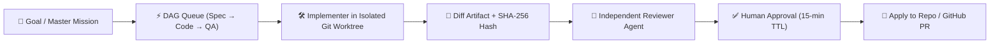
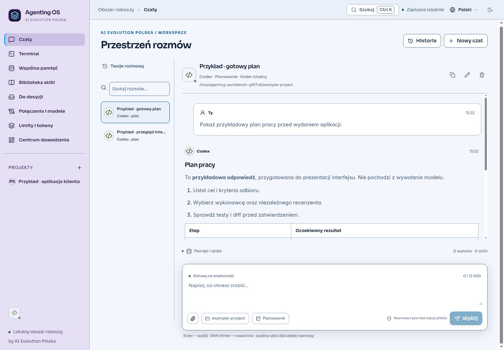
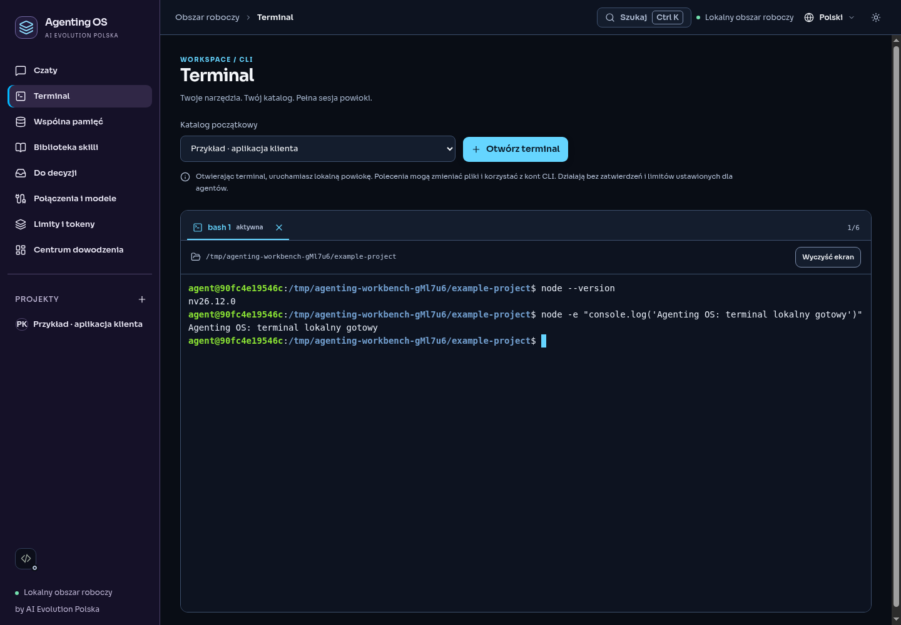
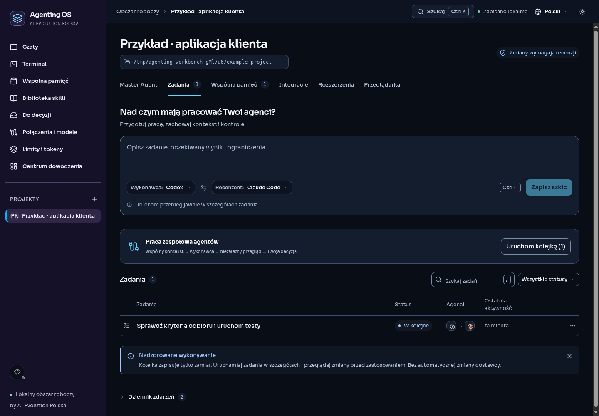
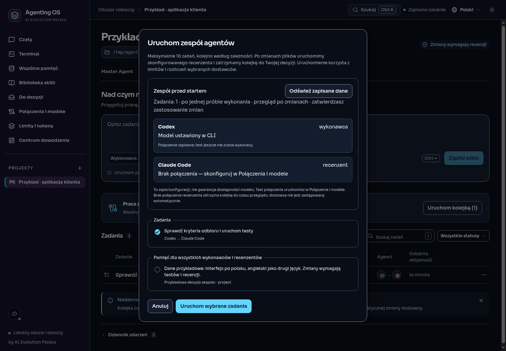
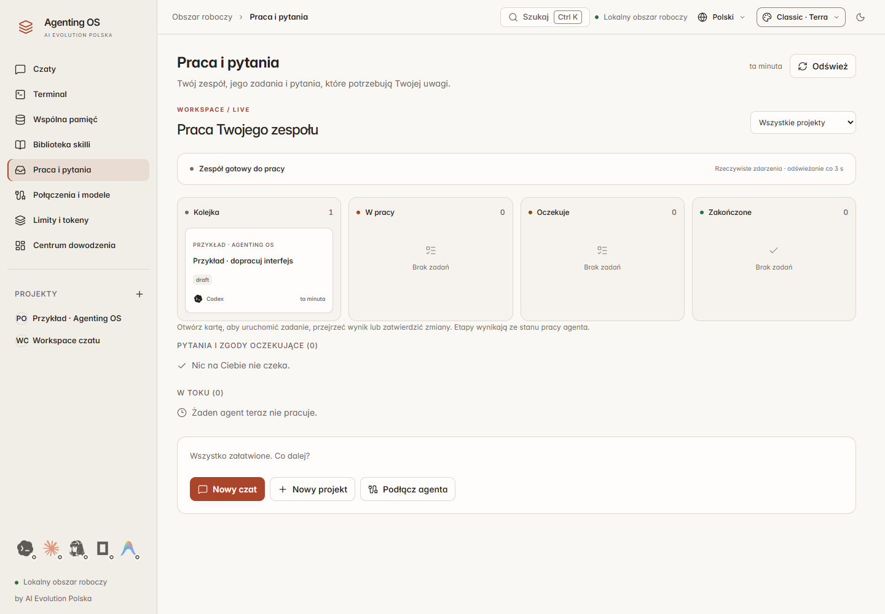
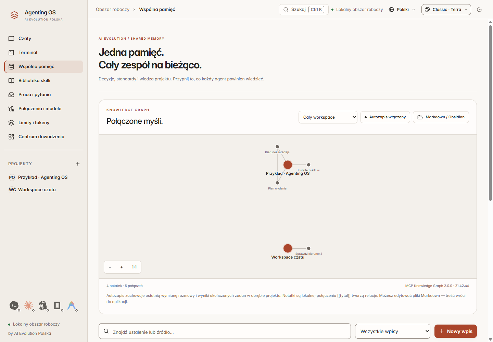
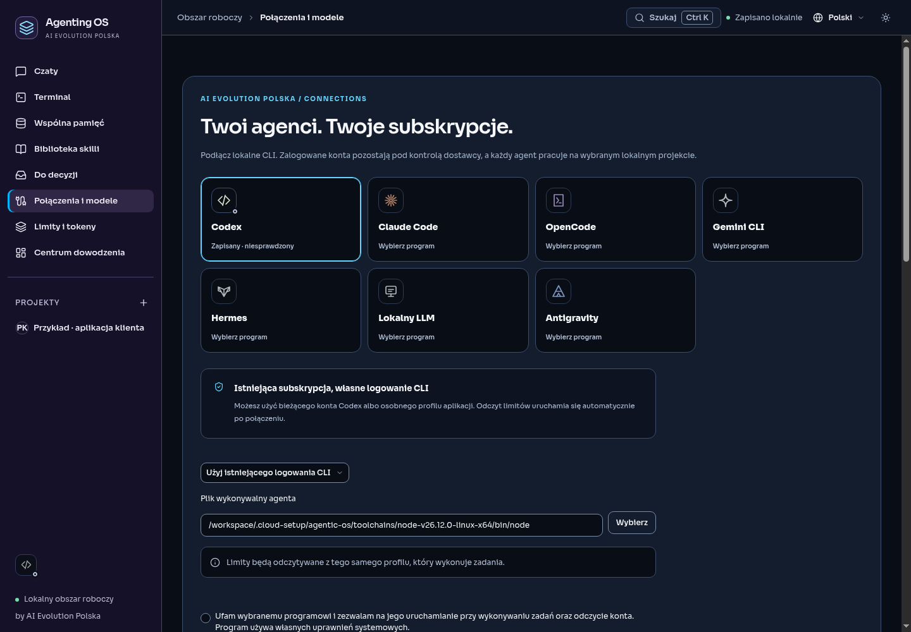
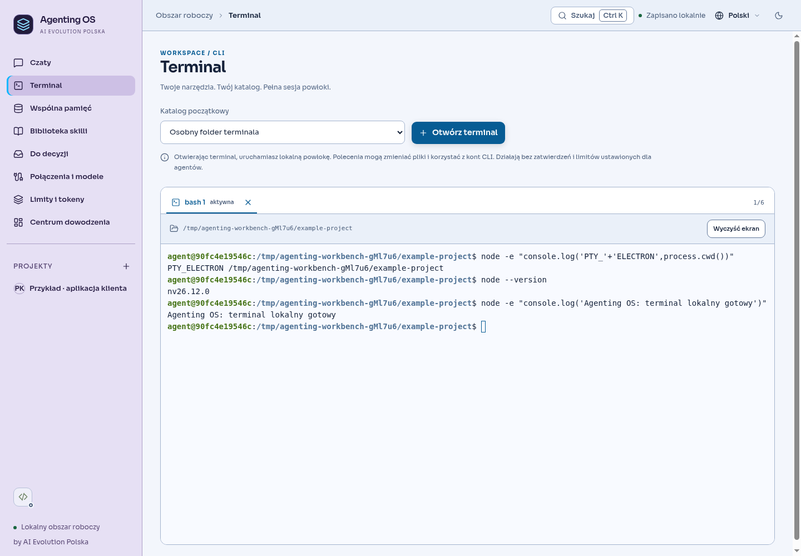

<div align="center">

# ⚡ Agenting OS — Multi-Agent Harness & Engineering Studio

### **A professional *Codex / Claude Code Harness*-grade desktop studio for AI agent orchestration, native PTY terminal workflows, MCP knowledge graphs, and verified Git worktree changes.**

**Built by [AI EVOLUTION POLSKA](https://www.aievolutionpolska.pl) · [www.aievolutionpolska.pl](https://www.aievolutionpolska.pl)**

[](https://www.aievolutionpolska.pl)
[](https://www.aievolutionpolska.pl)
[](mailto:kontakt@aievolutionpolska.pl)

[](https://github.com/aievolutionpl/agentic-os/actions/workflows/ci.yml)
[](https://github.com/aievolutionpl/agentic-os/releases/latest)
[](#license--commercial-use)
[](.nvmrc)
[](#architecture--tech-stack)
[](#download--installation)

[**🚀 Download**](#download--installation) · [**🛠️ Build from Source**](#build-from-source) · [**✨ Features**](#complete-feature-overview) · [**🧠 20 Built-In Skills**](#20-built-in-skill-packages--skillmd-studio) · [**🔌 AI Providers**](docs/PROVIDERS.md) · [**💼 Commercial License**](#license--commercial-use) · [**🇵🇱 Polski**](README.md)

</div>

## Harness — team instructions, memory and context

The **Harness** workspace adds editable shared instructions, configurable automatic memory recall, a source and budget inspector, and recorded agent connection status. `AGENTS.md` export requires an explicit project and includes only its private notes plus explicitly shared workspace memory.

See the [product concept, development plan and implementation prompt (Polish)](docs/HARNESS_EVOLUTION_PL.md). Run `npm run qa:harness-studio` for the native UI journey.


---

## 🌟 What is Agenting OS?

**Agenting OS** is a flagship, local-first engineering workbench (*Agentic Workbench & Harness Studio*) built by **[AI Evolution Polska](https://www.aievolutionpolska.pl)**. It unifies in a single, ultra-fast desktop window:

- 🤖 **Multi-Agent Chat & Planning** (*Codex*, *Claude Code*, *Antigravity*, *OpenCode / OpenRouter*, *Hermes*, *ACP*, and local models) with a 1-click **Multi-Agent Second Opinion** workflow.
- 🛡️ **Isolated Git Worktree Execution** with cryptographic diff verification (`SHA-256`), an independent Reviewer agent, and 1-click **GitHub Pull Request** creation.
- 🧠 **Local MCP Knowledge Graph + Auto-Vault** with `FTS5` full-text search, connected cluster Markdown export, and a 1-click **`AGENTS.md`** context bundle generator.
- 📚 **20 Built-In Pinned Skill Packages + Interactive `SKILL.md Studio`** writing custom skills directly to `.agents/skills/<slug>/SKILL.md`.
- 💻 **Native Multi-Tab PTY Terminal (`node-pty` + Xterm.js)** with 1-click CLI quick commands and dynamic synchronization across **7 color themes**.


---

## 💼 License & Commercial Use

> [!IMPORTANT]
> ### 📜 Download, Modification & Commercial Licensing Policy (`AI Evolution Polska`)
>
> - ✅ **Free to Download, Inspect & Customize (Personal / Educational / R&D):** Anyone is free to download, run, modify, and customize the source code for personal, educational, academic, and non-commercial evaluation purposes.
> - 🏢 **Commercial & Enterprise Use Requires a Commercial License:** If you or your company wish to use **Agenting OS** commercially within an organization, deploy it for business or engineering teams, offer commercial services powered by it, or embed it in commercial products — **you must contact AI Evolution Polska to obtain a commercial license**:
>   - 📧 **Email:** **[kontakt@aievolutionpolska.pl](mailto:kontakt@aievolutionpolska.pl)**
>   - 🌐 **Website:** **[www.aievolutionpolska.pl](https://www.aievolutionpolska.pl)**
>
> *Base repository code notices are provided in [LICENSE](LICENSE) and [NOTICE](NOTICE) (Copyright © 2026 AI Evolution Polska).*

---

## ✨ Complete Feature Overview

### 1. 💬 Multi-Agent Chat, `/Slash` Commands & "Second Opinion"
- **Conversation & Planning Modes (`Chat` / `Plan`):** Select any configured provider and a per-conversation model override.
- **Built-in `/slash` commands:** Type `/` in the composer to trigger `/plan`, `/review`, `/test`, `/debug`, or `/clear`.
- **🔄 Multi-Agent Second Opinion:** Click **"Second opinion"** under any completed assistant reply to switch to a different configured agent in Planning mode with an architectural critique prompt.
- **1-Click Handoff:** Save any reply directly to **Project Memory** or turn it into a **Task Queue item**.

### 2. 🎯 Master Agent & 3-Step DAG Pipeline Generator (`Spec → Code → QA`)
- **Autonomous Master Agent:** Proposes up to 6 steps, delegates approved tasks to implementer and reviewer agents, and evaluates the final result.
- **1-Click Mission Presets with Auto-Skill Bundles:** Launch *Full-Stack Feature + TDD*, *UI/UX Polish & Taste Redesign*, *Architecture Blueprint & Spec*, or *Security Audit & Bug Hunt* with pre-attached skill packages.
- **⚡ 3-Step DAG Pipeline Generator (`Spec → Code → QA`):** Create 3 sequential tasks with linked `dependencyIds` in a single click.



### 3. 🔍 Advanced Diff Studio, Git Repo Health & GitHub PR Integration
- **Live Git Repo Health Bar:** Displays the active `GIT BRANCH`, worktree status (`CLEAN` vs `DIRTY` with changed file count), and latest `HEAD` commit in the project header.
- **Interactive Diff Studio:** Live search inside diffs, per-file collapse/expand, **"Collapse / Expand all"**, and 1-click single-file diff copy.
- **Branch Export & GitHub Pull Requests:** Export any run to a local branch or create a **GitHub Pull Request (`gh pr create`)** with reviewer evidence.

### 4. 🧠 20 Built-In Skill Packages + Interactive `SKILL.md Studio`
Install 20 commit-pinned skill packages with one click from the **Dashboard Skills Dock** or **Skill Library**:
- **Engineering & Architecture:** `archify`, `addyosmani-agent-skills`, `agentskills-standard`, `mcp-builder`
- **Design & Frontend:** `frontend-design`, `taste-skill`
- **Testing, QA & Debugging:** `webapp-testing`, `systematic-debugging`, `test-driven-development`, `verification-before-completion`
- **Marketing & Content:** `marketingskills`, `humanizer`, `brainstorming`
- **Google Workspace & Docs:** `gws-calendar`, `gws-docs`, `gws-sheets`, `gws-shared`, `pdf`
- **Web Automation & Ecosystem:** `browserbase-skills`, `awesome-claude-skills`
- **✨ Interactive `SKILL.md Studio`:** Author custom skills using built-in templates (*Engineering & TDD*, *UI & Design System*, *API & Security Gate*) and write `.agents/skills/<slug>/SKILL.md` directly to your project folder.

### 5. 🕸️ MCP Memory Graph, Auto-Vault & `AGENTS.md` Exporter
- **Interactive Memory Graph:** Search nodes in real time, inspect connected neighbors, and copy any node + its connected cluster as Markdown (**"Copy cluster MD"**).
- **1-Click `AGENTS.md` Bundle Export:** Export all pinned rules and working memory notes as a portable `AGENTS.md` specification.

### 6. 💻 Embedded PTY Terminal, Project Browser & 7 Harness Studio Themes
- **Native PTY Terminal (`node-pty` + Xterm.js):** Up to 6 tabs with 1-click quick commands (`$ git status`, `$ git diff --stat`, `$ npm test`, `$ codex`, `$ claude`).
- **Project Browser:** Quick localhost presets (`:3000`, `:5173`, `:8080`, `:4321`, `GitHub`) + 1-click **"Save URL to Memory"**.
- **7 Color Themes:** `Classic · Terra`, `Graphite`, `Light`, `Claude Code`, `Codex CLI`, `Tokyo Night`, and `Nord Frost`.
- **Global Shortcuts:** `Ctrl+K` / `⌘K` Command Palette and `Alt+1`..`Alt+8` instant workspace switching.

---

## 🖼️ Interface Gallery

| Light Conversation Studio | Native Project Terminal |
| :---: | :---: |
|  |  |
| **Project Tasks & DAG Queue** | **Team Preflight Verification** |
|  |  |
| **Live Kanban Board** | **MCP Memory Graph** |
|  |  |
| **Connections & Diagnostics** | **Light Terminal Theme** |
|  |  |

---

## 📥 Download & Installation

The Windows x64 installer and `SHA-256` checksums are available in [**Releases**](https://github.com/aievolutionpl/agentic-os/releases/latest):

1. Download `Agenting-OS-<version>-windows-x64-setup.exe`.
2. Verify checksum: `certutil -hashfile <file> SHA256` against `SHA256SUMS.txt`.
3. Run the installer.

---

## 🛠️ Build from Source

Requires **Node.js 24 or 26** ([`.nvmrc`](.nvmrc) pins `26`), `npm`, `Git`, and C++ build tools for `node-pty` when prebuilds are unavailable.

```sh
git clone https://github.com/aievolutionpl/agentic-os.git
cd agentic-os
npm ci
npm start
```

### Verification & QA Commands

```sh
npm run typecheck
npm test
npm run smoke
npm run release:audit
```

---

## 🏛️ Architecture & Tech Stack

| Layer | Technology |
| :--- | :--- |
| **Desktop Shell** | Electron 43 + TypeScript 5.9 (`contextIsolation: true`, `sandbox: true`) |
| **Frontend UI** | React 19 + Vite 7 |
| **Storage & Memory** | SQLite + FTS5 + `@modelcontextprotocol/server-memory` |
| **Terminal** | `node-pty` 1.1 + `@xterm/xterm` |
| **Testing** | `node:test` + JSDOM + Playwright |

More documentation: [Providers](docs/PROVIDERS.md) · [Release Status](docs/RELEASE_STATUS.md) · [Workbench Audit](docs/WORKBENCH_AUDIT.md) · [Claudex / CC Switch Research](docs/research/claudex-cc-switch.md) · [Security](SECURITY.md) · [Contributing](CONTRIBUTING.md) · [Changelog](CHANGELOG.md).

---

## 🤝 Contact & Commercial Licensing

Designed and engineered by **[AI EVOLUTION POLSKA](https://www.aievolutionpolska.pl)**.

- 🌐 **Website:** **[www.aievolutionpolska.pl](https://www.aievolutionpolska.pl)**
- 📧 **Commercial Licensing & Enterprise Inquiries:** **[kontakt@aievolutionpolska.pl](mailto:kontakt@aievolutionpolska.pl)**
- 🐛 **Issues & Feature Requests:** [GitHub Issues](https://github.com/aievolutionpl/agentic-os/issues)

<div align="center">

**Built by [AI EVOLUTION POLSKA](https://www.aievolutionpolska.pl)** · [License](LICENSE) · [Notice](NOTICE) · [Third-Party Licenses](licenses/THIRD_PARTY_NOTICES.md) · [Code of Conduct](CODE_OF_CONDUCT.md)

</div>
