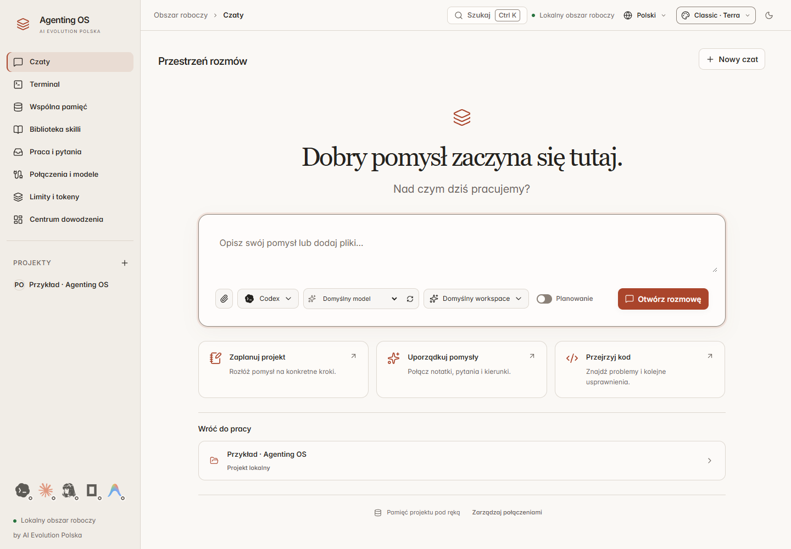

# Agenting OS

**One workspace for agent conversations, projects and persistent knowledge.**

Built by [AI Evolution Polska](https://www.aievolutionpolska.pl). [Polski](README.md)

[](https://github.com/aievolutionpl/agentic-os/actions/workflows/ci.yml)



*Screenshots show earlier interface versions. This README describes the current branch; published installers may contain an earlier feature set. The CI badge refers to main.*

Agenting OS is a desktop application for AI conversations, project memory and supervised implementation workflows. Choose an agent and model, organize context, schedule work and inspect results in one window. Coding tasks use a separate implementation and review workflow.

## Getting started

Check [GitHub Releases](https://github.com/aievolutionpl/agentic-os/releases) for available Windows x64 installers and release notes. Where checksums are supplied, compare the downloaded installer's SHA-256 with `SHA256SUMS.txt`.

To run from source, install Node.js 24 or 26, npm and Git. The recommended Node version is in [`.nvmrc`](.nvmrc). A graphical environment is required. Building the native terminal module may require Python 3 and C++ tools: Visual Studio Build Tools on Windows, make/g++ on Linux, or Xcode Command Line Tools on macOS. The installer configuration targets Windows x64; CI verifies Windows and Linux.

```sh
git clone https://github.com/aievolutionpl/agentic-os.git
cd agentic-os
npm ci
npm start
```

Select a specific branch with `git switch <branch>` before installing dependencies if needed. `npm start` builds and opens Electron.

1. Open Settings and configure an agent connection. Detecting a CLI does not prove authentication.
2. Add a project and select its folder, or use the default conversation workspace.
3. Start a conversation using the main button or the plus beside a project. Select an agent and model.
4. Add relevant skills to that project from the library.
5. Save useful answers to memory. For implementation, turn an answer into a task and use the execution/review workflow.

## Features

| Area | Workflow |
| --- | --- |
| Conversations | Per-conversation model selection, attachments, planning, second opinions and handoff to memory or tasks. |
| Projects | Nested conversations, project search and inline renaming without moving folders. |
| Tasks | Implementation in Git worktrees, diff inspection, independent review and explicit approval of results. |
| Memory | Project notes, explicitly shared workspace knowledge and a graph of relationships. |
| Harness | Editable workspace instructions, automatic recall controls, context sources and budget inspection. |
| Skills | 33 pinned packages, custom imports and enable/disable controls. |
| Plugins | Google Drive, Canva, Notion and Firecrawl connections with manual tool execution. |
| ScheduleJob | One-time, daily and selected-weekday schedules, pause controls and links to results. |
| Terminal and Git | Native PTY terminal, repository inspection, diff viewing and result export. |

The five visible palettes are **Pearl**, **Light Orange**, **Midnight**, **Graphite** and **AI Evolution**. Themes include the sidebar. Settings control content width, chat text size, project density, motion and glass effects. Active conversations have a compact composer and wider transcript. Wide windows combine the header and quotas into one row; smaller windows wrap controls. `Ctrl+K` / `Cmd+K` opens the command palette.

## Agents and quotas

Connections include Codex, Claude Code, Antigravity, OpenCode, Hermes and a local LLM profile. OpenRouter supplies models and billing for compatible connections. Capabilities depend on the adapter, installed CLI version, account and selected model.

The quota strip shows configured, enabled agents. Shared billing sources are deduplicated where the data identifies the same service. Disabling an agent blocks new jobs and hides its card; it does not log out the external account or stop an existing run.

Percentages, monetary balances and token counts are different measures. The app does not invent token allowances from percentages. Missing and stale readings are labeled. See [provider support](docs/PROVIDERS.md) and [subscription connections](docs/SUBSCRIPTION_CONNECTIONS.md); historical checks there do not establish current account readiness.

## Skills

The [catalog](resources/skills/catalog.json) contains 33 packages pinned to source versions, with source attribution and licenses. It covers design, architecture, debugging, testing, documents and marketing.

Ten added marketing packages from `coreyhaines31/marketingskills`, discovered through skills.sh, cover copywriting, content strategy, SEO, marketing plans, customer research, social media, email, ads, product marketing and sales enablement. Supporting files and licenses are bundled.

Installation writes to `.agents/skills/<slug>` in the selected project. Disabling a catalog skill moves it to `.agents/disabled-skills/<slug>` and excludes it from new agent context. Re-enabling preserves local edits. Installation does not automatically execute package scripts. A skill supplies instructions, not credentials or new tool permissions.

## Plugins

| Service | Connection | Scope |
| --- | --- | --- |
| Google Drive | Desktop OAuth client and browser login | Search and read text files; export Google Docs/Sheets. |
| Notion | Browser OAuth | Tools returned by the official MCP service. |
| Canva | OAuth; registered client credentials if required | Tools returned by Canva MCP. |
| Firecrawl | OAuth or API key | Web retrieval and search tools. |

Select a tool, inspect arguments and explicitly execute it in the panel. Results can be saved to project memory. Remote plugins are not automatically available in the model's conversation tool loop. Reconnect after restarting the app; saved grants are reused where supported.

See [plugin setup, storage and limitations](docs/PLUGINS.md).

## Memory and harness

Private memory belongs to its project; workspace sharing is explicit. Harness controls additional workspace instructions and recall. Exporting `AGENTS.md` requires selecting a project.

The core instruction covers the complete work cycle: understand the goal, inspect relevant context, act within permission boundaries, verify and report evidence. Skills, retrieved files and memories cannot expand permissions. Runtime code and provider adapters enforce execution limits.


## Current limitations

- Conversation and planning are not direct project editors. Chat still uses research context: compatible adapters run read-only, while other adapters use an isolated workspace. Direct selected-folder editing and an Auto accept switch in chat are not implemented. Use the task workflow for implementation.
- A configured connection does not guarantee model availability or remaining quota. CLI installation, authentication, an eligible plan or API configuration may be required.
- ScheduleJob requires a running app and computer; it does not wake the device. Scheduled jobs inherit conversation restrictions and require consent for recurring provider usage.
- Plugins require your own accounts and permissions. Google Drive requires OAuth setup. Protocol tests do not replace testing authenticated accounts.
- Local storage does not mean offline inference. Prompts, selected context and tool requests are sent to the providers you use. Provider charges and limits apply.

## Development

Electron and TypeScript provide the main process, React/Vite the interface, SQLite/FTS5 persistence, and node-pty/Xterm.js the terminal. Main-process adapters are in `src/main`, components in `src/renderer`, and IPC contracts in `src/shared.ts`.

```sh
npm run typecheck
npm run lint
npm test
npm run smoke
npm run qa:calm
npm run qa:plugins
npm run qa:harness-studio
npm run release:audit
```

UI checks require a graphical environment; Linux CI uses Xvfb. The release audit checks local documentation links, license inventory and skill pinning. It is not a comprehensive security audit.

Build and verify a Windows installer:

```sh
npm run package:win
npm run smoke:package
```

## Data, licenses and support

Application data is stored locally in Electron's user-data directory. OpenRouter keys and plugin credentials use the system encryption store. External tools can maintain their own authentication data. See [SECURITY.md](SECURITY.md).

Code terms are defined in [LICENSE](LICENSE); attribution is in [NOTICE](NOTICE). Skills and dependencies retain their own licenses; see [third-party notices](licenses/THIRD_PARTY_NOTICES.md). Contact AI Evolution Polska for deployment, support and collaboration.

[Website](https://www.aievolutionpolska.pl) · [Email](mailto:kontakt@aievolutionpolska.pl) · [Issues](https://github.com/aievolutionpl/agentic-os/issues)

[Plugins](docs/PLUGINS.md) · [Providers](docs/PROVIDERS.md) · [Release status](docs/RELEASE_STATUS.md) · [Contributing](CONTRIBUTING.md) · [Changelog](CHANGELOG.md)
