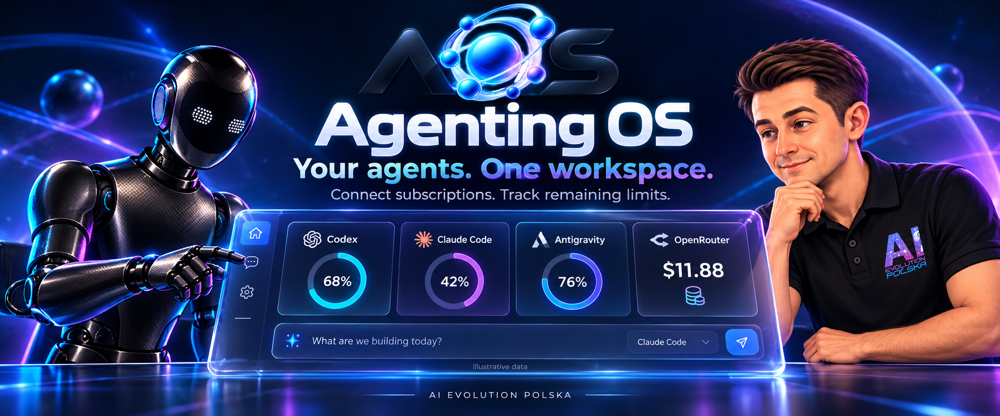
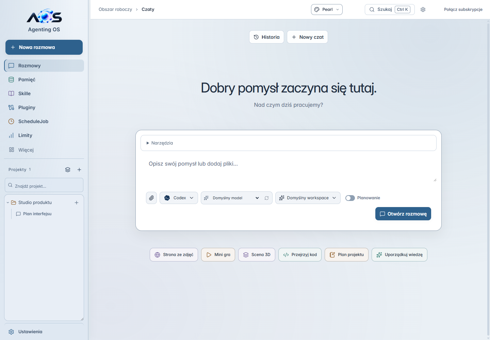
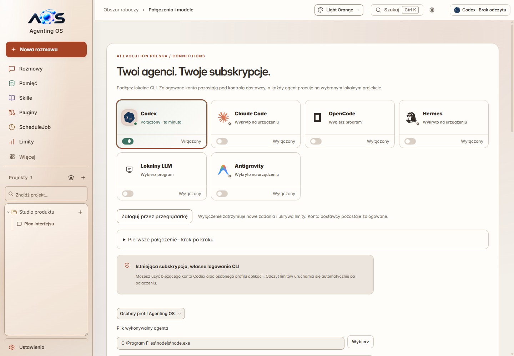
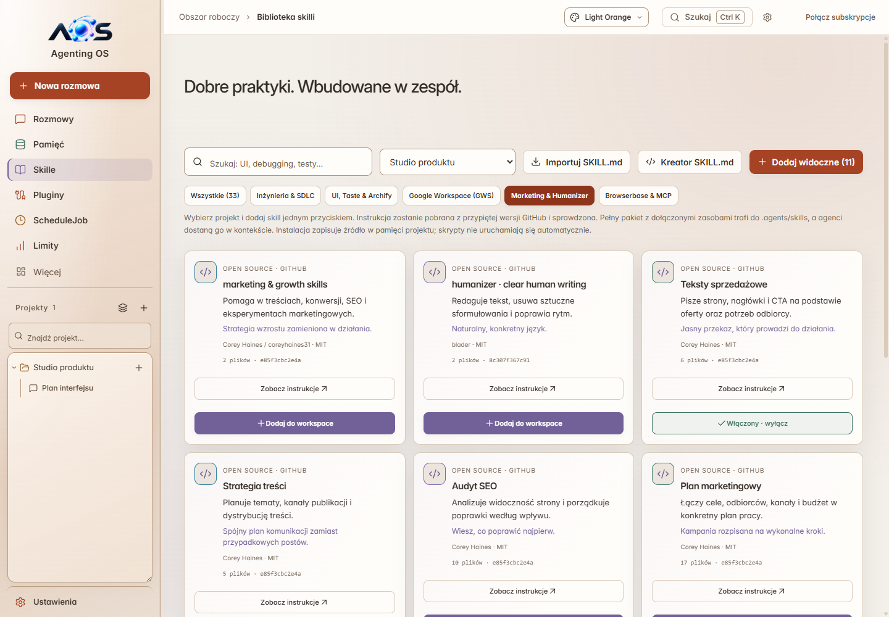
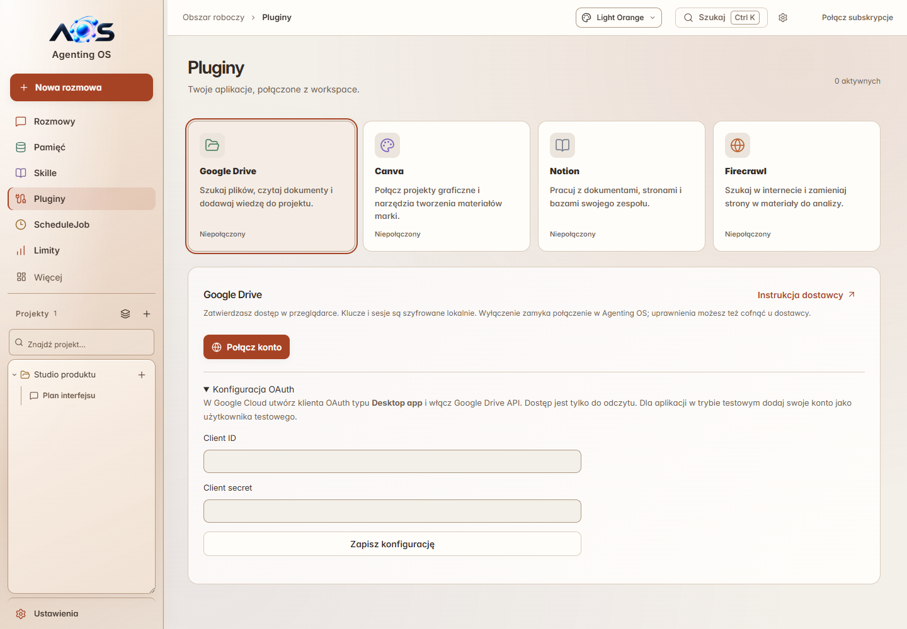
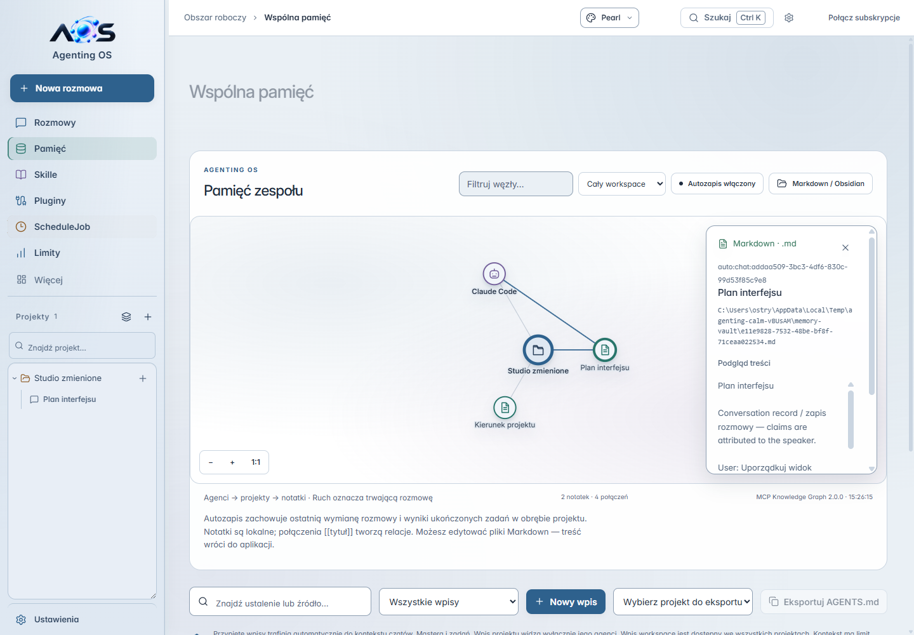
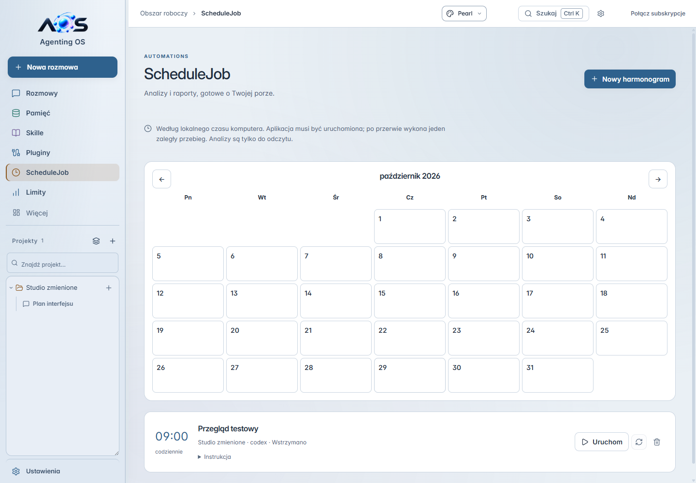
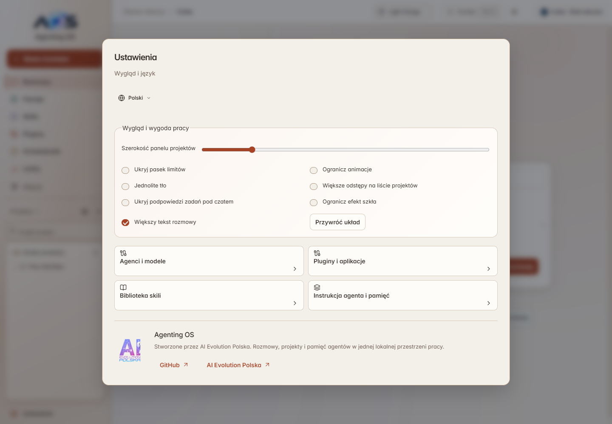
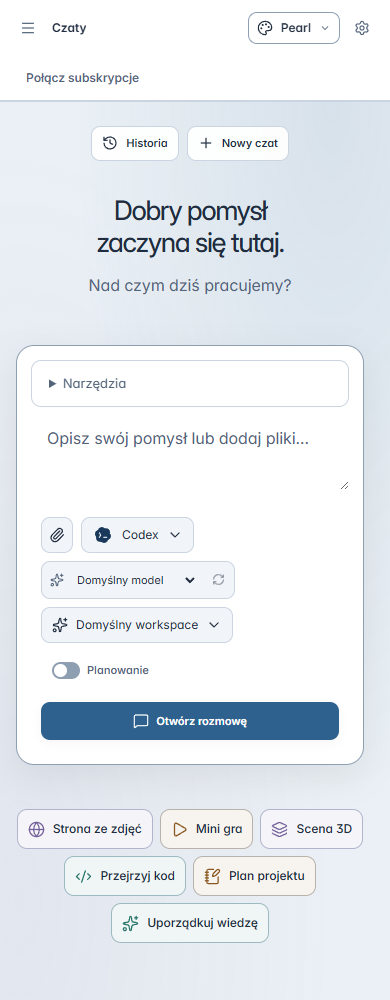
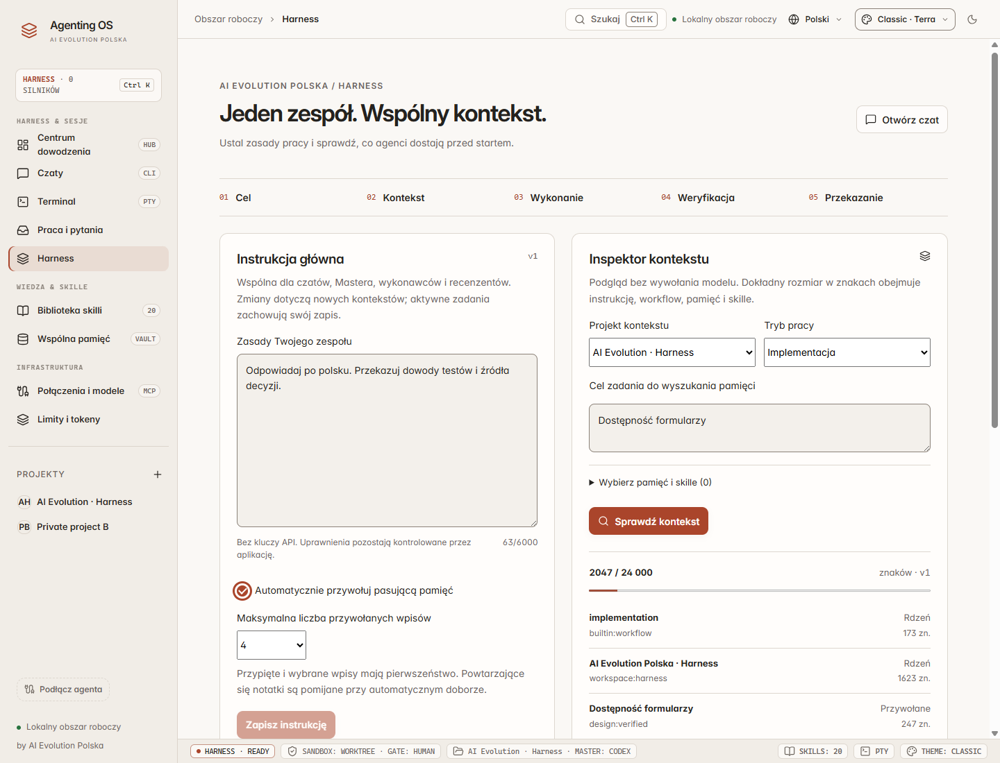

<sub>Wizualizacja produktu. Wartości limitów i salda są przykładowe; dostępność odczytów zależy od dostawcy.</sub>

# Agenting OS

**Jeden workspace do rozmów z agentami, pracy nad projektami i wiedzy, która zostaje z Tobą.**

Zbudowane przez [AI Evolution Polska](https://www.aievolutionpolska.pl).

[](https://github.com/aievolutionpl/agentic-os/actions/workflows/ci.yml)

[Start](#start) · [Możliwości](#możliwości) · [Skille](#skille) · [Pluginy](#pluginy) · [Ograniczenia](#ograniczenia) · [English](README.en.md)




Agenting OS to aplikacja desktopowa z lokalną bazą rozmów, pamięcią projektów i połączeniami z narzędziami AI. W jednym oknie wybierasz agenta i model, porządkujesz kontekst, planujesz zadania oraz przeglądasz wyniki pracy. Wykonywanie zmian w kodzie ma osobny proces implementacji i recenzji.

README opisuje kod w tej gałęzi. Gotowy instalator może zawierać wcześniejszy zestaw funkcji. Badge CI dotyczy `main`, nie bieżącej gałęzi.


## 🖼️ Galeria Interfejsu

Aktualne zrzuty wersji 0.5.0-rc.2, wykonane w aplikacji Electron na przykładowym projekcie. Statusy i dane na obrazach są testowe.

| Chat | Agents |
| --- | --- |
|  |  |
| Skills | Plugins |
|  |  |
| Memory | ScheduleJob |
|  |  |

<details>
<summary>Settings / Mobile</summary>





</details>

## Start

### Instalator Windows

Sprawdź dostępne pliki i opis wersji w [GitHub Releases](https://github.com/aievolutionpl/agentic-os/releases). Dla wydań zawierających instalator Windows wybierz plik `Agenting-OS-<wersja>-windows-x64-setup.exe`. Jeśli wydanie zawiera `SHA256SUMS.txt`, porównaj sumę pobranego pliku:

```powershell
Get-FileHash .\Agenting-OS-<wersja>-windows-x64-setup.exe -Algorithm SHA256
```

### Uruchomienie ze źródeł

Wymagania: Node.js 24 lub 26, npm, Git i środowisko graficzne. Zalecaną wersję Node wskazuje [`.nvmrc`](.nvmrc). Kompilacja natywnego modułu terminala może wymagać Python 3 i narzędzi C++: Visual Studio Build Tools na Windows, `make` i `g++` na Linux lub Xcode Command Line Tools na macOS. Konfiguracja instalatora w repozytorium dotyczy Windows x64; CI sprawdza Windows i Linux.

```sh
git clone https://github.com/aievolutionpl/agentic-os.git
cd agentic-os
npm ci
npm start
```

`npm start` buduje aplikację i otwiera okno Electron. Aby uruchomić konkretną gałąź, wybierz ją przez `git switch <nazwa-gałęzi>` przed instalacją zależności.

### Pierwsze pięć minut

1. Otwórz **Ustawienia → Agenci i modele**. Wybierz zainstalowane narzędzie i skonfiguruj połączenie. Samo wykrycie CLI nie oznacza zalogowanego konta.
2. Dodaj projekt i wybierz jego folder albo rozpocznij rozmowę w domyślnym workspace.
3. Użyj **Nowa rozmowa** lub przycisku **+** przy projekcie. Wybierz agenta i model.
4. W **Skillach** wybierz projekt i dodaj potrzebne pakiety. Nie musisz instalować całego katalogu.
5. Zapisuj przydatne odpowiedzi w pamięci. Gdy potrzebujesz implementacji, utwórz zadanie z odpowiedzi i przejdź do procesu wykonania oraz recenzji.

## Możliwości

| Obszar | Co możesz zrobić |
| --- | --- |
| **Rozmowy** | Wybrać model dla rozmowy, dodać pliki, zaplanować pracę, poprosić o drugą opinię i przekazać odpowiedź do zadania lub pamięci. |
| **Projekty** | Organizować rozmowy pod folderami, wyszukiwać projekty i zmieniać nazwę dwuklikiem. Zmiana nazwy nie przenosi folderu. |
| **Zadania i recenzja** | Uruchamiać wykonawcę w osobnym Git worktree, oglądać diff i weryfikację, a następnie zatwierdzić konkretny wynik. |
| **Pamięć** | Przechowywać notatki projektu, jawnie udostępniać wybrane wpisy w workspace i przeglądać powiązania na grafie. |
| **Harness** | Edytować instrukcje workspace, ustawiać przywoływanie pamięci i sprawdzać źródła oraz budżet kontekstu. |
| **Skille** | Instalować przypięte pakiety instrukcji, importować własne i włączać lub wyłączać zainstalowane skille. |
| **Pluginy** | Połączyć Google Drive, Canva, Notion lub Firecrawl, uruchomić narzędzie i zapisać wynik w pamięci projektu. |
| **ScheduleJob** | Zaplanować pracę jednorazową, codzienną lub w wybrane dni tygodnia; pauzować harmonogram i otwierać wyniki. |
| **Terminal i Git** | Korzystać z terminala PTY, podglądu repozytorium i diffów oraz eksportu wyników pracy. |

### Agenci i limity

Interfejs udostępnia połączenia Codex, Claude Code, Antigravity, OpenCode, Hermes i lokalnego LLM. OpenRouter jest źródłem modeli i rozliczeń dla obsługujących go połączeń. Możliwości zależą od adaptera, zainstalowanej wersji CLI, konta i modelu.

Pasek limitów pokazuje aktywnych, skonfigurowanych agentów. Wspólne źródło rozliczeń jest łączone w jedną kartę, gdy dane wskazują tę samą usługę. Wyłączenie agenta blokuje nowe zadania i ukrywa jego kartę; nie wylogowuje konta ani nie zatrzymuje już uruchomionej pracy.

Procent limitu, saldo pieniężne i liczba tokenów to różne miary. Aplikacja nie przelicza ich na fikcyjną liczbę pozostałych tokenów. Brak lub nieaktualność odczytu są oznaczane. Szczegóły: [połączenia i subskrypcje](docs/SUBSCRIPTION_CONNECTIONS.md), [adaptery dostawców](docs/PROVIDERS.md). Opisane tam historyczne testy nie potwierdzają aktualnego stanu Twojego konta.

### Wygląd i nawigacja

Pięć palet obejmuje także sidebar: **Pearl**, **Light Orange**, **Midnight**, **Graphite** i **AI Evolution**. Motyw wybierasz w górnym pasku. Ustawienia pozwalają m.in. dostosować szerokość treści, tekst rozmowy, gęstość projektów, animacje i efekt szkła.

Aktywna rozmowa ma szerszy obszar odpowiedzi i kompaktowe pole wpisywania. W szerokim oknie nagłówek i limity mieszczą się w jednym rzędzie. Przy mniejszych szerokościach układ przechodzi do kilku rzędów. `Ctrl+K` / `⌘K` otwiera paletę poleceń.

## Skille

Katalog zawiera **33 pakiety** przypięte do konkretnych wersji źródłowych, z informacją o pochodzeniu i licencji. Źródłem pełnej listy jest [catalog.json](resources/skills/catalog.json).

| Zastosowanie | Przykłady |
| --- | --- |
| Interfejsy i architektura | Frontend design, Taste UI, Archify, MCP builder |
| Debugowanie i jakość | Systematic debugging, test-driven development, verification before completion |
| Praca z dokumentami | Google Workspace, PDF, własne instrukcje `SKILL.md` |
| Marketing i sprzedaż | Copywriting, strategia treści, SEO, plan marketingowy, badanie klientów, social media, e-mail, reklamy, pozycjonowanie produktu i materiały sprzedażowe |

Dziesięć dodanych pakietów marketingowych pochodzi z kolekcji `coreyhaines31/marketingskills`, znalezionej przez skills.sh. Wersje, pełne zasoby pomocnicze i licencje są dołączone do repozytorium.

Instalacja zapisuje pakiet w `.agents/skills/<slug>` wybranego projektu. Wyłączony skill trafia do `.agents/disabled-skills/<slug>` i zostaje wykluczony z nowego kontekstu agentów. Ponowne włączenie zachowuje lokalne poprawki. Instalacja nie wykonuje automatycznie skryptów pakietu. Skill jest instrukcją pracy — nie dodaje samodzielnie kont, uprawnień ani narzędzi.

## Pluginy

| Usługa | Połączenie | Zakres |
| --- | --- | --- |
| Google Drive | Desktop OAuth client i logowanie w przeglądarce | Szukanie plików oraz odczyt dokumentów tekstowych i eksport Google Docs/Sheets. |
| Notion | OAuth w przeglądarce | Narzędzia udostępnione przez oficjalny serwer MCP. |
| Canva | OAuth; własne dane klienta, jeśli wymagane | Narzędzia udostępnione przez Canva MCP. |
| Firecrawl | OAuth lub klucz API | Narzędzia pobierania i przeszukiwania treści internetowych. |

Wybierasz narzędzie, sprawdzasz parametry i zatwierdzasz wykonanie w panelu. Wynik można dodać do pamięci projektu. Pluginy nie są jeszcze automatycznie wywoływane przez model podczas rozmowy. Po restarcie aplikacji trzeba ponownie nawiązać połączenie; zapisane granty są wykorzystywane tam, gdzie pozwala na to dostawca.

[Konfiguracja pluginów, przechowywanie danych i ograniczenia](docs/PLUGINS.md).

## Pamięć i harness

Prywatna pamięć pozostaje przypisana do projektu; wpisy współdzielone są udostępniane jawnie. Harness pozwala kontrolować przywoływanie pamięci i dodatkowe instrukcje workspace. Eksport `AGENTS.md` wymaga wskazania projektu.

Instrukcja główna obejmuje pracę od celu do zweryfikowanego wyniku: sprawdzenie kontekstu, sensowne decyzje, realizację w granicach uprawnień i komunikowanie rzeczywistych wyników. Treści plików, skili i pamięci nie podnoszą uprawnień agenta. Ograniczenia wykonania są egzekwowane przez kod aplikacji i adaptery.



## Ograniczenia

- **Czat i planowanie nie są bezpośrednim edytorem projektu.** Czat nadal używa kontekstu `research`; adaptery z obsługą odczytu pracują w tym trybie, a pozostałe korzystają z izolowanego workspace. Bezpośrednia edycja wybranego folderu i przełącznik „Auto accept” w czacie nie są wdrożone. Do implementacji użyj procesu zadań.
- **Połączenie nie gwarantuje dostępności modelu ani limitu.** Konieczne mogą być instalacja CLI, logowanie, odpowiedni plan lub konfiguracja API.
- **ScheduleJob wymaga działającej aplikacji i komputera.** Nie wybudza urządzenia. Zadania korzystają z ograniczeń rozmowy i wymagają zgody na cykliczne użycie dostawcy.
- **Pluginy wymagają własnych kont i uprawnień.** Google Drive potrzebuje konfiguracji OAuth. Testy protokołu nie zastępują sprawdzenia rzeczywistego konta.
- **Lokalna baza nie oznacza pracy offline.** Prompty, wybrany kontekst i żądania narzędzi trafiają do używanych dostawców. Opłaty oraz limity zależą od tych usług.

## Rozwój i weryfikacja

Electron i TypeScript obsługują proces główny, React/Vite — interfejs, SQLite/FTS5 — dane, a `node-pty` i Xterm.js — terminal. Kontrakty IPC znajdują się w `src/shared.ts`; adaptery i wykonanie w `src/main`, a komponenty w `src/renderer`.

```sh
npm run typecheck
npm run lint
npm test
npm run smoke
npm run qa:calm
npm run qa:plugins
npm run qa:harness-studio
npm run release:audit
```

Testy UI uruchamiają Electron i wymagają środowiska graficznego; CI na Linux korzysta z Xvfb. Audyt wydania sprawdza m.in. lokalne linki dokumentacji, katalog licencji i przypięcie skili. Nie jest pełnym audytem bezpieczeństwa.

Budowanie i sprawdzanie instalatora Windows:

```sh
npm run package:win
npm run smoke:package
```

## Dane, licencje i kontakt

Dane aplikacji są przechowywane lokalnie w katalogu `userData` Electron. Klucze OpenRouter i dane połączeń pluginów korzystają z systemowego magazynu szyfrowania. Narzędzia zewnętrzne mogą dodatkowo przechowywać własne dane logowania. Więcej: [SECURITY.md](SECURITY.md).

Warunki kodu określa [LICENSE](LICENSE), a informacje o autorstwie [NOTICE](NOTICE). Pakiety skili i zależności zachowują własne licencje — zobacz [wykaz licencji](licenses/THIRD_PARTY_NOTICES.md). W sprawie wdrożeń, wsparcia i współpracy skontaktuj się z AI Evolution Polska.

[Strona AI Evolution Polska](https://www.aievolutionpolska.pl) · [kontakt@aievolutionpolska.pl](mailto:kontakt@aievolutionpolska.pl) · [Zgłoś problem](https://github.com/aievolutionpl/agentic-os/issues)

[Pluginy](docs/PLUGINS.md) · [Dostawcy](docs/PROVIDERS.md) · [Stan wydania](docs/RELEASE_STATUS.md) · [Współpraca](CONTRIBUTING.md) · [Historia zmian](CHANGELOG.md)
