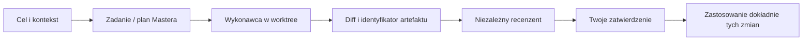
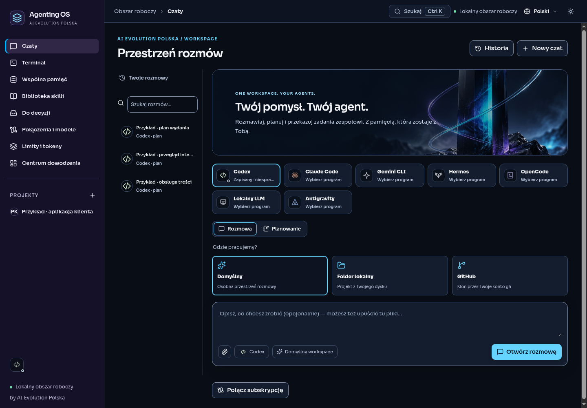
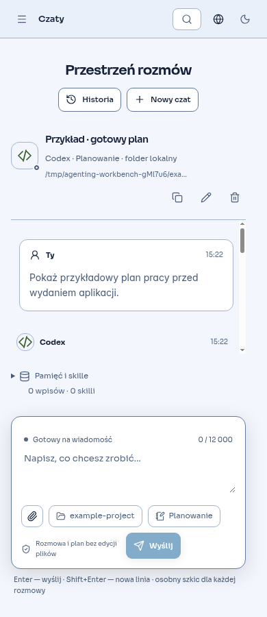
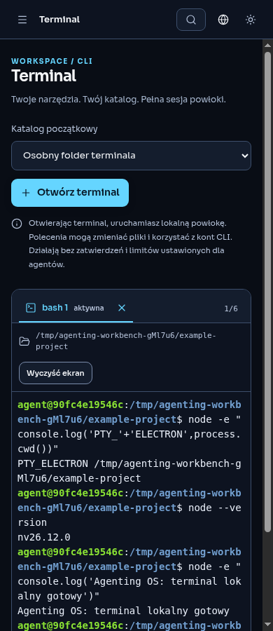

# Agenting OS

**Jedno miejsce do rozmów z agentami, pracy w terminalu i wdrażania sprawdzonych zmian.**

Agenting OS to otwarty pulpit do pracy z agentami AI od **AI Evolution Polska**. Łączy czat, projekty, wspólną pamięć, skille, terminal i kontrolowany proces zmian w Git. Wybierasz wykonawcę i recenzenta, widzisz rezultat i decydujesz o jego zastosowaniu.

[English](README.en.md) · [Uruchomienie](#uruchomienie) · [Jak to działa](#jak-to-działa) · [Dostawcy](docs/PROVIDERS.md) · [Stan wydania](docs/RELEASE_STATUS.md) · [Współpraca](CONTRIBUTING.md)


**Nowości workspace:** Classic · Terra i ciemny Grafit, wybór modelu w rozmowie, automatyczny graf pamięci z Markdown, osiem pełnych skilli z GitHuba oraz Kanban z rzeczywistą aktywnością agentów. [Szczegóły i źródła](docs/PREMIUM_WORKSPACE.md).

**0.5.0-rc.1 — kandydat do publicznego preview.** To aplikacja desktopowa. Zrzuty przedstawiają rzeczywisty interfejs z oznaczonymi danymi przykładowymi. Weryfikacja lokalna i warunki publikacji są opisane w [raporcie wydania](docs/RELEASE_STATUS.md). Instalator Windows jest niepodpisany; nie udostępniamy automatycznych aktualizacji.

## Co jest w środku

| Obszar | Do czego służy |
| --- | --- |
| **Czaty** | Rozmowa lub planowanie, strumieniowanie odpowiedzi, zatrzymywanie, historia i wyszukiwanie, zmiana nazwy, osobne szkice i załączniki dla rozmów. Markdown z tabelami, listami i kopiowaniem kodu oraz całej rozmowy. |
| **Terminal** | Prawdziwa lokalna powłoka w aplikacji: do sześciu kart, wybór katalogu projektu, zmiana rozmiaru, Ctrl+C i ciągłość sesji podczas nawigacji. PowerShell na Windows; Bash lub sh na Linux/macOS. |
| **Projekty i zadania** | Kolejka, zależności, role wykonawcy i recenzenta, kontekst oraz dziennik pracy. Podgląd zespołu przed startem pokazuje zapisane połączenia i brakującego recenzenta. |
| **Master Agent** | Wybrany agent przygotowuje plan do sześciu kroków, deleguje zatwierdzony plan i ocenia rezultat. Misja zatrzymuje się przy zmianach wymagających Twojej decyzji. |
| **Pamięć i skille** | Automatyczny lokalny graf MCP, edytowalne pliki Markdown, zakres projektu/workspace, przypinanie i FTS5. Osiem pełnych pakietów Anthropic/Superpowers instalowanych jednym przyciskiem oraz import SKILL.md. |
| **Połączenia i limity** | Wykrywanie CLI, konfiguracja modeli, jawne testy połączenia, rozróżnienie konfiguracji od rzeczywiście wykonanego zadania. Oficjalne limity Codex i budżet klucza OpenRouter; pozostałe mogą być nieznane. |
| **Narzędzia i dane** | Ręczne wywołania zaufanych serwerów MCP, przeglądarka projektu, kopie zapasowe, odwracalne przygotowanie przywrócenia i diagnostyka z redakcją rozpoznanych sekretów. |

Interfejs jest dostępny po polsku i angielsku, z motywami Grafit, Jasny i Classic · Terra. Animacje uwzględniają systemowe ograniczenie ruchu. `Ctrl+K` / `⌘K` otwiera wyszukiwarkę poleceń; w aktywnym terminalu skróty trafiają do powłoki.

## Uruchomienie

Potrzebujesz **Node.js 26**, npm, Git i środowiska graficznego. Terminal korzysta z natywnego `node-pty`: gdy dla Twojej platformy nie ma gotowego pliku binarnego, potrzebne są Python 3 i kompilator C++ (Linux: `make`, `g++`; Windows: Visual Studio Build Tools z narzędziami C++; macOS: Xcode Command Line Tools).

```sh
git clone https://github.com/aievolutionpl/agentic-os.git
cd agentic-os
npm ci
npm start
```

`npm start` buduje aplikację, zapewnia przypięty runtime Electron i otwiera okno. Do obejrzenia interfejsu i testów automatycznych nie potrzebujesz konta dostawcy ani kluczy API. Do rozmowy z modelem potrzebujesz zainstalowanego i skonfigurowanego CLI lub połączenia API.

Na Windows x64 można zbudować i sprawdzić niepodpisany pakiet:

```sh
npm run package:win
npm run smoke:package
```

Wynik: `release/Agenting-OS-0.5.0-rc.1-windows-x64-setup.exe`. Test pakietu uruchamia wypakowaną aplikację i sprawdza również natywny terminal. Test instalacji, aktualizacji i odinstalowania to osobny warunek wydania. Gotowych instalatorów Linux/macOS obecnie nie dostarczamy.

## Jak to działa

### 1. Zacznij od rozmowy

W **Połączenia i modele** zapisz zaufany program i wykonaj test połączenia. W **Czatach** wybierz agenta, tryb rozmowy lub planowania i kontekst: domyślny workspace, folder lokalny albo repozytorium GitHub. Klonowanie z GitHub korzysta z Twojego logowania `gh`.

Napisz cel, dołącz plik tekstowy i wybierz pamięć lub skille. Odpowiedź można skopiować, zapisać w pamięci albo zamienić w szkic zadania. Szkice wiadomości i ich załączniki pozostają osobne dla każdej rozmowy podczas bieżącej sesji aplikacji; historia wysłanych wiadomości jest zapisywana lokalnie. Szkice nie są zapisywane po zamknięciu aplikacji.

### 2. Przekaż zmianę zespołowi

Do wdrażania zmian wybierz **czyste lokalne repozytorium Git z przynajmniej jednym commitem**. Utwórz zadanie, wskaż wykonawcę i innego, obsługującego przegląd recenzenta. Dodaj kryteria odbioru i kontekst.

Możesz uruchomić jedno zadanie, ręczną kolejkę do dziesięciu zadań albo plan Master Agenta. Podgląd kolejki pokazuje role, modele ustawione w aplikacji lub wybór pozostawiony CLI oraz datę ostatniego testu połączenia. Odczyt podglądu nie wywołuje modelu. Przygotowanie planu przez Master Agenta już korzysta z wybranego dostawcy.



Wykonawca pracuje w osobnym worktree. Aplikacja zapisuje diff i jego SHA-256. Recenzja nie zatwierdza automatycznie zmiany: robisz to sam, a później osobno wybierasz jej zastosowanie. Zgoda wygasa po 15 minutach; zmiana artefaktu, brudny katalog źródłowy lub zmieniona baza blokują zastosowanie.

Kolejka działa sekwencyjnie, bez ukrytych ponowień i podmiany dostawcy. Błąd, zależność lub konieczność decyzji zatrzymują pracę. Po restarcie przerwane zadania pozostają do sprawdzenia i jawnego wznowienia.

### 3. Używaj terminala do ręcznej pracy

Otwórz **Terminal**, wybierz katalog i utwórz kartę. Możesz uruchomić `git status`, testy projektu lub zainstalowane `codex` / `claude`. Sesja działa dalej podczas przechodzenia do czatu. Zamknięcie karty wymaga potwierdzenia i kończy powłokę; sesje kończą się także przy zamknięciu aplikacji.

**Terminal działa z Twoimi uprawnieniami systemowymi.** Ręcznie wpisane polecenia mogą modyfikować projekt, korzystać z sieci i kont CLI. Nie przechodzą przez zatwierdzanie zmian ani budżety agenta. Historia wyświetlana w terminalu jest ograniczona i przechowywana w pamięci; sama powłoka i uruchomione programy mogą zapisywać własną historię. Terminal nie jest piaskownicą systemową.

## Zobacz aplikację

| Rozmowa w jasnym motywie | Lokalny terminal |
| --- | --- |
|  |  |
| **Projekt i zadania** | **Zespół przed startem** |
|  |  |
| **Połączenia i modele** | **Terminal w jasnym motywie** |
|  |  |

<details>
<summary>Pierwszy ekran i małe okna</summary>



 

To responsywność aplikacji desktopowej, nie osobna aplikacja mobilna. Procedura odtworzenia zrzutów: `npm run qa:workbench`.

</details>

## Dostawcy i granice działania

Obsługiwane adaptery obejmują Codex app-server, Claude Code, ACP, Gemini CLI, Hermes, OpenCode/OpenRouter, lokalny model przez OpenCode i eksperymentalne Antigravity. Dostępność ról i modeli zależy od protokołu oraz zainstalowanego programu. Hermes i Antigravity nie mają potwierdzonego trybu recenzenta tylko do odczytu. [Macierz dostawców](docs/PROVIDERS.md) opisuje szczegóły i historyczne próby; bieżącą gotowość pokazuje aplikacja.

Wykryty program, zapisane połączenie, udany handshake i zakończone zadanie to różne fakty. Nieznany limit pozostaje nieznany. Subskrypcja CLI i płatność za API to oddzielne rozliczenia. Testy automatyczne używają lokalnych procesów testowych i nie wykonują płatnych zapytań.

## Dane i bezpieczeństwo

Dane trafiają do katalogu `userData` Electron: baza SQLite, worktree, profile dostawców i sesje przeglądarki. `AGENTING_DATA_DIR` pozwala wskazać oddzielny katalog do testów. Tekst rozmów, pamięć, kontekst i diff nie są szyfrowane. Klucze OpenRouter korzystają z `safeStorage`; aplikacja odrzuca zapis przy nieszyfrującym backendzie. Natywne CLI zarządzają własnym logowaniem.

Nie ma hostowanej telemetrii ani synchronizacji kont. Wybrany dostawca otrzymuje treść zadania i kontekst, a lokalne programy i odwiedzane strony mogą korzystać z sieci. ACP/MCP to zaufane procesy lokalne, nie izolowane wtyczki. Markdown nie wykonuje HTML ani nie pobiera zdalnych obrazów; zwykłe odnośniki HTTP(S) otwierasz ręcznie w przeglądarce. Szczegóły: [SECURITY.md](SECURITY.md).

## Weryfikacja i rozwój

```sh
npm run typecheck
npm test
npm run smoke
npm run qa:tools
npm run qa:workspace
npm run qa:harness
npm run qa:workbench
npm audit --audit-level=moderate
npm run release:audit
```

Na Linux bez pulpitu uruchamiaj testy Electron przez `xvfb-run -a`. Opcja `AGENTING_TEST_NO_SANDBOX=1` jest przeznaczona dla izolowanego runnera testowego wymagającego wyłączenia sandboxa Chromium; nie należy jej ustawiać do codziennej pracy. Zrzuty i wyniki można skierować poza repo przez `AGENTING_QA_OUTPUT`.

Kod interfejsu jest w `src/renderer`, backend Electron i nadzór procesów w `src/main`, kontrakt IPC w `src/shared.ts`. [Audyt 0.5](docs/WORKBENCH_AUDIT.md) opisuje poprawki i dowody. [Porównanie Claudex Loop i CC Switch](docs/research/claudex-cc-switch.md) wyjaśnia wybrane inspiracje i świadomie odłożone funkcje. [Changelog](CHANGELOG.md) zbiera zmiany.

**Apache-2.0** · [Licencja](LICENSE) · [Notice](NOTICE) · [Licencje zależności](licenses/THIRD_PARTY_NOTICES.md) · [Jak współtworzyć](CONTRIBUTING.md)
