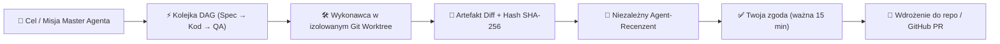

<div align="center">

# ⚡ Agenting OS — Multi-Agent Harness & Engineering Studio

### **Profesjonalne środowisko klasy *Codex / Claude Code Harness* do orkiestracji agentów AI, pracy w terminalu, zarządzania wiedzą MCP i bezpiecznego wdrażania zmian w Git.**

**Zbudowane przez [AI EVOLUTION POLSKA](https://www.aievolutionpolska.pl) · [www.aievolutionpolska.pl](https://www.aievolutionpolska.pl)**

[](https://www.aievolutionpolska.pl)
[](https://www.aievolutionpolska.pl)
[](mailto:kontakt@aievolutionpolska.pl)

[](https://github.com/aievolutionpl/agentic-os/actions/workflows/ci.yml)
[](https://github.com/aievolutionpl/agentic-os/releases/latest)
[](#licencja-i-wykorzystanie-komercyjne)
[](.nvmrc)
[](#architektura-i-stack-technologiczny)
[](#pobranie-i-instalacja)

[**🚀 Pobierz**](#pobranie-i-instalacja) · [**🛠️ Uruchom ze źródeł**](#uruchomienie-ze-źródeł) · [**✨ Możliwości i funkcje**](#kompleksowy-przegląd-funkcji) · [**🧠 33 Wbudowane Skille**](#biblioteka-skilli) · [**🔌 Dostawcy AI**](docs/PROVIDERS.md) · [**💼 Licencja i Biznes**](#licencja-i-wykorzystanie-komercyjne) · [**🇬🇧 English**](README.en.md)

</div>

---

## Połączenia, pluginy i skille

Dashboard pokazuje aktywnych agentów i wspólne źródła rozliczeń bez duplikatów. W **Połączeniach i modelach** można wyłączyć agenta bez wylogowywania konta. Biblioteka zawiera 33 pakiety, w tym 10 skili marketingowych z polskimi opisami. Wyłączenie skilla zachowuje pliki, ale usuwa go z katalogu odczytywanego przez agentów.

Nowy widok **Pluginy** obsługuje Google Drive, Canva, Notion i Firecrawl. Konfigurację, uprawnienia i obecne ograniczenia opisuje [instrukcja pluginów](docs/PLUGINS.md). Test przepływów UI: `npm run qa:plugins`.

## Harness — instrukcja, pamięć i kontekst zespołu

Nowy widok **Harness** łączy edycję instrukcji głównej, ustawienia automatycznego przywoływania pamięci, podgląd źródeł i budżetu kontekstu oraz zapisane połączenia agentów. Eksport `AGENTS.md` wymaga wyboru projektu i zawiera tylko jego prywatne wpisy oraz pamięć jawnie udostępnioną workspace.

[Pomysł produktu, plan rozwoju i gotowy prompt implementacyjny](docs/HARNESS_EVOLUTION_PL.md). Test nowego przepływu: `npm run qa:harness-studio`.


## 🌟 Czym jest Agenting OS?

**Agenting OS** to flagowe, lokalne środowisko inżynierskie (*Local-First Agentic Workbench & Harness Studio*) stworzone przez zespół **[AI Evolution Polska](https://www.aievolutionpolska.pl)**. Łączy w jednym, ultraszybkim oknie desktopowym:

- 🤖 **Wieloagentowy czat i planowanie** (*Codex*, *Claude Code*, *Antigravity*, *OpenCode / OpenRouter*, *Hermes*, *ACP* oraz modele lokalne) z opcją **„Druga opinia”** (*Multi-Agent Second Opinion*).
- 🛡️ **Izolowany proces zmian w Git Worktree** z kryptograficzną weryfikacją diffów (`SHA-256`), niezależnym agentem-recenzentem (*Reviewer*) oraz 1-klikowym tworzeniem **GitHub Pull Requestów**.
- 🧠 **Lokalny Graf Pamięci MCP + Auto-Vault** z wyszukiwaniem pełnotekstowym `FTS5`, eksportem klastrów wiedzy oraz generatorem specyfikacji **`AGENTS.md`**.
- 📚 **33 wbudowane pakiety Skilli + interaktywny kreator `SKILL.md Studio`** zapisujący skille bezpośrednio w `.agents/skills/<slug>/SKILL.md`.
- 💻 **Natywny, wielokartowy terminal PTY (`node-pty` + Xterm.js)** z paskiem szybkich komend CLI i dynamiczną synchronizacją z **7 motywami kolorystycznymi**.


---

## 💼 Licencja i Wykorzystanie Komercyjne

> [!IMPORTANT]
> ### 📜 Zasady pobierania, edycji i wdrożeń komercyjnych (`AI Evolution Polska`)
>
> - ✅ **Pobieranie, nauka i modyfikacja (Open Access & Customizing):** Każdy użytkownik może swobodnie pobierać kod źródłowy, uruchamiać aplikację lokalnie, edytować ją, rozbudowywać o własne skille i dostosowywać na użytek prywatny, edukacyjny, badawczy oraz testowy.
> - 🏢 **Wykorzystanie komercyjne w firmie (Commercial & Enterprise License):** Jeżeli chcesz wykorzystywać **Agenting OS** komercyjnie w swojej firmie, wdrożyć narzędzie dla zespołu deweloperskiego, świadczyć za jego pomocą usługi komercyjne lub zintegrować je z komercyjnym produktem — **wymagany jest kontakt z nami w celu uzyskania licencji komercyjnej**:
>   - 📧 **E-mail:** **[kontakt@aievolutionpolska.pl](mailto:kontakt@aievolutionpolska.pl)**
>   - 🌐 **Strona WWW:** **[www.aievolutionpolska.pl](https://www.aievolutionpolska.pl)**
>
> *Kod bazowy repozytorium udostępniany jest z zachowaniem pliku [LICENSE](LICENSE) oraz [NOTICE](NOTICE) (Copyright © 2026 AI Evolution Polska).*

---

## 🔥 Dlaczego Agenting OS robi różnicę?

| Problem tradycyjnej pracy z AI | Rozwiązanie w **Agenting OS** |
| :--- | :--- |
| ❌ **Chaos 5 otwartych terminali i okien czatu** | ✅ **Jeden spójny Harness Studio:** Czat, Terminal PTY, Kanban, Diff Studio, Graf Pamięci, Przeglądarka i Skille w jednym oknie ze wspólnym kontekstem. |
| ❌ **Agent nadpisuje pliki bezpośrednio w Twoim repozytorium** | ✅ **Bezpieczna izolacja Git Worktree:** Wykonawca pracuje w osobnym worktree, generuje diff z sumą `SHA-256`, a zmianę ocenia **niezależny Recenzent** przed Twoim zatwierdzeniem. |
| ❌ **Utrata kontekstu i ustaleń między sesjami** | ✅ **Memory Vault + Graf MCP + `AGENTS.md`:** Automatyczna ekstrakcja wiedzy z ukończonych rozmów (z redakcją sekretów), powiązania `[[Wiki]]` i 1-klikowy eksport `AGENTS.md`. |
| ❌ **Uzależnienie od jednego modelu / dostawcy** | ✅ **Wieloagentowa elastyczność:** Przełączaj w locie między *Codex*, *Claude Code*, *Antigravity*, *OpenRouter* i *Hermes* oraz proś innego agenta o **Drugą opinię** architektoniczną. |
| ❌ **Chmurowa telemetria i wyciek kodu na obce serwery** | ✅ **100% Local-First:** Baza SQLite, pamięć, sesje i artefakty leżą wyłącznie lokalnie w `userData` Electron. Brak konta w chmurze i brak ukrytej telemetrii. |

---

## ✨ Kompleksowy Przegląd Funkcji

### 1. 💬 Wieloagentowy Czat, `/Slash` Commands i „Druga Opinia”
- **Praca w trybie Rozmowy lub Planowania (`Chat` / `Plan`):** Wybierz dowolnego skonfigurowanego agenta oraz indywidualny model dla każdej rozmowy.
- **Szybkie komendy `/slash` w polu czatu:** Wpisz `/`, aby błyskawicznie wywołać `/plan` (plan architektoniczny), `/review` (audyt bezpieczeństwa i błędów), `/test` (scenariusze testowe), `/debug` (analiza przyczyn źródłowych) lub `/clear`.
- **🔄 Przycisk „Druga opinia” (*Multi-Agent Second Opinion*):** Pod każdą ukończoną odpowiedzią asystenta możesz jednym kliknięciem przekazać odpowiedź do **innego agenta** w trybie Planowania, aby uzyskać niezależną krytykę architektoniczną i wykryć przypadki brzegowe.
- **Handoff jednym kliknięciem:** Każdą odpowiedź możesz od razu zapisać do **Pamięci projektu** albo przekształcić w **Zadanie w kolejce**.

### 2. 🎯 Master Agent & Generator Pipeline’ów DAG (`Spec → Kod → QA`)
- **Autonomiczny Master Agent:** Tworzy wieloetapowy plan działania (do 6 kroków), deleguje zadania do wykonawców i recenzentów, a następnie weryfikuje rezultaty.
- **Gotowe Presety Misji z Auto-Skillami:** Jednym kliknięciem uruchomisz misję *Full-Stack Feature + TDD*, *UI/UX Polish & Taste Redesign*, *Architecture Blueprint & Spec* lub *Security Audit & Bug Hunt* wraz z automatycznie dobranym pakietem skilli.
- **⚡ Generator 3-Etapowego Łańcucha DAG (`Spec → Kod → QA`):** W widoku projektu jednym przyciskiem wygenerujesz 3 powiązane zależnościami zadania:
  1. `Etap 1/3 [Spec]` — Analiza architektury i specyfikacja zmian
  2. `Etap 2/3 [Kod]` — Implementacja funkcjonalności i kontraktów (zależne od Etapu 1)
  3. `Etap 3/3 [QA]` — Testy regresyjne i weryfikacja końcowa (zależne od Etapu 2)



### 3. 🔍 Zaawansowane Diff Studio, Git Repo Health & Integracja GitHub
- **Pasek stanu Git Repo Health w nagłówku projektu:** Podgląd na żywo aktywnej gałęzi (`GIT BRANCH`), stanu drzewa roboczego (`WORKTREE: CLEAN` lub `DIRTY` z liczbą zmienionych plików) oraz ostatniego commita `HEAD`.
- **Interaktywna przeglądarka Diff Studio:**
  - Wyszukiwarka tekstu i plików wewnątrz diffu w czasie rzeczywistym (`Szukaj w diffie...`).
  - Zwijanie i rozwijanie pojedynczych plików lub wszystkich naraz (**„Zwiń / Rozwiń wszystkie”**).
  - Kopiowanie diffu pojedynczego pliku jednym kliknięciem.
- **Eksport gałęzi i GitHub Pull Request:** Z zatwierdzonego przebiegu możesz jednym kliknięciem wyeksportować lokalny branch (`agentic/task-...`) lub utworzyć **Pull Request na GitHubie (`gh pr create`)** z pełnym raportem recenzenta.

<a id="biblioteka-skilli"></a>

### 4. 🧠33 Wbudowane Pakiety Skilli + Kreator `SKILL.md Studio`
Agenting OS posiada wbudowany katalog **33 zweryfikowanych, przypiętych do konkretnego commita (`SHA-1`) pakietów skilli** dostępnych z poziomu **Dashboard Skills Dock** oraz **Biblioteki Skilli**:

| Kategoria | Wbudowane pakiety skilli (instalowane 1 kliknięciem do `.agents/skills/`) |
| :--- | :--- |
| **🏗️ Engineering & Architecture** | `archify` (*Architecture Diagrams & ADR*), `addyosmani-agent-skills` (*Chrome Eng Workflows*), `agentskills-standard` (*Modular Spec*), `mcp-builder` (*Anthropic MCP Builder*) |
| **🎨 Design & Frontend** | `frontend-design` (*Anthropic UI Craft*), `taste-skill` (*High-Taste UI & Anti-Slop Design*) |
| **🧪 Testing, QA & Debugging** | `webapp-testing` (*Playwright Verification*), `systematic-debugging` (*Root-Cause Debugging*), `test-driven-development` (*Strict Red-Green-Refactor*), `verification-before-completion` (*Evidence Gate*) |
| **📈 Marketing: praca i kampanie** | `copywriting`, `content-strategy`, `seo-audit`, `marketing-plan`, `customer-research`, `social`, `emails`, `ads`, `product-marketing`, `sales-enablement` |
| **📈 Marketing & Content** | `marketingskills` (*CRO, Copywriting, SEO & Analytics*), `humanizer` (*Natural Writing & AI Pattern Removal*), `brainstorming` (*Structured Ideation*) |
| **☁️ Google Workspace & Docs** | `gws-calendar` (*Calendar & Meet*), `gws-docs` (*Google Docs Markdown*), `gws-sheets` (*Spreadsheets & Formulas*), `gws-shared` (*Drive Auth & Permissions*), `pdf` (*Anthropic PDF Toolkit*) |
| **🌐 Web Automation & Ecosystem** | `browserbase-skills` (*Stagehand Cloud Browser Automation*), `awesome-claude-skills` (*Composio Workflow Patterns*) |

- **✨ Wbudowany Kreator `SKILL.md Studio`:** Twórz własne skille bezpośrednio w aplikacji (z gotowymi szablonami *Engineering & TDD*, *UI & Design System*, *API & Security Gate*). Kreator automatycznie zapisuje plik `.agents/skills/<slug>/SKILL.md` w katalogu projektu, rejestruje go w bazie SQLite i udostępnia wszystkim agentom.

### 5. 🕸️ Graf Pamięci MCP, Auto-Vault i Eksport `AGENTS.md`
- **Interaktywny Graf Pamięci (`MemoryGraphPanel`):**
  - Wizualizacja węzłów pamięci projektu i workspace’u oraz krawędzi powiązań `[[Wiki]]`.
  - Wyszukiwarka węzłów na żywo, licznik bezpośrednich sąsiadów oraz przycisk **„Kopiuj klaster MD”**, który eksportuje wybrany węzeł wraz ze wszystkimi powiązanymi notatkami jako ustrukturyzowany dokument Markdown.
- **Memory Vault (Auto-Sync):** Automatyczna synchronizacja wniosków z ukończonych rozmów do pamięci projektu z automatyczną redakcją kluczy API i tokenów.
- **📦 Eksport `AGENTS.md`:** Jednym kliknięciem w zakładce Pamięć wygenerujesz i skopiujesz kompletny plik specyfikacji **`AGENTS.md`** zawierający przypięte reguły architektoniczne oraz notatki robocze projektu.

### 6. 💻 Wbudowany Terminal PTY, Przeglądarka Projektu i 7 Motywów Kolorystycznych
- **Natywny Terminal (`node-pty` + Xterm.js):**
  - Do 6 równoległych kart terminala działających w tle podczas przełączania widoków.
  - Pasek szybkich komend 1-Click: `$ git status`, `$ git diff --stat`, `$ npm test`, `$ codex`, `$ claude` oraz przycisk czyszczenia bufora.
- **🌐 Przeglądarka Projektu (`BrowserPanel`):**
  - Wbudowane presety portów deweloperskich (`localhost:3000`, `localhost:5173`, `localhost:8080`, `localhost:4321`, `GitHub`).
  - Przycisk **„Zapisz URL w Pamięci”** — jednym kliknięciem zapisuje oglądany adres i tytuł strony w pamięci projektu dla agentów.
- **🎨 7 Motywów Kolorystycznych (*Harness Studio Themes*):**
  - `Classic · Terra` (jasny, ciepły edytorial)
  - `Graphite` (głęboki ciemny grafit)
  - `Light` (czysty dzienny kontrast)
  - `Claude Code` (ciepły obsydian + bursztynowy akcent `#D97757`)
  - `Codex CLI` (terminalowa czerń + szmaragdowy akcent `#10A37F`)
  - `Tokyo Night` (indygo `#1A1B26` + błękit `#7AA2F7`)
  - `Nord Frost` (arktyczny łupek `#2E3440` + lodowy błękit `#88C0D0`)
- **⌨️ Skróty klawiszowe Harness:** `Ctrl+K` / `⌘K` otwiera paletę poleceń (*Command Palette*), a skróty **`Alt+1` do `Alt+8`** błyskawicznie przełączają główne moduły aplikacji.

### 7. 🔌 Plugin Marketplace, Lifecycle Hooks, Zasady i Budżety
- **6 Wbudowanych Pluginów i Hooków Cyklu Życia:**
  - `auto-test-runner` (*Auto Test Runner Hook*)
  - `security-gate-hook` (*Zero-Trust Security Gate*)
  - `conventional-commit-guard` (*Conventional Commits Guard*)
  - `code-complexity-radar` (*Code Complexity & Architecture Radar*)
  - `docs-sync-hook` (*Documentation & README Sync*)
  - `pr-changelog-composer` (*PR & Release Notes Composer*)
- **🛡️ 1-Klikowe Profile Bezpieczeństwa i Budżetu (`PolicyPanel`):**
  - **Strict Sandbox (\$0 API)** — pełna kontrola człowieka, blokada wydatków API.
  - **Balanced Team (\$25 / Ask)** — zbalansowany profil zespołowy z limitem \$25/mies.
  - **Autonomous Sprint (\$100)** — wysoka autonomia na dłuższe sesje inżynierskie.
- **📊 Eksport telemetrii CSV:** Eksport zużycia tokenów, kosztów i historii uruchomień do pliku CSV jednym kliknięciem.

---

## 🖼️ Galeria Interfejsu

| Czat z formatowaniem i akcjami | Natywny terminal PTY projektu |
| :---: | :---: |
|  |  |
| **Projekt, zadania i kolejka DAG** | **Weryfikacja zespołu przed startem** |
|  |  |
| **Tablica Kanban na żywo** | **Graf Pamięci i Wiedzy MCP** |
|  |  |
| **Połączenia, modele i diagnostyka** | **Terminal w jasnym motywie** |
|  |  |

<details>
<summary>📱 Zobacz ekran startowy oraz układ responsywny dla węższych okien</summary>


<p align="center">
  
  
</p>

</details>

---

## 📥 Pobranie i Instalacja

Gotowy instalator dla systemu **Windows x64** wraz z sumami kontrolnymi `SHA-256` znajduje się w sekcji [**Releases**](https://github.com/aievolutionpl/agentic-os/releases/latest):

1. Pobierz plik `Agenting-OS-<wersja>-windows-x64-setup.exe`.
2. *(Opcjonalnie)* Zweryfikuj sumę kontrolną:
   ```powershell
   certutil -hashfile Agenting-OS-0.5.0-rc.1-windows-x64-setup.exe SHA256
   ```
   i porównaj z plikiem `SHA256SUMS.txt`.
3. Uruchom instalator (ostrzeżenie Windows SmartScreen wynika z braku komercyjnego certyfikatu EV Code Signing w wersji preview).

---

## 🛠️ Uruchomienie ze źródeł

Wymagania: **Node.js 24 lub 26** (plik [`.nvmrc`](.nvmrc) wskazuje `26`), `npm`, `Git` oraz środowisko graficzne. W przypadku kompilacji natywnego modułu `node-pty` wymagany jest Python 3 oraz kompilator C++ (Windows: *Visual Studio C++ Build Tools*, Linux: `make` + `g++`, macOS: *Xcode Command Line Tools*).

```sh
git clone https://github.com/aievolutionpl/agentic-os.git
cd agentic-os
npm ci
npm start
```

Polecenie `npm start` kompiluje proces główny oraz renderer React/Vite i otwiera okno aplikacji Electron. Aby zbudować instalator Windows x64:

```sh
npm run package:win
npm run smoke:package
```

---

## 🏛️ Architektura i Stack Technologiczny

| Warstwa | Technologia | Rola w systemie |
| :--- | :--- | :--- |
| **Powłoka Desktopowa** | **Electron 43 + TypeScript 5.9** | Izolowany proces główny (`contextIsolation: true`, `sandbox: true`), nadzór procesów potomnych i worktree Git. |
| **Interfejs Użytkownika** | **React 19 + Vite 7** | Wielopanelowy *Harness Studio*, 7 motywów kolorystycznych, skróty `Ctrl+K` i `Alt+1..8`. |
| **Baza Danych i Pamięć** | **SQLite + FTS5 + MCP Memory** | Lokalna trwałość czatów, zadań, przebiegów, skilli, polityk bezpieczeństwa i grafu wiedzy. |
| **Terminal i Procesy** | **`node-pty` 1.1 + `@xterm/xterm`** | Prawdziwe lokalne sesje PowerShell / Bash z obsługą sygnałów i zachowaniem stanu między kartami. |
| **Testy i Jakość (QA)** | **`node:test` + JSDOM + Playwright** | Ponad 190 testów jednostkowych, integracyjnych i UI sprawdzających protokoły, bazę SQLite i komponenty. |

```text
src/renderer/   Interfejs React 19 (Chat, Terminal, DiffViewer, MemoryGraph, KnowledgeHub, ControlCenter)
src/main/       Proces główny Electron, adaptery dostawców, supervisor Git worktree, SQLite store
src/shared.ts   Silnie typowany kontrakt IPC (allowlista kanałów i walidacja wejścia)
resources/      20 przypiętych pakietów skilli (resources/skills/catalog.json)
tests/          Testy jednostkowe, protokołowe i UI (node:test + jsdom + Playwright)
docs/           Dokumentacja architektury, macierz dostawców (PROVIDERS.md) i raporty wydania
```

### Weryfikacja deweloperska i testy

```sh
npm run typecheck       # Sprawdzenie typów TypeScript (main + renderer)
npm test                # Pełny zestaw testów automatycznych
npm run smoke           # Szybki test dymny uruchomienia Electron
npm run release:audit   # Audyt bezpieczeństwa, linków dokumentacji, licencji i katalogu skilli
```

---

## 🔒 Bezpieczeństwo i Prywatność (*Zero-Telemetry Local-First*)

- **Pełna lokalność danych:** Wszystkie rozmowy, pamięć MCP, historia przebiegów i worktree znajdują się w lokalnym katalogu `userData` aplikacji Electron.
- **Szyfrowanie kluczy API:** Klucze OpenRouter są chronione natywnym mechanizmem systemowym `safeStorage` (DPAPI / Keychain / Secret Service).
- **Redakcja sekretów:** Automatyczny Memory Vault oraz diagnostyka automatycznie maskują rozpoznane klucze (`sk-...`, `ghp_...`, `github_pat_...`, klucze prywatne PEM).
- **Twarda izolacja Chromium:** Renderer działa z `contextIsolation: true`, `nodeIntegration: false`, `sandbox: true` oraz rygorystycznym `Content-Security-Policy`. Szczegóły w pliku [SECURITY.md](SECURITY.md).

---

## 🤝 Kontakt, Wsparcie i Wdrożenia Komercyjne

Narzędzie zostało zaprojektowane i zbudowane przez **[AI EVOLUTION POLSKA](https://www.aievolutionpolska.pl)**.

- 🌐 **Strona internetowa:** **[www.aievolutionpolska.pl](https://www.aievolutionpolska.pl)**
- 📧 **Licencje komercyjne, wdrożenia firmowe i współpraca B2B:** **[kontakt@aievolutionpolska.pl](mailto:kontakt@aievolutionpolska.pl)**
- 🐛 **Zgłaszanie błędów i propozycji funkcji:** [GitHub Issues](https://github.com/aievolutionpl/agentic-os/issues)
- 📖 **Dokumentacja dodatkowa:** [Dostawcy AI](docs/PROVIDERS.md) · [Stan wydania](docs/RELEASE_STATUS.md) · [Współpraca](CONTRIBUTING.md) · [Bezpieczeństwo](SECURITY.md) · [Changelog](CHANGELOG.md)

---

<div align="center">

**Stworzone z pasją do inżynierii AI przez [AI EVOLUTION POLSKA](https://www.aievolutionpolska.pl)**  
📧 [kontakt@aievolutionpolska.pl](mailto:kontakt@aievolutionpolska.pl) · 🌐 [www.aievolutionpolska.pl](https://www.aievolutionpolska.pl)

[Licencja](LICENSE) · [Notice](NOTICE) · [Licencje zależności](licenses/THIRD_PARTY_NOTICES.md) · [Kodeks postępowania](CODE_OF_CONDUCT.md)

</div>


### Uproszczony workspace

Rozmowy i projekty mają wspólne drzewo nawigacji. Nową rozmowę uruchomisz przyciskiem u góry albo bezpośrednio pod projektem. Skille, Limity i ScheduleJob są dostępne bezpośrednio w menu. Narzędzia dodatkowe znajdują się w „Więcej”, a język, motyw i połączenia w Ustawieniach. Stały pasek u góry pokazuje pozostałe limity podłączonych subskrypcji; stare odczyty są oznaczone. Nowe profile zaczynają od jasnej palety perłowo-granatowej. Mapa pamięci pokazuje rzeczywistych agentów z historii rozmów i notatki, które utworzyli.

Szczegóły odczytu limitów, w tym ograniczenia nieudokumentowanego endpointu konta Claude i ochrona danych logowania: [Calm workspace](docs/CALM_WORKSPACE.md). Weryfikacja nowej nawigacji: `npm run qa:calm`.

ScheduleJob uruchamia codzienne analizy i raporty o wybranej godzinie lokalnej, gdy aplikacja jest włączona. Utworzenie harmonogramu wymaga zgody na cykliczne wysyłanie kontekstu i zużycie limitu. Przebiegi korzystają z istniejących zabezpieczeń rozmowy i trybu tylko do odczytu. Możesz je pauzować, uruchomić od razu i otworzyć wynik z historii. Harmonogram nie wybudza komputera; po przerwie wykonuje jeden zaległy przebieg. Zmiana nazwy projektu jest dostępna pod prawym przyciskiem myszy lub ikoną ołówka i nie przenosi folderu.


Kolorystykę zmienisz w górnym pasku: **Pearl**, **Claude Light**, **Midnight**, **Graphite**, **AI Evolution**. Każdy motyw obejmuje także boczne menu i terminal. Dwuklik nazwy projektu w menu włącza edycję w miejscu (Enter zapisuje, Escape anuluje). Pierścienie przy subskrypcjach pokazują pozostały procent rzeczywistego limitu; saldo pieniężne nie jest przeliczane na procenty.
