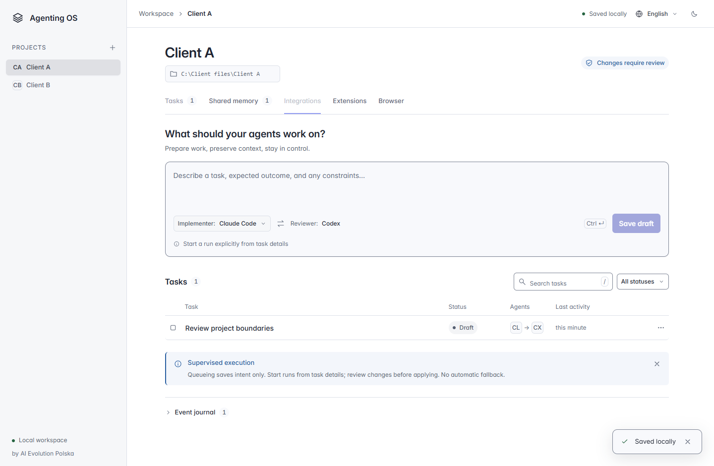
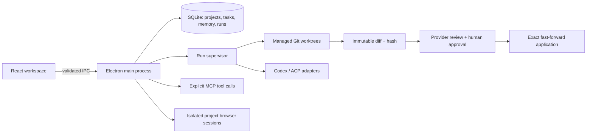

# Agenting OS

**One desktop workspace for tasks, agents, context and reviewed changes.**

Agenting OS is an open-source, local-first workbench by **AI Evolution Polska**. Give an agent a task, keep its changes in a separate Git worktree, inspect the result, request a second provider's review, then decide what reaches your project.

[Getting started](#getting-started) · [Agent workflow](#agent-workflow) · [Provider support](#provider-support) · [Architecture](#architecture) · [Contributing](CONTRIBUTING.md) · [Polish handoff](HANDOFF_PL.md)



*Early release 0.4.0. The evidence folders contain real application captures. Model execution requires your own configured provider. Windows builds are unsigned.*

## What you can do

- **Organize work:** persistent projects, task dependencies, execution history, retries, cancellation and restart recovery.
- **Run with a boundary:** explicit starts, managed Git worktrees, provider deadlines and a saved artifact instead of silent edits to the source checkout.
- **Review before applying:** captured diff + SHA-256, a separate configured reviewer, expiring human approval and a second action to apply the exact approved commit.
- **Choose context:** project-scoped full-text memory, source/date attribution, workflow templates and versioned skills. Preview the frozen context before sending it.
- **Use your tools:** explicitly trusted MCP stdio servers, paginated tool discovery and a confirmation for every manual call.
- **Browse per project:** separate persistent cookie sessions, no app bridge in remote pages, blocked downloads/popups/device permissions.
- **Work comfortably:** Polish/English, dark/light themes, keyboard navigation, compact task rows and layouts for smaller windows.

There is no hosted account, telemetry service or cloud database. Local persistence does not prevent a provider, tool server or visited website from using its own network connection.

## Getting started

Install **Node 26**, npm and Git. A graphical desktop is required to open the app.

```sh
git clone https://github.com/aievolutionpl/agenting-os.git
cd agenting-os
npm ci
npm start
```

`npm start` builds the TypeScript/React application and opens Electron. Electron's upstream install script downloads the runtime for your platform. No API key or model request is needed to explore the workspace.

For a Windows x64 installer:

```sh
npm run package:win
npm run smoke:package
```

The output is `release/Agenting-OS-0.4.0-windows-x64-setup.exe`. The Windows CI job also uploads an unsigned installer as an Actions artifact after verification. This release does not include signing, an auto-updater or macOS/Linux installers. The unpacked executable is smoke-tested; installing/uninstalling into a real user's profile is a separate release check.

## Agent workflow

1. Create a project and choose an existing **clean Git repository** with a commit. Task and memory data are scoped to this project.
2. In **Integrations**, select a trusted executable. Codex uses `app-server`; the Claude slot accepts a compatible ACP server. Save the connection with explicit consent. Codex sign-in is initiated by its own button and uses an app-owned profile.
3. Save a task. In its details choose a workflow, memory entries and optional skills. Inspect the context preview and start the run. Queueing by itself does not start a process.
4. Follow the activity and result. Stop a process explicitly; an interrupted run keeps its worktree. Resume is explicit and requires an unchanged source base.
5. Inspect the captured diff and request review from the other configured provider. A completed review is evidence for your decision, not an automatic approval.
6. Approve the artifact, then use **Apply approved changes**. Approval expires after 15 minutes. The application checks the exact artifact, latest attempt, clean source and unchanged base, then fast-forwards the source checkout. Stale or conflicting changes are rejected.

Use `/` to focus task search and `Ctrl+Enter` / `⌘Enter` to save a draft. Unsaved task text survives project/tab switches within the current app session; **Save draft** persists it across restarts.

## Provider support

| Connection | Implemented | Validation / limitations |
| --- | --- | --- |
| Codex app-server | Initialize, thread start/resume, streamed messages, steering, cancellation, explicit browser sign-in | Local installed CLI handshake and protocol fixtures tested. Authenticated model inference is not part of automated QA. Provider sandbox enforcement remains the provider's responsibility. |
| Claude / ACP v1 | Initialize, session creation/loading, prompt, cancellation, read-only review mode | Tested with a local stdio fixture. Supply a trusted compatible ACP executable; arbitrary `claude` CLI output is not an ACP protocol. The provider name is declared by configuration. |
| MCP stdio | Protocol `2025-11-25`, tool pagination, explicit manual calls, bounded text results | Fixture-tested. No HTTP transport, model-driven calls, sampling, elicitation or background execution. Servers validate their argument schemas. |

Read-only installation probes are separate from these execution connections. Authentication and subscription quota are not inferred from installed command names; quota remains **unknown** when no authoritative source is available.

## Context and extensions

Memory stays inside its project and uses SQLite FTS5 retrieval. Only selected entries are included in a run. The context snapshot retains their source and date and is limited to 24,000 characters. Oversized or cross-project selections are rejected.

Four workflows are included: implementation, bug fix, research and UI audit. Research/audit request read-only execution. Two original text skills cover evidence-based review and accessible UI; both are opt-in.

Import versioned JSON manifests from **Extensions**. Skills contain instructions, not executable scripts:

```json
{
  "kind": "skill",
  "name": "Project conventions",
  "version": "1.0.0",
  "author": "Your team",
  "license": "Apache-2.0",
  "source": "local/project-conventions",
  "instructions": "Reuse the existing architecture and report checks actually run."
}
```

An MCP manifest uses the same metadata with `"kind": "mcp"`, an absolute `command` path and an `args` array instead of `instructions`. Importing does not launch it. Review the executable, arguments, source and license first. Secrets do not belong in a manifest. There is no automatic extension download, executable marketplace or signature verification.

## Architecture



The supervisor owns process lifetime, deadlines, leases and recovery. JSON-RPC transport and provider adapters are separate modules. Deterministic Git/state checks remain ordinary code. SQLite migrations preserve existing data; a restart records interrupted work without replaying actions.

| Area | Source |
| --- | --- |
| Lifecycle, persistence, memory | `src/main/store.ts`, `lifecycle.ts`, `runs.ts`, `knowledge.ts` |
| Worktrees, artifacts, approval/application | `git.ts`, `artifacts.ts`, `approvals.ts`, `applications.ts` |
| Provider and tool protocols | `rpc.ts`, `providers.ts`, `acp.ts`, `extensions.ts` |
| Remote browser / trusted IPC | `browser.ts`, `browser-policy.ts`, `index.ts`, `preload.cts` |
| Workspace UI | `src/renderer/` |

## Privacy and trust

Data lives in Electron's per-user `userData` directory: `agenting.sqlite`, managed worktrees, provider profiles and browser partitions. `AGENTING_DATA_DIR` overrides that directory for isolated development/QA; it is not a renderer setting. No credentials are required in an application `.env` file.

Metadata, context and diffs are unencrypted. Codex manages its sign-in material in the app-owned provider directory. Back up the whole data directory while the app is closed if you need recovery. Do not commit it or enter credentials into task/memory text.

The app renderer has a sandboxed, narrow IPC bridge. Remote browser contents have no preload or app bridge. Host permission requests and provider escalation requests are denied. **ACP and MCP executables are trusted local programs, not OS-sandboxed plugins.** Their read-only/capability declarations do not isolate their process. Use an OS/container boundary for untrusted programs. Redaction and protected-file checks recognize common secrets and sensitive paths; they are not a complete secret detector. See [SECURITY.md](SECURITY.md).

## Verification

```sh
npm run typecheck
npm test
npm run smoke
npm run qa:tools
npm run qa:contrast
npm audit --audit-level=moderate
```

The 43 automated tests cover real Git/SQLite behavior, project isolation, migrations, scoped context, process cancellation, restart recovery, artifact approval/application and local protocol fixtures. Electron checks cover the UI and browser sessions. On Linux, use Xvfb for graphical checks; CI explicitly disables Chromium's OS sandbox in that environment, so those checks do not certify sandbox enforcement.

Current evidence and practical limits: [0.2 execution](docs/evidence/stage-02/README.md), [0.3 collaboration](docs/evidence/stage-03/README.md), [0.4 distribution](docs/evidence/release-04/README.md). Historical UI evidence is retained and labeled by stage. Tests make no paid model calls and do not certify third-party providers or servers.

## Open-source foundations and direction

The implementation follows the public contracts of [Codex](https://github.com/openai/codex), [Agent Client Protocol](https://github.com/agentclientprotocol/agent-client-protocol) and [Model Context Protocol](https://github.com/modelcontextprotocol/modelcontextprotocol), using [Electron](https://github.com/electron/electron), React and Git worktrees. Protocol adapters and supervision are implemented here; no reference application's UI or orchestration code was copied. Dependency/font notices are retained in [licenses](licenses/THIRD_PARTY_NOTICES.md).

The requested stages 0.2–0.4 add supervised execution, scoped collaboration and extensions/distribution. The highest-value next work is authenticated end-to-end provider compatibility testing, signed installers with install/upgrade/uninstall checks, and OS-level isolation for third-party ACP/MCP processes. See [implementation scope](docs/ROADMAP_IMPLEMENTATION.md) and [current status](docs/STATUS.md). The [original plan](docs/original-plan/Agenting_OS_Master_Plan_v2.1.md) is design history, not a claim of completed functionality.

## Contribute

Open a focused issue or PR with a reproducible workflow and actual verification. Start with [CONTRIBUTING.md](CONTRIBUTING.md); report sensitive issues using [SECURITY.md](SECURITY.md).

**Apache-2.0** · [License](LICENSE) · [Notice](NOTICE) · Built by AI Evolution Polska
