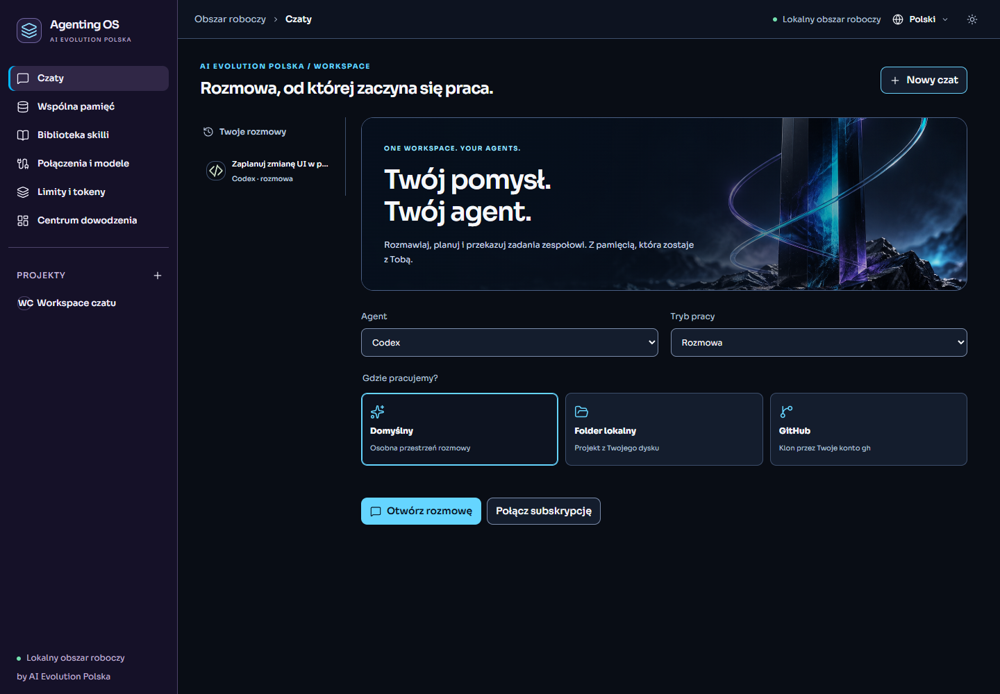
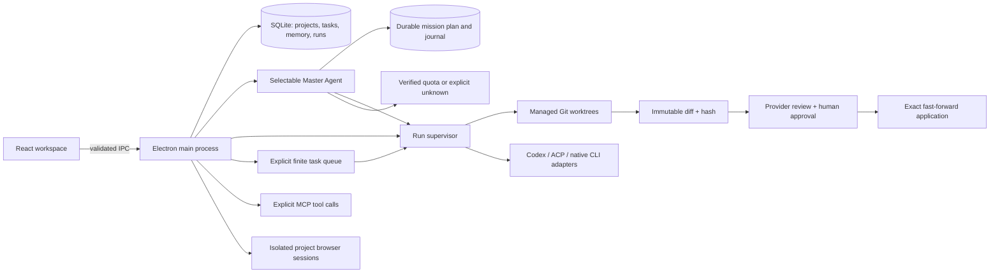

# Agenting OS

**One desktop workspace for conversations, agents, shared memory and reviewed changes.**

Agenting OS is an open-source, local-first workbench by **AI Evolution Polska**. Choose a Master Agent and give your team a goal. Master inspects the project, proposes a plan, delegates approved steps and evaluates the outcome. Changes stay in separate Git worktrees until you review and apply them.

[Getting started](#getting-started) · [Agent workflow](#agent-workflow) · [Provider support](#provider-support) · [Architecture](#architecture) · [Contributing](CONTRIBUTING.md) · [Polish handoff](HANDOFF_PL.md)



*Early release 0.4.0. The evidence folders contain real application captures. Model execution requires your own configured provider. Windows builds are unsigned.*

## What you can do

- **Start with a conversation:** choose an agent, Conversation/Planning, and a default workspace, local folder or GitHub repository. Stream and stop replies, retain history, save an answer to memory or turn a plan into a draft task with an independent reviewer. Codex/Claude read-only chats support ordinary local folders without Git; GitHub cloning uses your existing `gh` login.
- **Keep a team library:** open Shared Memory and Skills directly from the sidebar. Edit and pin common knowledge; inspect nine bundled skills and import selected local SKILL.md instructions. Pinned workspace entries automatically reach every agent's next context; private project entries stay in that project.
- **See your whole fleet:** the Control Center detects installed agent CLIs, local model servers and GitHub sign-in, and states honestly what is ready, what needs a login and what is unknown. Provider limits stay *unknown* until a verified official source exists.
- **Give Master a goal:** select a lead and roster, freeze memory/skills, generate a bounded plan of up to six steps, inspect assignments and acceptance criteria, then launch. Sequential delegation follows dependencies, checks provider quota and includes previous outcomes. Master evaluates the final repository and reports completion or remaining work. Missions persist across restarts without automatic replay.
- **Keep manual control:** the existing queue can still launch up to ten manually prepared tasks. Both paths pause for human approval of file changes; neither silently retries, merges or publishes.
- **Run with a boundary:** explicit starts, managed Git worktrees, provider deadlines and a saved artifact instead of silent edits to the source checkout.
- **Review before applying:** captured diff + SHA-256, a separate configured reviewer, expiring human approval and a second action to apply the exact approved commit.
- **Share knowledge:** one SQLite FTS5 memory with project-private or explicitly workspace-wide entries, source/date attribution, workflow templates and versioned skills. Selected and explicitly pinned entries go to an agent.
- **Connect your providers:** Codex, Claude Code, Gemini CLI, Hermes, OpenCode/OpenRouter, a local model through OpenCode, and experimental Antigravity. An installed CLI, saved connection and verified live execution remain separate facts.
- **Understand usage:** official Codex rate-limit windows, OpenRouter per-key USD budgets, and clearly labeled manual token budgets. OpenQuota refreshes every minute after connecting a provider, after sign-in and on request. Unknown limits have no invented gauges or trends.
- **Use your tools:** explicitly trusted MCP stdio servers, paginated tool discovery and a confirmation for every manual call.
- **Browse per project:** separate persistent cookie sessions, no app bridge in remote pages, blocked downloads/popups/device permissions.
- **Work comfortably:** Polish/English, dark/light themes, Sora typography, Lucide icons, original generated illustrations, distinct violet navigation, keyboard access and layouts for smaller windows.

There is no hosted account, telemetry service or cloud database. Local persistence does not prevent a provider, tool server or visited website from using its own network connection.

## Getting started

Install **Node 26**, npm and Git. A graphical desktop is required to open the app.

```sh
git clone https://github.com/aievolutionpl/agentic-os.git
cd agentic-os
npm ci
npm start
```

`npm start` builds the TypeScript/React application, ensures the pinned Electron runtime and opens the app. The `runtime:install` step invokes Electron's upstream installer with its bundled checksums; it also handles environments that skipped dependency install scripts. No API key or model request is needed to explore the workspace.

For a Windows x64 installer:

```sh
npm run package:win
npm run smoke:package
```

The output is `release/Agenting-OS-0.4.0-windows-x64-setup.exe`. The Windows CI job also uploads an unsigned installer as an Actions artifact after verification. This release does not include signing, an auto-updater or macOS/Linux installers. The unpacked executable is smoke-tested; installing/uninstalling into a real user's profile is a separate release check.

## Agent workflow

1. Create a project and choose an existing **clean local Git repository** with a commit. No GitHub repository, remote or cloud workspace is required.
2. In **Connections & models**, detect or select a trusted executable and save the connection. Codex can use its existing CLI login or a separate app profile. Claude uses `claude auth login`; Antigravity uses its own CLI login. For OpenRouter, install OpenCode, connect its native executable with ACP, then save an API key and model in the OpenRouter panel. API billing is separate from subscriptions.
3. Save a task. In its details choose a workflow, memory entries and optional skills. Inspect the context preview and start the run. Alternatively, explicitly start the project queue and select up to ten queued tasks. Queueing a task alone does not start a process. The dispatcher processes eligible tasks sequentially and pauses at a failure, blocked dependency or human approval.
4. Follow the activity and result. Stop a process explicitly; an interrupted run keeps its worktree. Resume is explicit and requires an unchanged source base.
5. Inspect the captured diff and request review from the other configured provider. A completed review is evidence for your decision, not an automatic approval.
6. Approve the artifact, then use **Apply approved changes**. Approval expires after 15 minutes. The application checks the exact artifact, latest attempt, clean source and unchanged base, then fast-forwards the source checkout. Stale or conflicting changes are rejected.

Use `/` to focus task search and `Ctrl+Enter` / `⌘Enter` to save a draft. Unsaved task text survives project/tab switches within the current app session; **Save draft** persists it across restarts.

### Master Agent workflow

Open a local project and its **Master Agent** tab. Choose the lead, at least two configured team members for distinct implementation/review roles, selected memory and skills. **Prepare plan** consumes a model request but does not create or execute tasks. The model returns a strict plan; invalid providers, cycles, duplicate keys, unsupported roles and excessive plans are rejected.

Review the plan and choose **Launch plan**. Each step uses the existing supervisor and isolated worktree. File changes receive independent review and pause the mission. Open the task result, approve and apply the exact artifact, then **Continue mission**. Research steps are read-only and need no Git application. After all steps complete, Master inspects the repository and evaluates the goal. **Save result** explicitly writes its attributed assessment to project or workspace memory; this is a model assessment, not an independently verified fact.

The journal records delegation, quota provenance and stopping reasons. Verified exhausted quota blocks the next call; an unavailable quota is explicitly recorded as unknown and does not imply unlimited access. On restart, active missions become interrupted and require a user action. No automatic retries, provider fallback, unbounded self-improvement loop or parallel worktree merging is implemented. A failed task can be inspected/resumed in its existing result panel; continue the mission afterwards. A terminal failed plan can be replaced with a new goal.

## Provider support

| Connection | Implemented | Validation / limitations |
| --- | --- | --- |
| Codex app-server | Threads, streaming, steering, cancellation, browser sign-in, existing/isolated profiles, official rate-limit windows | Real subscription read-only file task, local CLI/account probe and protocol fixtures pass. Exact token allowances are not inferred from percentages. |
| Claude Code native CLI | Streaming JSON, CLI-owned login, resume, file reading/editing and read-only reviews | Real subscription read-only file task, auth status and protocol fixtures pass. Requires a CLI supporting `--safe-mode`; shell tools and ambient MCP are disabled. Automatic quota reading is unavailable. |
| Claude / ACP v1 | Compatible ACP bridge, sessions, cancellation, read-only review mode | Legacy configurable bridge retained; fixture-tested. An ordinary `claude` executable is not an ACP server. |
| Gemini CLI / ACP | Native `--acp`, Google OAuth, npm-declared Windows entrypoint and trusted system certificates | CLI 0.64.0 verified. Google no longer serves personal AI Pro/Ultra through Gemini CLI: the app reports migration to Antigravity. Supported organizational Code Assist accounts remain a distinct path; enterprise inference was not tested. Read-only roles require advertised `plan` mode. |
| Hermes / ACP | Native Windows managed-Python bootstrap, `hermes acp`, official ChatGPT/Codex sign-in and session-specific model selection | Real two-turn subscription chat passes with `openai-codex:gpt-6.1-sol`. Explicit app model selection required; global Hermes model is preserved. Worker/chat role only; no read-only guarantee is claimed. |
| OpenCode / OpenRouter | Existing ACP agent loop, model selection, encrypted API key, public model catalog, per-key budget | ACP/vault fixtures and public catalog probe. OpenCode and an API key are required for real inference; no authenticated OpenRouter inference was performed. |
| Local LLM / OpenCode | Separate ACP profile with an explicit OpenAI-compatible loopback endpoint and model; Ollama / LM Studio presets can be entered | Configure `http://127.0.0.1:11434/v1` or `http://127.0.0.1:1234/v1`, model ID and the OpenCode executable. No OpenRouter key is injected. Not live-verified with a local model; server/model compatibility and sufficient context are required. A loopback server can itself route to cloud models; locality depends on its configuration. |
| Antigravity CLI | Official `agy` streaming input/output, OS-keyring Google login, selectable models and cancellation | Native CLI 1.4.2: real two-turn Google model chat passes with `gemini-4-argon-medium`. This is the consumer subscription path replacing Gemini CLI. Read-only/reviewer and resume roles remain rejected. Automatic quotas are unavailable. |
| MCP stdio | Protocol `2025-11-25`, tool pagination, explicit manual calls, bounded text results | Fixture-tested. No HTTP transport, model-driven calls, sampling, elicitation or background execution. Servers validate their argument schemas. |

Read-only installation probes are separate from these execution connections. Authentication and subscription quota are not inferred from installed command names; quota remains **unknown** when no authoritative source is available.

Master and review roles support Codex, Claude, Gemini, OpenCode and the local OpenCode profile when their read-only mode works. Hermes and Antigravity remain implementation-only. ACP permission prompts may authorize one located file edit inside the worktree; outside paths, Git metadata, hardlinks and terminal requests are denied. ACP executables are trusted local programs, not an OS sandbox supplied by Agenting OS.

Codex reads effective configuration through its official app-server, disables ambient MCP/apps/plugins/hooks and internal multi-agent spawning for the supervised thread, and checks runtime MCP status before inference. These overrides do not edit the user's global CLI configuration or copy credentials. Older servers without these contracts fail closed. The same bounded policy applies to existing-profile worker runs and reviews.

## Context and extensions

Memory defaults to its project. An explicitly shared entry is searchable and selectable across the workspace; project-private entries cannot be selected from another project. Selected entries and explicitly pinned entries are included in subsequent contexts. Pinning a workspace entry makes it automatic across projects; pinning a private entry affects its project only. The frozen context retains source, date and scope, is reused for review, and is limited to 20 memory entries and 24,000 characters including skills. This is a single local workspace database, not cloud synchronization between computers.

Four workflows are included: implementation, bug fix, research and UI audit. Research/audit request read-only execution. Six original text skills cover frontend design, source-grounded research, workspace memory curation, evidence-based review, accessible UI and AI Evolution Polska team handoff. Three pinned MIT skills from obra/superpowers add systematic debugging, verification before completion and test-driven development. The searchable sidebar library exposes all nine skills with source/license previews and a local SKILL.md import. Imports contain instructions only; supporting files are not fetched or executed. Individual runs choose skills explicitly; the queue includes the team handoff skill automatically. Each task can select a distinct implementer and supported reviewer.

Conversation keeps at most 12 completed messages in the next prompt and has bounded history/context limits. A stopped or interrupted response is never replayed automatically. Conversation/Planning inspects context and produces answers; use **Create task** to enter the existing implementation/review workflow. Hermes and Antigravity lack verified read-only planning, so their local/GitHub conversations require a separate Git worktree. Read the [harness audit](docs/HARNESS_AUDIT.md) for live-provider evidence and limits, and [visual provenance](docs/research/harness-assets-2026-10-19.md) for bundled art, font and icons.

Import versioned JSON manifests from **Extensions**. Skills contain instructions, not executable scripts:

```json
{
  "kind": "skill",
  "name": "Project conventions",
  "version": "1.0.0",
  "author": "Your team",
  "license": "Apache-2.0",
  "source": "local/project-conventions",
  "instructions": "Reuse the existing architecture and report checks actually run."
}
```

An MCP manifest uses the same metadata with `"kind": "mcp"`, an absolute `command` path and an `args` array instead of `instructions`. Importing does not launch it. Review the executable, arguments, source and license first. Secrets do not belong in a manifest. There is no automatic extension download, executable marketplace or signature verification.

## Architecture



The supervisor owns process lifetime, deadlines, leases and recovery. JSON-RPC transport and provider adapters are separate modules. Deterministic Git/state checks remain ordinary code. SQLite migrations preserve existing data; a restart records interrupted work without replaying actions.

| Area | Source |
| --- | --- |
| Lifecycle, persistence, memory | `src/main/store.ts`, `lifecycle.ts`, `runs.ts`, `knowledge.ts` |
| Worktrees, artifacts, approval/application | `git.ts`, `artifacts.ts`, `approvals.ts`, `applications.ts` |
| Provider and tool protocols | `rpc.ts`, `providers.ts`, `acp.ts`, `extensions.ts` |
| Queue, native agents, model connection and limits | `orchestrator.ts`, `cli-provider.ts`, `openrouter.ts`, `quota.ts` |
| Remote browser / trusted IPC | `browser.ts`, `browser-policy.ts`, `index.ts`, `preload.cts` |
| Workspace UI | `src/renderer/` |

## Privacy and trust

Data lives in Electron's per-user `userData` directory: `agenting.sqlite`, managed worktrees, provider profiles and browser partitions. `AGENTING_DATA_DIR` overrides that directory for isolated development/QA; it is not a renderer setting. No credentials are required in an application `.env` file.

Metadata, context and diffs are unencrypted. Native CLIs manage their own subscription login. OpenRouter keys use Electron `safeStorage` (Windows DPAPI); plaintext/basic-text fallback is refused. The renderer receives only the connection state/model, never a saved key. The trusted OpenCode child receives the key in its environment. Back up the whole data directory while the app is closed if you need recovery; encrypted keys are not portable between OS accounts. Do not enter credentials into task/memory text.

The app renderer has a sandboxed, narrow IPC bridge. Remote browser contents have no preload or app bridge. Host permission requests and provider escalation requests are denied. **ACP and MCP executables are trusted local programs, not OS-sandboxed plugins.** Their read-only/capability declarations do not isolate their process. Use an OS/container boundary for untrusted programs. Redaction and protected-file checks recognize common secrets and sensitive paths; they are not a complete secret detector. See [SECURITY.md](SECURITY.md).

## Verification

```sh
npm run typecheck
npm test
npm run smoke
npm run qa:tools
npm run qa:workspace
npm run qa:contrast
npm audit --audit-level=moderate
```

The automated tests cover real Git/SQLite behavior, explicit shared memory, migrations, process cancellation, restart recovery, artifact approval/application, bounded orchestration and provider protocol fixtures. Electron checks cover UI, browser isolation, responsive layouts, text contrast and OS-backed credential persistence. On Linux, use Xvfb for graphical checks; CI explicitly disables Chromium's OS sandbox in that environment, so those checks do not certify sandbox enforcement.

Current evidence and practical limits: [workspace audit](docs/WORKSPACE_AUDIT.md) and [research](docs/research/agent-workspace-2026-10-19.md). Historical evidence: [0.2 execution](docs/evidence/stage-02/README.md), [0.3 collaboration](docs/evidence/stage-03/README.md), [0.4 distribution](docs/evidence/release-04/README.md). Automated tests make no model calls. A separate opt-in `scripts/live-agent-smoke.mjs` consumes a small amount of existing CLI subscription allowance to verify real read-only file access; its [latest result](docs/evidence/workspace-06/live-inference.json) covers Codex and Claude. This does not certify all model/tool operations or third-party servers.

## Open-source foundations and direction

The implementation follows the public contracts of [Codex](https://github.com/openai/codex), [Agent Client Protocol](https://github.com/agentclientprotocol/agent-client-protocol) and [Model Context Protocol](https://github.com/modelcontextprotocol/modelcontextprotocol), using [Electron](https://github.com/electron/electron), React and Git worktrees. Protocol adapters and supervision are implemented here; no reference application's UI or orchestration code was copied. Dependency/font notices are retained in [licenses](licenses/THIRD_PARTY_NOTICES.md).

The requested stages 0.2–0.4 add supervised execution, scoped collaboration and extensions/distribution. The highest-value next work is authenticated end-to-end provider compatibility testing, signed installers with install/upgrade/uninstall checks, and OS-level isolation for third-party ACP/MCP processes. See [implementation scope](docs/ROADMAP_IMPLEMENTATION.md) and [current status](docs/STATUS.md). The [original plan](docs/original-plan/Agenting_OS_Master_Plan_v2.1.md) is design history, not a claim of completed functionality.

## Contribute

Open a focused issue or PR with a reproducible workflow and actual verification. Start with [CONTRIBUTING.md](CONTRIBUTING.md); report sensitive issues using [SECURITY.md](SECURITY.md).

**Apache-2.0** · [License](LICENSE) · [Notice](NOTICE) · Built by AI Evolution Polska
