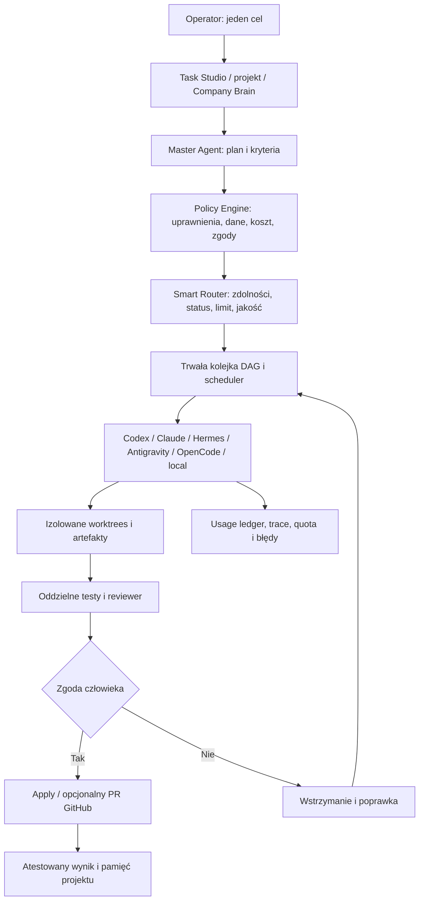

# AgenticOS / Agenting OS — Roadmap v4 (delta audit)

**Data audytu:** 19 października 2026  
**Repozytorium:** https://github.com/aievolutionpl/agentic-os  
**Weryfikowany commit `main`:** `732d422bde20772cbe238c4087bcc7147c875a90`  
**Zakres:** odczyt plików i metadanych przez połączony GitHub, wyników CI i dokumentów projektu. Nie uruchamiałem aplikacji na twoim komputerze i nie zmieniałem kodu, branchy ani konfiguracji.

## 1. Stan potwierdzony

Agenting OS 0.4.0 to lokalna aplikacja Electron / React / TypeScript / SQLite. Posiada:

- Konwersacje i profile Codex, Claude Code, Gemini ACP, Hermes ACP, OpenCode/OpenRouter, lokalny model przez OpenCode oraz Antigravity. **Stan konfiguracji nie oznacza automatycznie sprawdzonej inferencji.**
- Master Agent: rzeczywiste modelowe planowanie, maks. 6 kroków, walidacja planu, delegacja sekwencyjna, osobny recenzent, zamrożony kontekst, ewaluacja celu.
- Zarządzane Git worktrees, nadzorowanie procesu, anulowanie i kontrolowane wznowienie, artefakty diff + SHA-256, ręczne review i osobne zatwierdzenie zmian.
- Wspólna pamięć lokalna FTS5, zakres projektu/workspace, przypięte wpisy, skille i MCP, oddzielna przeglądarka projektu.
- Control Center i OpenQuota. Oficjalne dane Codex, budżet klucza OpenRouter, ręczne budżety; brak pełnego automatycznego odczytu zużycia pozostałych subskrypcji.
- CI: na sprawdzanym commicie udane testy na Windows i Linux, testy Electron, `npm audit` oraz budowa niepodpisanego instalatora Windows. Ostatni workflow: https://github.com/aievolutionpl/agentic-os/actions/runs/39336473112
- W repo pięć scalonych PR-ów i brak otwartych PR-ów na moment audytu. Raport w `docs/SUBSCRIPTION_CONNECTIONS.md` deklaruje 80/80 testów lokalnych i rzeczywiste dwuturowe rozmowy Hermes + Antigravity na skonfigurowanej maszynie. Tych sesji nie powtarzałem.

**Interpretacja:** działający techniczny fundament. Nie oznacza jeszcze kompletnego produktu 1.0 dla danych klientów i działania bez nadzoru.

## 2. Luki na bazie kodu i dokumentacji

| Priorytet | Luka | Dowód | Wniosek |
| --- | --- | --- | --- |
| P0 | Ręczna orkiestracja jest nietrwała | `src/main/orchestrator.ts` używa `Map` w pamięci; po restarcie batch nie wraca do osobnego trwałego dziennika | Zapisać status kolejki w SQLite; po restarcie oznaczać jako przerwany, **nie uruchamiać automatycznie** |
| P0 | Zaufane procesy ACP/MCP nie są izolowane przez OS | `SECURITY.md` | Tryb ograniczony, kontrola ścieżek/egress, później sandbox/VM/Windows isolation |
| P0 | Dokumentacja ma sprzeczne historyczne statusy | `docs/RELEASE_GATES.md` mówi „not releasable, nothing pushed”; późniejsze PR-y i CI potwierdzają inne etapy | Oddzielić historię od stanu bieżącego i oprzeć release status na aktualnym SHA |
| P1 | Master planuje tylko 1–6 kroków i wykonuje je kolejno | `src/main/master-agent.ts`, `src/shared.ts` | Plan zależności + równoległa praca tam, gdzie jest bezpieczna, limit jednoczesnych procesów |
| P1 | Brak Smart Routera wyboru providera | `docs/plan-v3/AGENTING_OS_PLAN_V3.md` ma specyfikację; produkcyjne kroki mają wskazanych wykonawców | Capability Registry + deterministyczny Policy Router z uzasadnieniem decyzji |
| P1 | Brak pełnego ledgeru tokenów/kosztów per run | `src/main/quota.ts` ma kwoty, ale nie kompletne rozliczenie per krok | Oddzielić oficjalne limity, ręczne szacunki i faktyczny koszt API, blokować przekroczenie budżetu |
| P2 | GitHub działa głównie jako clone/źródło kontekstu | `src/main/chats.ts`, `src/main/index.ts` | Issues → zadania, PR/CI/review z jawnie zatwierdzonym push |
| P2 | Pamięć ma FTS i pinning, ale brak rozbudowanego lifecycle | `src/main/knowledge.ts` | TTL, supersedes, typy rekordów, handoff, wersjonowanie Company Brain, eksport/backup |
| P2 | Brak podpisanego wydania i pełnego QA instalatora | `README.md`, `electron-builder.yml`, workflow CI | Test install/upgrade/uninstall, podpis, aktualizacje dopiero po audycie |
| P2 | Repo puchnie od evidence | Drzewo `main`: 1159 plików, ok. 71,5 MB; `docs/` ok. 62,5 MB / 752 pliki | Zostawić małe raporty i goldeny w Git, duże screeny/logi przesunąć do CI artifacts, z retencją i redakcją sekretów |

Raport historyczny `docs/audit/deepseek-integration-review.md` analizuje dawny kod bez providerów i **nie opisuje obecnej funkcjonalności**. Plan v3 zawiera część pomysłów już zrealizowanych; roadmapa v4 powinna być delta planem, a nie kolejnym rewrite.

## 3. Docelowa architektura

Polityki egzekwuje aplikacja, a nie prompt. Wyjście modelu nigdy nie stanowi zgody na push, deploy, wydatki ani dostęp do sekretów.

## 4. Kolejność realizacji

### V4.1 — Fundament i prawdziwy stan integracji [P0]

1. Zamrozić baseline (`main` SHA, testy, migracje, macierz zgodności). Ujednolicić `README`, `docs/STATUS.md`, `docs/RELEASE_GATES.md`, `HANDOFF_PL.md`, oznaczyć archiwalne sekcje.
2. Zapisywać status ręcznych batchy i zdarzenia do SQLite. Restart → `interrupted` + „Inspect / Continue”, bez auto replay. Ustalić idempotentne identyfikatory zadań i akcje.
3. Dodać **Doctor / Capability Registry**: executable detected, authenticated, protocol handshake, live read-only tested, roles, supported models, last tested time, unsupported reason. Rzeczywista inferencja dopiero po opt-in.
4. Dodać backup/restore danych z walidacją schematu i opcją redakcji danych w paczce diagnostycznej. Uruchomić podstawowy test awaryjnego zamknięcia.
5. Osobny test narzędzi ACP/MCP i granic wykonania. Nie oznaczać `sandboxed` bez testu granicy OS.

**Gate:** restart nie gubi historii batcha, nie powtarza akcji i nie stosuje zmian; UI pokazuje jasno stany `unverified` i `needs-auth`; przejście dotychczasowego CI.

### V4.2 — Policy Engine, Smart Router i rozliczenia [P1]

1. Modele danych: `ConnectorCapability`, `Account`, `RoutingDecision`, `UsageRecord`, `WorkspacePolicy`, `BudgetLimit` z migracjami bez utraty obecnej konfiguracji.
2. Filtry twarde: dostępność/rola, tryb read-only, lista dozwolonych łączników, polityka wrażliwości danych, dostępność limitu, zakaz nieautoryzowanego płatnego fallbacku.
3. Ranking wyjaśnialny: dopasowanie zdolności, dane testowe dotyczące jakości, koszt API, latency, zdrowie, zróżnicowanie recenzentów. Brak źródeł → nie zgaduj ocen.
4. Tryby routingu: **Manual**, **Balanced**, **Subscription-first**, **Quality-first**. Interaktywny podgląd wyboru przed uruchomieniem.
5. Ledger per model i run: official tokens/cost API gdy dostawca je zwraca, lokalny licznik i oddzielnie nieznana wartość, rezerwa budżetowa, blokady `budget_exceeded` przed płatnym requestem, kwoty tylko z podaną proweniencją.
6. Pozostawić automatyczny fallback między płatnymi dostawcami wyłączony do czasu jawnej zgody i limitów.

**Gate:** 20+ deterministycznych scenariuszy routingu, także brak CLI, wygasłe logowanie, brak roli read-only, quota unknown/stale, limit 429, drogi model, prywatny projekt. Żadnego automatycznego wydatku API bez aprobaty.

### V4.3 — Zespół agentów i trwały graf zadań [P1]

1. Podnieść limit planu dopiero z kontrolą rozmiaru i kosztu. Zamiast zwykłej listy: jawne zależności DAG i widok grafu.
2. Scheduler początkowo max. 2 niezależne kroki jednocześnie. Każdy krok w osobnym worktree. Kontrola konfliktu plików i brancha przed łączeniem.
3. Structured handoff: cel, rezultat, testy, pliki, diff hash, błędy, dane źródłowe, nierozwiązane decyzje. Nie przekazywać całych surowych logów i przypadkowych instrukcji z zewnątrz.
4. Quality gates: rzeczywisty test/linters, drugi reviewer, wersjonowane kryteria odbioru. Ograniczona liczba poprawek za zgodą, bez nieograniczonej pętli.
5. Resume po restarcie tylko na żądanie, bez utraty istniejących artefaktów. Konflikt wprowadzony przez inny krok → `blocked`, nie automerge.

**Gate:** demonstracja jednego zadania z minimum dwoma różnymi agentami, dwoma niezależnymi krokami, recenzentem innym niż autor i jawnie zatwierdzonym końcowym diffem. Umyślna kolizja plików zatrzymuje zastosowanie.

### V4.4 — Operator UX: dashboard, ślady, wiedza [P1/P2]

- **Overview:** aktywne runy, oczekujące zgody, zaufany status połączeń, niepewność limitów, wydatki API, najbliższy krok użytkownika.
- **Task Studio:** Solo / Team / Compare / Read-only z podglądem planu, polityki, powiązanej pamięci i wpływu na koszty.
- **Run Graph & Audit:** live graf, streaming zdarzeń, wyjaśnienie routingu, potwierdzone testy vs deklaracje agentów, porównanie artefaktów.
- **Company Brain:** profile klientów/projektów, źródła GitHub i później Google Drive przez oficjalne integracje, zapis wyłącznie za zgodą i bez wycieku między klientami. Pamięć z typem, wersją, TTL/supersedes i jawnie widocznym snapshotem użytym w danym runie.
- **Nawigacja:** jeden startowy przepływ „podłącz → wybierz folder → wybierz Master → zadanie → sprawdź plan → uruchom”, skrót Ctrl+K.

**Gate:** użytkownik uruchamia jeden prosty przepływ bez czytania README; wszystkie decyzje o zgodzie i kosztach są widoczne; testy 390px/desktop, klawiatura, kontrast, focus oraz powrót po błędzie.

### V4.5 — GitHub, bezpieczeństwo i dystrybucja [P2/P0 dla produkcji]

1. GitHub Hub: issues→zadania, PR draft, status CI, komentarze review, porównanie branchy. `push` i publikacja wyłącznie po zatwierdzeniu konkretnej akcji.
2. Trust boundaries: procesy ACP/MCP uruchamiać w określonych ścieżkach, oddzielnych profilach i tam, gdzie możliwe, OS/container sandbox; polityka sieci, sekrety, blokada plików `.env` i magazynów tożsamości.
3. Audyt threat model, prompt injection, wyciek do logów, sprawdzanie zależności i licencji, kopie zapasowe i migracje. Testy negatywne, a nie tylko happy path.
4. Windows installer podpisany, wersjonowanie, install/upgrade/uninstall w czystym profilu; dopiero potem kanał aktualizacji. Nie utożsamiać smoke uruchomienia unpacked EXE z testem instalacji.

**Gate 1.0:** zero nierozwiązanych krytycznych i wysokich błędów w zakresie bezpieczeństwa i integralności zmian; test świeżej instalacji i aktualizacji; jawna macierz wspieranych providerów i trybów.

## 5. Pierwsze sugerowane issues / PR-y

1. **P0 — Persist manual orchestration journal and safe recovery**  
   Zakres: `src/main/orchestrator.ts`, `src/main/store.ts`, migracja SQL, `tests/runtime.test.mjs`.  
   Akceptacja: restart po aktywnym kroku nie powoduje auto-replay; stan jest audytowalny; brak podwójnego apply.
2. **P0 — Consolidate release truth and capability verification**  
   Zakres: dokumentacja i `src/main/connectors.ts`, `src/main/provider-discovery.ts`, UI Control Center.  
   Akceptacja: jeden stan aktualnego wydania, rozdzielone detected/auth/handshake/live/role, daty i dowody.
3. **P1 — Introduce Policy Engine and budget approval contract**  
   Nowy `src/main/policy.ts` + kontrakty w `src/shared.ts`. Testy odmowy: niezgodny provider, prywatne dane, brak zgody na koszt.
4. **P1 — Smart Router with explainable deterministic decisions**  
   `src/main/router.ts`, registry/fixtures, preview UI.  
   Akceptacja: powtarzalny wybór z tych samych faktów; każda decyzja ma przyczyny i odrzuconych kandydatów.
5. **P1 — Usage ledger with separate API and subscription units**  
   `src/main/usage-ledger.ts`, rozszerzenie quota UI i SQLite.  
   Akceptacja: nieznane użycie nie jest zerem; budżet płatnego API zatrzymuje nową próbę.
6. **P1 — Safe parallel DAG scheduler**  
   `src/main/master-agent.ts`, `src/main/orchestrator.ts`, `src/main/supervisor.ts`.  
   Akceptacja: dwa niezależne kroki, izolowane worktrees, poprawna obsługa konfliktu.
7. **P1 — Reviewer evidence and bounded revision loop**  
   Rzeczywiste artefakty, testy z podaniem źródła, limit prób i zgoda na kolejną korektę.
8. **P2 — Dashboard Task Studio, Graph and approvals inbox**  
   Nowe ekrany React bez przepisywania istniejącego interfejsu.
9. **P2 — Versioned Company Brain and scoped handoffs**  
   TTL, źródła, typy, wersje, dane klienta, eksport, kontrola dostępu.
10. **P2 — GitHub issues/PR/CI workflow**  
    Wykorzystaj `gh` lub GitHub App. Nie dodawaj automatycznego merge na main.
11. **P2 — CI evidence and repository cleanup**  
    Zastąp ciężkie screenshoty w Git przez artefakty workflow dla nowych buildów; utrzymaj metadane wyników i redakcję danych.
12. **Release — OS sandbox, signed installer, lifecycle QA**  
    Niezbędne przed pozycjonowaniem 1.0 jako stabilnego narzędzia do pracy z klientami.

## 6. Nieprzekraczalne zasady

- Zero kopiowania OAuth cookies/tokenów z aplikacji w nieoficjalny proxy do „wspólnego konta”. Każdy CLI działa w ramach własnego wspieranego mechanizmu autoryzacji.
- Nie rób z unknown quota deklaracji „nielimitowane”. Nie udawaj precyzyjnego licznika tokenów abonamentów, gdy go nie ma.
- AI dostaje tylko wybrany, ograniczony kontekst. Repozytorium, przeglądarka i MCP są niezaufanymi źródłami instrukcji.
- Nie ma ukrytych wydatków, autopush, deploy, merge ani edycji globalnych ustawień providera.
- Każda migracja bazy ma test rollback; każdy PR ma testy, realny smoke i raport źródeł dowodów.

## 7. Gotowy brief dla agenta implementującego pierwszy etap

> Otwórz repozytorium `aievolutionpl/agentic-os` i najpierw sprawdź aktualny SHA `main`; nie zakładaj, że stan audytu z 2026-10-19 jest nadal najnowszy. Przeczytaj `README.md`, `SECURITY.md`, `docs/STATUS.md`, `docs/plan-v3/AGENTING_OS_PLAN_V3.md`, `src/main/orchestrator.ts`, `src/main/master-agent.ts`, `src/main/supervisor.ts`, `src/main/store.ts` i aktualne testy.
>
> Pracuj w osobnej gałęzi. Zaimplementuj wyłącznie pierwszy bezpieczny slice: trwały dziennik ręcznej kolejki w SQLite, restart jako `interrupted` bez automatycznego powtórzenia, możliwość jawnego sprawdzenia/wznowienia, migrację bez utraty danych i testy regresyjne. Nie dodawaj nowych płatnych wywołań, automatycznego merge/push/deploy ani zmian globalnej konfiguracji Hermes/Codex/Claude/Google. Jeśli napotkasz już istniejącą implementację, najpierw zweryfikuj ją i nie duplikuj.
>
> Wykonaj `npm run typecheck`, `npm test` oraz właściwe Electron smoke i QA na wspieranym systemie. Oddziel wyniki fixture od rzeczywistego modelu. Przygotuj PR z listą zmienionych plików, migracji, testów, ograniczeń i rollbacku. Nie scalaj do `main` bez decyzji właściciela.

## 8. Źródła w repozytorium

- [README](https://github.com/aievolutionpl/agentic-os/blob/main/README.md)
- [Plan v3](https://github.com/aievolutionpl/agentic-os/blob/main/docs/plan-v3/AGENTING_OS_PLAN_V3.md)
- [Master Agent](https://github.com/aievolutionpl/agentic-os/blob/main/src/main/master-agent.ts)
- [Ręczna kolejka](https://github.com/aievolutionpl/agentic-os/blob/main/src/main/orchestrator.ts)
- [Pamięć](https://github.com/aievolutionpl/agentic-os/blob/main/src/main/knowledge.ts)
- [Limity](https://github.com/aievolutionpl/agentic-os/blob/main/src/main/quota.ts)
- [Zweryfikowane subskrypcje](https://github.com/aievolutionpl/agentic-os/blob/main/docs/SUBSCRIPTION_CONNECTIONS.md)
- [Granice bezpieczeństwa](https://github.com/aievolutionpl/agentic-os/blob/main/SECURITY.md)
- [Najświeższy CI na audytowanym SHA](https://github.com/aievolutionpl/agentic-os/actions/runs/39336473112)

**Stan prac:** wyłącznie audyt i plan. Z repozytorium nie zmieniono żadnego pliku ani ustawienia.
