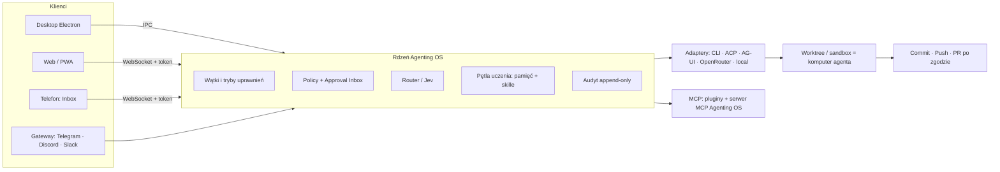

# Agenting OS — Roadmap v5: harness, UI i funkcje

**Data:** 27 listopada 2026 · **Baza:** `main` @ `7c71436` (0.5.0-rc.3 + memory lifecycle v19)
**Wzorce:** T3 Code (pingdotgg), OpenBot (CopilotKit), Hermes Agent (Nous Research)

Dokument to plan delta, nie rewrite. Uczymy się z architektury i UX tych projektów; nie kopiujemy kodu, nazw ani wyglądu. Wszystkie trzy są na licencji MIT. Gdy zechcemy przenieść konkretny kod, sprawdzamy licencję pliku i zapisujemy to w `licenses/`.

---

## 1. Co bierzemy z każdego wzorca

| Wzorzec | Ich mocna strona | Co to znaczy dla Agenting OS |
| --- | --- | --- |
| **T3 Code** | Jeden szybki „control plane” dla wielu agentów CLI. Serwer WebSocket, a nad nim klienci: desktop, web i telefon. Wątek w osobnym worktree. Diff, commit, push i PR jednym przyciskiem. Zmiana modelu w trakcie wątku. Handoff Claude → Codex. Tryby uprawnień. Wydajność traktowana jako funkcja. | Czat staje się **wątkiem roboczym**: własny worktree, tryb uprawnień, przełączanie agenta w locie, a na końcu PR. Oddzielamy rdzeń (main) od UI przez lokalny serwer, żeby później dodać zdalny dostęp i telefon. |
| **OpenBot** | Agent ma własny „komputer” (VM lub sandbox) z przeglądarką i plikami. Interaktywne wyniki w rozmowie. Agent czeka na zgodę przed akcją, a człowiek może przejąć sterowanie. Polityki narzędzi, audyt i vault sekretów. AG-UI dla agentów, MCP dla narzędzi. | **Approval inbox** z zatwierdzaniem pojedynczych akcji, a nie tylko całych diffów. Widok „komputer agenta” (przeglądarka i terminal na żywo, z przejęciem sterowania). Generatywne karty wyników w czacie. Audyt wszystkich akcji. Adapter AG-UI jako kolejny protokół obok ACP. |
| **Hermes Agent** | Agent, który rośnie: po trudnym zadaniu sam pisze skill i ładuje go przy podobnych zadaniach. Pamięć `memory.md`/`user.md`. Wyszukiwanie po sesjach. Przegląd co N tur: co zapisać. Gateway do komunikatorów. Cron z dostarczaniem wyników na dowolny kanał. | **Pętla uczenia**: propozycje skilli i wpisów pamięci po zakończonej pracy, zawsze do akceptacji. Profil użytkownika. Wyszukiwanie po całej historii rozmów. Gateway (Telegram, Discord, Slack) dla ScheduleJob i zatwierdzeń. |

Czego **nie** przejmujemy: automatycznego zapisu skilli bez zgody (u nas skill nie podnosi uprawnień i musi przejść review), resellingu tokenów, zależności od zamkniętych usług w rodzaju CopilotKit Intelligence.

---

## 2. Stan wyjściowy (co już mamy)

Mamy już mocny fundament: wielu dostawców (Codex, Claude Code, Antigravity, OpenCode, Hermes ACP, lokalny LLM, OpenRouter), worktrees z review i zatwierdzaniem diffu, trwały cykl zadań z leasami, Master Agenta, Jev routing, pamięć FTS5 z grafem i lifecycle, harness z budżetem kontekstu, 33 skille, pluginy MCP, ScheduleJob, terminal PTY, 7 motywów i paletę poleceń.

Luki względem wzorców (sprawdzone w `src/`):

| Luka | Dowód |
| --- | --- |
| Czat nie edytuje projektu i nie ma trybów uprawnień | README → Ograniczenia; brak `permissionMode` w kodzie |
| Brak PR z poziomu wątku | `github-integration.ts` obsługuje głównie źródło kontekstu |
| Brak zdalnego dostępu, weba i telefonu | brak serwera dla klientów; UI tylko przez IPC Electron |
| Pluginy nie są wywoływane przez model w czasie rozmowy | README → Pluginy |
| Brak wyszukiwania po wszystkich sesjach | brak globalnego indeksu rozmów |
| Brak pętli uczenia (skill i pamięć z doświadczenia) | memory lifecycle nie ma jeszcze UI; brak propozycji skilli |
| Brak gateway do komunikatorów | brak integracji Telegram/Discord/Slack |
| Monolity UI spowalniają rozwój | `main.tsx` 1826 linii, `ChatWorkspace.tsx` 1817 linii, 9 plików CSS |
| Długie rozmowy renderowane w całości | brak wirtualizacji listy wiadomości |

---

## 3. Fazy rozwoju

Każda faza kończy się wydaniem z zielonym CI, zrzutami w `docs/images` i wpisem w `CHANGELOG.md`. Kolejność wynika z wartości dla użytkownika i zależności technicznych.

### Faza 0 — Fundament UI i wydajność (0.6, ~2 tyg.)
*Wzorzec: T3 Code („dropped frame is a bug”).*

1. **Rozbić monolity.** Z `main.tsx` wydzielić `AppShell`, `Sidebar`, `Header` i `Router`. Z `ChatWorkspace.tsx` wydzielić `ThreadView`, `MessageList`, `Composer` i `ThreadToolbar`. Zachowanie bez zmian, testy QA bez zmian.
2. **Design tokens.** Jeden plik `tokens.css` (kolor, odstępy, promienie, cienie, czas animacji). Motywy nadpisują tylko tokeny. Scalić `calm/glass/premium/workbench/harness*.css` w warstwy: `tokens → base → components → themes`.
3. **Wirtualizacja i streaming.** Wirtualna lista wiadomości dla rozmów powyżej 200 wiadomości. Streaming tokenów bez ponownego renderu całej listy. Lazy-load ciężkich paneli (MemoryGraph, DiffViewer, Terminal).
4. **Budżet wydajności w CI.** Skrypt `qa:perf` w Playwright/Electron: czas startu, czas przełączenia rozmowy i FPS przewijania 1000 wiadomości. Próg blokuje merge.

**Kryterium:** start < 1,5 s na referencyjnej maszynie, przewijanie 1000 wiadomości ≥ 55 FPS, żaden plik komponentu > 600 linii.

### Faza 1 — Wątek jako jednostka pracy (0.7, ~3 tyg.)
*Wzorzec: T3 Code (worktree per wątek, git built-in, permission modes).*

1. **Tryby uprawnień na wątek:** `Plan` (tylko odczyt), `Ask` (każda zmiana wymaga zgody), `Auto-edit` (edycje w worktree bez pytania, polecenia z pytaniem) i `Full` (z jawnym ostrzeżeniem, tylko w worktree). Egzekwuje je `policy.ts` i adaptery, nie prompt. Zamyka lukę „Auto accept w czacie”.
2. **Worktree na wątek (opcjonalny).** Przełącznik „Pracuj w izolacji” tworzy worktree przez istniejące `git.ts`/`supervisor.ts`. Status gałęzi i licznik zmian widać w nagłówku wątku.
3. **Panel zmian obok czatu.** Split view: rozmowa po lewej, diff, pliki i terminal po prawej. Wykorzystać `DiffViewer` i `TerminalPanel`.
4. **Ship bar:** `Commit → Push → Otwórz PR` z poziomu wątku. Komunikat commita i opis PR generuje agent, a człowiek edytuje go przed wysłaniem. Push i PR zawsze wymagają kliknięcia.
5. **Przełączanie agenta i modelu w trakcie wątku** oraz **handoff:** „Przekaż Codexowi do review”, z zachowaniem kontekstu przez `review-evidence.ts`.
6. **Checkpointy i undo.** Snapshot worktree przed każdą turą agenta z możliwością cofnięcia jednej tury.

**Kryterium:** pełna ścieżka „prompt → zmiany w worktree → review → PR” bez wychodzenia z wątku, pokryta testem E2E na repo demo.

### Faza 2 — Zatwierdzenia, komputer agenta, audyt (0.8, ~3 tyg.)
*Wzorzec: OpenBot (approvals, computer view, take over, audit, generative UI).*

1. **Approval Inbox.** Jedna kolejka wszystkich próśb o zgodę (polecenie shell, zapis poza worktree, wywołanie pluginu, push, wydatek API) z pełnymi parametrami i opcjami: *Zatwierdź raz*, *Zawsze dla tego wątku*, *Odrzuć z komentarzem*. Rozbudować `approvals.ts` i `Inbox.tsx`.
2. **Widok „komputer agenta”.** Na żywo: przeglądarka (`BrowserPanel`), terminal i aktywny plik. Przycisk **Przejmij sterowanie** pauzuje agenta, a **Oddaj** go wznawia.
3. **Pluginy wywoływane przez model.** Narzędzia MCP dostępne w rozmowie przez zgodę per narzędzie i per wątek (bez zgody globalnej). Zamyka lukę z README.
4. **Generatywne karty wyników.** Agent zwraca strukturę (tabela, wykres, lista zadań, formularz zgody), a UI renderuje komponent zamiast surowego Markdownu. Zamknięty katalog komponentów, bez wykonywania HTML od modelu.
5. **Dziennik audytu.** Każda akcja agenta, zgoda i zmiana uprawnień trafia do SQLite (append-only, z hashem łańcuchowym). Widok filtrów i eksport CSV/JSON. Rozszerzyć `runs.ts` i `observations.ts`.
6. **Vault.** Zunifikować przechowywanie sekretów (safeStorage) i dodać opcjonalne źródła: 1Password CLI i zmienne środowiskowe. Sekrety nigdy nie trafiają do renderera ani logów.

**Kryterium:** żadna akcja z efektem zewnętrznym nie dzieje się bez wpisu w audycie i zgody zgodnej z trybem wątku.

### Faza 3 — Agent, który się uczy (0.9, ~3 tyg.)
*Wzorzec: Hermes (self-written skills, memory review, session search, user model).*

1. **Wyszukiwanie po wszystkich sesjach.** Globalny indeks FTS5 rozmów, wyników i diffów. `Ctrl+Shift+F` otwiera go, z filtrami projekt, agent i data. Agent może z niego korzystać jako narzędzia `session_search` (tylko odczyt, w granicach projektu).
2. **Przegląd po pracy.** Po zakończonym wątku (lub co N tur) agent proponuje **wpisy pamięci** (fakt, decyzja, konwencja, z TTL) oraz **nowy skill** albo poprawkę istniejącego. Propozycje trafiają do Approval Inbox jako diff `SKILL.md` lub wpisu. Zapis następuje dopiero po akceptacji.
3. **UI dla memory lifecycle.** Kontrolki `expiresAt` i „zastąp poprawioną wersją” w ekranie Pamięć (backend v19 już istnieje). Widok „przestarzałe”.
4. **Profil użytkownika (`user.md`).** Jawny, edytowalny profil preferencji (język, styl, stack, zakazy) wstrzykiwany przez harness z widocznym kosztem tokenów.
5. **Skill Hub.** Import skilli w formacie zgodnym z agentskills.io / `SKILL.md`. Ocena jakości (ile razy użyty, czy zadanie przeszło weryfikację). Wyłączanie nieużywanych.
6. **Metryki harnessu.** Dla każdego skilla i wpisu pamięci: kiedy został przywołany i czy pomógł (zadanie zaliczone przy pierwszym podejściu). Panel w `HarnessPanel`.

**Kryterium:** po 10 zadaniach na repo demo system proponuje co najmniej 1 sensowny skill. Żaden zapis nie odbywa się bez zgody.

### Faza 4 — Wszędzie: serwer, web, telefon, komunikatory (1.0-beta, ~4 tyg.)
*Wzorce: T3 Code (server + klienci, remote), Hermes (gateway, cron → dowolny kanał), OpenBot (Slack/Teams).*

1. **Lokalny serwer rdzenia.** Wydzielić logikę z `src/main` do procesu z API WebSocket (typowane kontrakty z `shared.ts`). Electron staje się jednym z klientów, a IPC zostaje jako szybka ścieżka lokalna. Domyślnie bind do `127.0.0.1` z tokenem parowania.
2. **Klient web (PWA)** z tego samego kodu React: lista wątków, czat, Approval Inbox i podgląd diffu. Zdalny dostęp przez LAN lub Tailscale tylko po jawnym włączeniu, z parowaniem przez kod QR.
3. **Telefon = zatwierdzenia w pierwszej kolejności.** Responsywny widok PWA zoptymalizowany pod „agent czeka na zgodę”, z powiadomieniami push.
4. **Gateway komunikatorów:** Telegram, Discord i Slack jako kanały do powiadomień, zatwierdzeń (przyciski) i krótkich poleceń. ScheduleJob dostarcza wyniki na wybrany kanał.
5. **Protokoły agentów.** Obok ACP dodać adapter **AG-UI** (zewnętrzni agenci z platform typu LangGraph, Mastra czy Agent SDK) oraz **serwer MCP Agenting OS**, żeby zewnętrzne agenty mogły tworzyć zadania i czytać pamięć projektu (z zakresami).

**Kryterium:** wątek uruchomiony na desktopie da się zatwierdzić z telefonu przez Tailscale. Bez parowania serwer odrzuca połączenie.

### Faza 5 — Produkcja i zespół (1.0, ciągłe)

1. Podpisany instalator Windows, notaryzowany build macOS, AppImage/deb dla Linux oraz auto-update ze ścieżką rollback.
2. Sandbox dla procesów ACP/MCP: Windows AppContainer/Job Objects, na Linux bubblewrap, a opcjonalnie Docker lub zdalny sandbox jako „komputer agenta”.
3. Tryb zespołowy: współdzielony workspace, role, polityki narzędzi i wspólny dziennik audytu.
4. Repo na dietę: duże evidence i screeny do artefaktów CI (luka z Roadmap v4).

---

## 4. Ulepszenia UI — konkretna lista

| # | Zmiana | Inspiracja | Faza |
| --- | --- | --- | --- |
| U1 | Sidebar wątków z grupami *Aktywne / Czeka na Ciebie / Zakończone* i statusem na żywo (kropka, spinner, licznik zgód) | T3 Code | 1 |
| U2 | Nagłówek wątku: agent, model, tryb uprawnień, gałąź, licznik zmian, koszt | T3 Code | 1 |
| U3 | Split view czat ↔ zmiany/terminal/przeglądarka, z zapamiętaną szerokością | T3 Code, OpenBot | 1 |
| U4 | Composer z `/`-komendami (skille, tryby, agenci) i `@`-wzmiankami (pliki, pamięć, wątki) | T3 Code, Hermes | 1 |
| U5 | Approval cards w rozmowie i w Inbox, ze skrótami `Y`/`N`/`A` | OpenBot | 2 |
| U6 | Live timeline narzędzi: zwijane kroki „czyta plik”, „uruchamia test” z czasem trwania | T3 Code, OpenBot | 2 |
| U7 | Karty generatywne (tabela, wykres, checklist) zamiast surowego Markdownu | OpenBot | 2 |
| U8 | „Nauczyłem się” — dyskretny toast z propozycją skilla lub pamięci | Hermes | 3 |
| U9 | Globalne wyszukiwanie sesji z podglądem fragmentu | Hermes | 3 |
| U10 | Tryb mobilny „Inbox-first” | T3 Code | 4 |
| U11 | Onboarding w 3 krokach: wykryj CLI → zaloguj → pierwszy wątek na repo demo | wszystkie | 0 |
| U12 | Tryb Zen: tylko rozmowa i composer, `Ctrl+.` | — | 0 |

---

## 5. Architektura docelowa

Zasada bez zmian: **polityki egzekwuje kod, nie prompt.** Wyjście modelu nigdy nie jest zgodą.

---

## 6. Najbliższe 3 sprinty (do realizacji od razu)

| Sprint | Zakres | Pliki startowe |
| --- | --- | --- |
| **S1** | Rozbicie `main.tsx` i `ChatWorkspace.tsx`; `tokens.css`; wirtualna lista wiadomości; `qa:perf` | `src/renderer/main.tsx`, `ChatWorkspace.tsx`, `*.css` |
| **S2** | Tryby uprawnień w `policy.ts` z egzekucją w adapterach; selektor w nagłówku wątku; testy jednostkowe na każdy tryb | `src/main/policy.ts`, `adapters.ts`, `cli-provider.ts`, `shared.ts` |
| **S3** | Worktree na wątek, split view ze zmianami, Ship bar (commit/push/PR po zgodzie) | `git.ts`, `supervisor.ts`, `github-integration.ts`, `DiffViewer.tsx` |

Definicja „done” dla każdego sprintu: `typecheck`, `lint`, `test`, `smoke` i odpowiedni `qa:*` są zielone; zrzuty PL/EN; wpis w `CHANGELOG.md`.

---

## 7. Ryzyka

| Ryzyko | Mitygacja |
| --- | --- |
| Zdalny dostęp otwiera powierzchnię ataku | Domyślnie wyłączony, tylko `127.0.0.1`, parowanie tokenem, ograniczenie do Tailscale/LAN, audyt połączeń |
| Auto-skille „zatruwają” kontekst | Zapis tylko po zgodzie, metryki skuteczności, TTL, łatwe wyłączenie |
| Agent SDK szybciej zużywa limity niż CLI | Pokazywać źródło limitu per adapter; preferować oficjalne CLI |
| Rozrost zakresu | Każda faza ma kryterium wyjścia; nowe pomysły trafiają do backlogu, nie do bieżącej fazy |

## Źródła

- T3 Code: https://github.com/pingdotgg/t3code
- OpenBot (CopilotKit): https://github.com/CopilotKit/OpenBot
- Hermes Agent: https://hermes-agent.nousresearch.com/docs
- Wcześniejsze plany: [ROADMAP_V4.md](ROADMAP_V4.md), [architecture/HERMES_MAPPING.md](architecture/HERMES_MAPPING.md)
