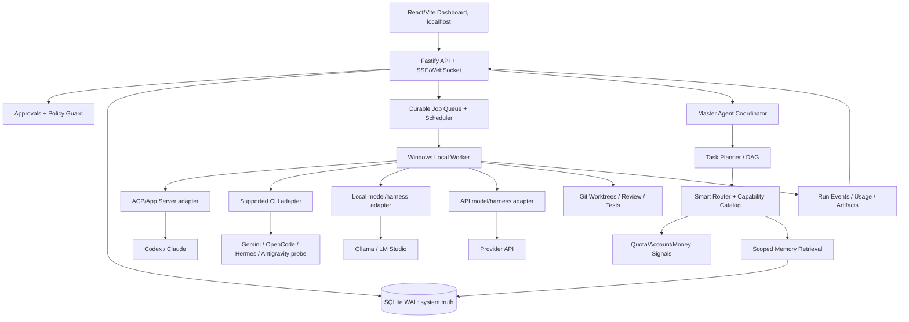

# AGENTING OS | Pełna dokumentacja architektury i zadanie dla Hermesa
Wersja 2.1 · 19.10.2026 · Windows local-first · status: plan zatwierdzony, implementacja nie rozpoczęta
---


---

<!-- SOURCE: 00-START-TUTAJ-PL.md -->

# Agenting OS - START TUTAJ (polski przewodnik)

**Co dostajesz:** specyfikację własnego systemu, architekturę, dokumentację wszystkich modułów, prompt dla Hermesa, reguły bezpieczeństwa, audyt multi-agentowy, testy, przykładowe schematy danych i skrypt pobierający repozytoria referencyjne.

**Co jest gotowe:** plan i dokumenty. **Czego jeszcze nie ma:** ukończonego programu Agenting OS ani sprawdzonych na twoim PC logowań CLI. Hermes ma dopiero wykonać audyt R0 i następnie budować produkt.

## Najważniejsza idea
- Agenting OS to **nazwy produktu**. Hermes go **buduje**. Po uruchomieniu w każdym Workspace wybierasz Master Agenta: Codex/Claude/Gemini/Hermes/OpenCode/inny wspierany.
- Zlecasz zadanie raz. Router deleguje podzadania na agentów po sprawdzeniu **uprawnień, umiejętności, dostępności, kosztów i quota**. Wyniki wspólnie zapisują się do pamięci danego Workspace.
- Abonamenty nie zmieniają się w „jeden pakiet tokenów”. Program zarządza niezależnymi logowaniami i metrykami i używa wyłącznie wspieranych sposobów dostępu.

## Jak zacząć
1. Pobierz ZIP i rozpakuj na Windows, np. `D:\Projects\AgentingOS`.
2. Zapoznaj się z `README.md` (przegląd) oraz `docs/08-ux-ui.md` (dashboard).
3. Skontroluj i uruchom PowerShell `scripts/clone-reference-repos.ps1` (pobranie źródeł, bez wykonywania ich kodu).
4. W Hermes podaj: **„Otwórz `HERMES_MASTER_PROMPT.md` w tym folderze i rozpocznij wyłącznie audyt R0. Zanim napiszesz kod, pokaż mi źródła, ryzyka i plan wdrożenia.”**
5. Po raporcie R0 zatwierdź wybór adapterów; wtedy Hermes przechodzi do kolejnych etapów i pokazuje działające przyrosty.

## Główne moduły dashboardu
Overview / Workspaces / New Task / Agent Fleet / Subscription Quotas / Model Catalog / Smart Router / Task Graph / Shared Memory / GitHub / Approvals / Activity / Settings.

## Gdzie czytać szczegóły
- `HERMES_MASTER_PROMPT.md` - główny prompt dla Hermesa.
- `AGENTS.md` - zasady dla każdego programującego agenta.
- `docs/01` do `docs/11` - cel, architektura, integracje, routing, pamięć, GitHub, limity, UI, bezpieczeństwo, open source i roadmapa.
- `docs/12` do `docs/14` - niezależne audyty, kontrakty API, Windows.

**Ważne:** Po uruchomieniu programu agenci nie powinni mieć dostępu do sekretnych danych klientów innych Workspace. Operacje o skutkach zewnętrznych wymagają zatwierdzenia użytkownika.


---

<!-- SOURCE: README.md -->

# Agenting OS | Master Build Pack v2.0

Status: approved product direction, implementation NOT started.
Prepared: 2026-10-19. Language: Polish (product UI bilingual-ready PL/EN).
Owner/brand: AI Evolution Polska (subtle visual credit; product called **Agenting OS**).
Platform: Windows local-first. Primary builder: **Hermes Agent**.

## The product in one sentence
Agenting OS is a beautiful, fast, local-first command centre for choosing a **Master Agent** and running coordinated work across existing subscription-backed coding agents, local LLMs and pay-as-you-go API models, with shared scoped memory, explainable routing, quota visibility, GitHub integration and required approvals for high-impact operations.

## Unchangeable decisions
1. **The application is named Agenting OS**, not Agent Control Center or ACC.
2. **Hermes builds Agenting OS**. Hermes may later be added as any runtime worker/master, but it is not hardcoded as its manager.
3. The user selects a per-workspace or per-task **Master Agent**; orchestration and policy enforcement remain provider-agnostic.
4. The first environment is **local Windows** (no mandatory VPS). Expose UI only on localhost by default; no remote hosting required for MVP.
5. First-wave connectors: Codex, Claude Code, Gemini CLI, Antigravity, Hermes, OpenCode, local LLMs (Ollama/LM Studio), API models (OpenAI-compatible or official SDKs). Partial support must be labelled honestly.
6. Reuse useful parts of licensed OSS **after auditing**. Keep reference clones in a separate, gitignored, read-only folder. Build original product/domain layer.
7. **Semi-autonomous**: independent planning, coding and local tests are permitted inside isolated worktrees; deployments, spending, destructive actions, credential changes and remote side effects require user approval.
8. A quota may be `unknown`. Never invent remaining tokens, models, entitlements or cost estimates.
9. Partition shared memory by user/workspace/project/task, with provenance and permissions. Sharing does not mean mixing client data.
10. Run independent architecture, security, OSS/license, quality, UX and finance audits, including against the builder's work.

## Reading order
- `HERMES_MASTER_PROMPT.md`: paste to Hermes or ask Hermes to read this file.
- `AGENTS.md`: mandatory repo-wide development policy.
- `docs/01-vision-prd.md`: requirements and scenarios.
- `docs/02-architecture.md`: component diagram and technology choices.
- `docs/03-connectors.md`: provider connections, account and model catalog.
- `docs/04-orchestration.md`: Master Agent, workflow DAG, smart routing.
- `docs/05-memory.md`: common memory and retrieval.
- `docs/06-workspaces-github.md`: repos, worktrees, GitHub, artifacts.
- `docs/07-quotas-costs.md`: quotas, subscriptions and expenditure.
- `docs/08-ux-ui.md`: product navigation, detailed UX and styling.
- `docs/09-security.md`: permissions, risk and trust boundaries.
- `docs/10-oss-reuse.md`: source inventory, reverse engineering, licenses.
- `docs/11-roadmap-tests.md`: milestones, exit criteria and E2E tests.
- `docs/12-independent-audit.md`: multia­gent adversarial verification.
- `docs/13-data-api-contracts.md`: sample DB, events, schemas and API.
- `docs/14-windows-setup.md`: operator and development workflow.
- `contracts/`: example typed payloads (NOT data from actual accounts).
- `scripts/clone-reference-repos.ps1`: safe, no-execution git clone utility.

## Immediate workflow
1. On Windows, open PowerShell 7 with Git installed and choose a new empty project root, e.g. `D:\Projects\AgentingOS`.
2. Unpack this package there and run `pwsh -File .\scripts\clone-reference-repos.ps1`. This clones sources, records commit SHAs, and **does not install dependencies or execute third-party code**.
3. Open Hermes on that local project and paste `HERMES_MASTER_PROMPT.md` (or instruct it to read the file).
4. Hermes first performs **R0 research + audits + compatibility spikes**, publishes a short decision report and receives approval for its architecture changes. No bulk rewrite before R0.
5. Hermes implements product increments behind acceptance tests, with a working UI demo every milestone. It must report failures rather than claim unsupported functionality.

## Design principle
The codebase is a cohesive new product, not five applications glued into an iframe. Use adapters and borrowed algorithms/modules only after license/compatibility checks. Prefer **a functioning Codex + Claude end-to-end vertical slice** over mock dashboards claiming all providers work.

## Operational caution
A subscription is **not** a pool of API tokens. Agenting OS manages independently authenticated and entitled clients. Never scrape secrets, export OAuth sessions into an unsupported gateway or evade provider limits. If a provider supports only API billing, display it as an API connector, not as a subscription.


---

<!-- SOURCE: docs/01-vision-prd.md -->

# 01 | Product Vision, Requirements & Jobs to Be Done

## Scope
Product name: Agenting OS. A privacy-conscious, local-first multi-agent workbench and subscription/usage operations dashboard, visually linked only subtly to AI Evolution Polska.

### Primary user flow
1. Open Agenting OS on Windows (browser at localhost; packaged desktop later).
2. Add existing **CLI accounts** via guided, officially supported sign-in; add API providers by securely stored key, and local models through approved endpoints.
3. Create a Workspace with repo/folder and privacy boundary. Define default Master Agent and allowed workers.
4. Type task: 'Build a CRM landing page from this repo and run tests'. Choose automatic delegation or manual agent routing, policy and spending cap.
5. Master Agent writes a clear plan/DAG. User can edit before dispatch. Runtime assigns substeps to compatible agents using quotas, skills, cost and availability.
6. Agents run in isolated branches/worktrees; shared memory provides scoped context; dashboard shows live status, artifacts, diffs, quota status and routing rationale.
7. Test/review gates detect defects, retry within budget and ask approval for risky actions, payments, push, deployment or destructive commands.
8. Store final summary, decision log, test evidence, artifacts and minimal reusable facts in project memory.

## User-visible modules
**Dashboard:** status bar with active runs, blocked tasks, provider health, quota alerts, budget, recent work, quick task.
**Workspaces:** projects, local folder/GitHub repo, Master Agent, project instructions, privacy classification, linked tools, memory scope.
**Agent Fleet:** provider account != model != runtime agent != role; capabilities, installation, verified access, status, logs, versions; group by local host.
**Subscriptions:** provider cards with window-specific quotas, reset times, auth status and evidence, account-specific limits, estimates and unknown values.
**Models:** available/permitted models and verified capabilities, context/tools/vision where supported; never conflate model advertised with executable access.
**Task Studio:** task composer, attachments, Master Agent picker, draft plan, DAG, dependencies, retry/cancel, worker override, cost budget.
**Runs:** streaming event timeline, file changes, stdout/stderr with redaction, action requests, traces, test results, review and replay.
**Shared Memory:** project facts, documents, agent decisions, provenance, expiry, visibility, search, pin/archive/delete.
**GitHub:** connect via `gh` or OAuth fine-grained privileges; clone/fetch/issues/branches/diffs/PR/CI; protected main branch and approval controls.
**Insights:** usage per subscription/API/local model and task; availability, retries, productivity, estimated value, cost per accepted output.
**Settings:** credentials, routing policy, project permissions, local-only mode, backup/export/import, notification preferences.

## Work modes
- **Single agent:** one explicitly selected agent, no delegation.
- **Master + workers:** main agent generates a task graph, tasks are routed to workers.
- **Compare:** assign same isolated task to up to N workers, compare tests and diffs; needs quota/budget consent.
- **Review-only:** separate agent inspects existing code, no write permissions.
- **Local-first budget mode:** prefer local inference / subscribed agents when quality and permissions allow.

## Example scenarios (must demonstrate with real execution, not static mocks)
A. Codex as Master, Claude as Reviewer. Start task in local repo, create worktree, get tests, request approval to merge.
B. Claude as Master, Gemini CLI as research worker; memory stores normalized findings with citations, not raw hallucinations.
C. User selects local Ollama model as Master. System checks if it supports tool calls; if not, use it for planning/chat but prevent autonomous file operations until a tool harness is configured.
D. API model as worker with explicit project hard budget; over-budget task is blocked before any paid call.
E. Antigravity integration fails feasibility: UI says `Experimental / setup needed` with a precise error and a fallback, never displays false successful connection.
F. Quota source returns stale/no data: UI displays `Unknown / last checked ...`, router reduces confidence and avoids false percentage.
G. User disconnects one agent midway: run safely pauses, then offers fallback; no silent paid-service switch.

## Required business rules
- Provider subscription accounts are independent. Different plans/quotas are never pooled or resold.
- A workspace can have one default Master Agent plus per-task override. Workers may be auto-selected; Master must be changeable anytime between tasks.
- Agent selection considers permission, model capability, account auth, quota, budget, secrets boundary and local hardware resource use before scoring quality/speed/cost.
- User can force an agent and see why automatic routing chose another.
- Each action and major decision is reproducible by a stored event or source reference.
- The home screen must stay focused and lightweight; advanced configuration remains in drawers or details.

## Non-goals for initial release
Full remote/cloud hosting, marketplace, resale of models, unrestricted OAuth proxy, universal token meter, public multiplayer SaaS billing, mobile native apps, external payment automation, self-modifying permission policy, mandatory Neo4j/Graphiti, and universal autonomous agents without individual adapter tests.

## Release definition
An MVP is not 'eight colorful connected tiles'. It is: one Windows machine; a useful home dashboard; two production-verified agent integrations; workspace + selected Master Agent; real plan/route/run/test/review; durable trace; persistent scoped memory; trustworthy quota and cost status; GitHub workflow; approval gates; transparent unsupported integrations.


---

<!-- SOURCE: docs/02-architecture.md -->

# 02 | System Architecture and Technical Decisions

## Architectural boundary
Hermes is **build-time implementer**. Agenting OS is **runtime orchestrator**, independent of Hermes. The runtime Master Agent is selected by the end user. A Master Agent can plan/delegate through a constrained `Orchestration Tools API` but cannot alter governance or run arbitrary approval-bypassing code.



## Preferred tech stack (Hermes may change with measured justification)
- Monorepo `pnpm` workspaces + TypeScript strict mode; frontend React, Vite, Tailwind, shadcn/ui, Radix, TanStack Query, React Flow for task DAG, responsive layout.
- Node LTS + Fastify + Zod/OpenAPI for local API. SSE for lifecycle; WebSocket only when bi-directional shell is required.
- **SQLite WAL + FTS5 on Windows for first release**. Single DB writer/reliable locks, transactional queue with lease/heartbeat, DB migrations and backups. No mandatory Docker/WSL just to launch.
- Vector memory optional: sqlite-vec or separate local embedding index after baseline retrieval. PostgreSQL + pgvector later if scale or multi-host requires it.
- Runtime worker is a separate local child process supervising actual agent CLIs, named pipe/loopback only; tracks PID trees, cancellation, process timeouts, stdout/stderr redaction, run resume.
- ACP preferred for real agent interactive sessions; vendor native App Server SDK where better. CLI adapters only when supported and tested. Tool MCP exposes project memory/tasks narrowly; it does not replace ACP.
- Local LLM connection via Ollama / LM Studio OpenAI-compatible endpoint with capability probes. *An LLM != coding agent:* tools/harness and permission policy required for autonomous work.
- API accounts use documented SDK/HTTP APIs and actual billing rates; HTTP requests routed through a backend, keys in Windows Credential Manager or Windows DPAPI backed encrypted local secret store.
- Initial launch: `pnpm dev` starts localhost UI+API+worker. Later optional Tauri 2 desktop packaging + tray. No packaged .exe promises before Windows CI proof.

## Repo organization
```
agenting-os/
  apps/web/                  # UI only
  apps/server/               # API, SSE, auth, policy, queue
  apps/worker/               # Windows process supervisor, worktrees
  packages/contracts/        # Zod + TypeScript: task, agent, quota, usage
  packages/adapters/         # ACP + CLI + local + API plugin interfaces
  packages/orchestrator/     # Master, DAG, state machine, retries
  packages/router/           # cost/quota/quality scoring
  packages/memory/           # scoped retrieval, ingestion, audit
  packages/github/           # Git, gh, PR, CI states
  packages/observability/    # tracing and provider usage normalization
  packages/ui/               # reusable UI components
  migrations/; tests/; docs/; config/; scripts/
  references/                # downloaded OSS, gitignored, never imported blindly
  licenses/THIRD_PARTY_NOTICES.md
  AGENTS.md
```

## Durable workflow model
Task graph is a DAG with explicit dependencies. Loop-back from failed review creates a *new versioned attempt* rather than corrupting DAG. One work item can have multiple runs. State machine:
`draft -> planning -> awaiting_plan_approval? -> ready -> queued -> running -> validating -> awaiting_user_approval? -> completed`
Exceptions: `blocked`, `needs_auth`, `waiting_quota`, `paused`, `retry_wait`, `failed`, `cancelled`, `orphaned`.
Workers lease jobs atomically. Heartbeat/lease expiry prevents silent lost tasks. Retries require operation classifications (`idempotent` vs `side_effecting`). Never automatically repeat deploy, pay, publish, email or destructive operations.

## Master Agent orchestration contract
`propose_plan(workspaceId, task, constraints) -> DAG`; `request_context(scope, query) -> grounded snippets`; `request_delegate(nodeId, suggestedAgent?, permissions) -> queue job`; `review_results(...)`; `request_revision(...)`; `finish(summary, artifacts, evidence)`.
All calls enforced server-side; user can revoke Master at any moment. Master chosen per workspace/task; fallback to another Master requires explicit policy or confirmation. Simpler agent that lacks delegation tooling can still serve as a specialist worker.

## Adapter lifecycle
`detect -> authStatus -> discoverModels -> probeCapabilities -> quotaRead -> prepare -> start -> stream -> stop -> resume? -> collectArtifacts -> healthCheck`.
Each method may be unsupported. Adapter errors normalized: `AUTH_REQUIRED`, `NOT_SUPPORTED`, `QUOTA_BLOCKED`, `MODEL_UNAVAILABLE`, `RUNTIME_NOT_FOUND`, `TIMEOUT`, `PERMISSION_DENIED`, `TRANSIENT`, `UNKNOWN`. Implement an adapter feature matrix; UI does not render a green status for an untested step.

## Deployment isolation
Bind server to 127.0.0.1, no public port. Local IPC and OS access as logged-in Windows user. Terminal/agent has narrow working directory. Shell sandbox and Git worktree are *not* strong security isolation against hostile code; optional Windows Sandbox/VM for untrusted repos. Never run cloned reference code automatically. Auth/CSRF required if web UI accepts state-changing cross-origin requests. Filesystem path checks prevent `..` traversal.

## Architecture decision records
- ADR-001: new independent monorepo rather than wholesale UI fork.
- ADR-002: SQLite WAL for Windows MVP; Postgres optional migration later.
- ADR-003: ACP first when stable; provider CLI/native SDK where essential.
- ADR-004: Master selected by user; server independently enforces routing and approvals.
- ADR-005: quota snapshots with provenance, no imaginary 'tokens left'.
- ADR-006: reference repos as learning sources, audited code reuse with notices.
- ADR-007: Git worktree-based parallelism, conflicts resolved at review.
- ADR-008: memory locality + source tracing + explicit scopes.


---

<!-- SOURCE: docs/03-connectors.md -->

# 03 | Subscription / Model / Agent Connector Strategy

## Vocabulary (must not conflate)
Provider: OpenAI/Anthropic/Google/etc. Account: login or billing identity. Entitlement: what this account may access. Model: an available model on a provider. Agent runtime: Codex CLI, Claude Code CLI, OpenCode etc. Endpoint: direct API/local server. Master Agent: selected orchestrator role bound to a specific agent runtime/model and tool permissions. Worker: a runtime assigned one task.

## Wave 1 adapter matrix (targets, not untested promises)
| Connector | Preferred route | Account type | Feasibility actions | Key risks |
|---|---|---|---|---|
| Codex | official App Server or ACP codex-acp | ChatGPT subscription or API (separate) | version, login, session, models, real execution, usage | subscription != API; version-specific events |
| Claude Code | official CLI/SDK + ACP where permitted | Claude subscription or API (separate) | interactive/headless, approvals, quota visibility | usage terms; OAuth token sharing |
| Gemini CLI | official supported CLI / adapter | Google account, AI plan, or API | availability, models, context, rate limits | account-specific model offerings |
| Antigravity | official supported product workflow where exposed | Google plan | audit real extensibility; possible read-only connector first | closed interfaces; avoid UI automation bypass |
| Hermes | local executable / approved gateway/CLI | Hermes config / underlying provider | request->run->events->stop, skills support | Hermes may be running as builder concurrently |
| OpenCode | official CLI / SDK/provider API | subscription/provider API as configured | enumerate models, session, streaming | per-provider billing varies |
| Local LLM | Ollama/LM Studio endpoint | local hardware, no provider subscription | enumerate loaded models, tool-call test, VRAM health | resource contention and weak tool support |
| API model | supported SDK / OpenAI compatible HTTP | API key, pay-as-you-go | model list, completion/tool, usage, prices | overspend unless user-approved budgets |

## Guided onboarding UX
Agenting OS shows `Connect` > `Select provider` > `Detect installed tool` > `Open official login` or `Store API credential` > `Test a zero/low-cost operation` > `Verify models & capabilities` > `Connection ready or diagnostic`. Allow account display nickname; never display raw tokens.

## Implementation steps per provider
1. Read official integration docs and current upstream. Pin checked binary versions and adapter code provenance.
2. `detect`: binary path, version, config/credential *presence* without reading secrets unnecessarily, host and mode.
3. `authStatus`: inspect via official CLI commands or documented SDK, not token copy from private files.
4. `models`: list supported model IDs, then distinguish `advertised` from `verified-in-account`.
5. `start`: run one controlled minimal task in safe workspace; capture streamed structured events.
6. `cancel`: graceful signal; verify child process exits; handle zombie runs.
7. `resume`: only if actually supported; else resume with persistent task context at higher level.
8. `quotaRead`: normalize metric snapshots without changing units or claiming unlimited use.
9. Persist capabilities with observed version/date and diagnostic logs.

## GitHub connection
Use Git CLI and optional GitHub CLI `gh auth login` for account authorization. OAuth app is a later option when clearly required. Restrict scopes. No remote write by default; creating PRs and pushing branches requires explicit approval and user confirmation. Git credentials remain managed by git/OS.

## CC Switch / OpenQuota roles
CC Switch is useful for UX/logic around CLI settings, official-provider profiles, model/config switching, MCP and skills. It is **not** by itself a proof that a subscription can be used as unrestricted API.
OpenQuota is a candidate quota-monitor extraction/reference with app-specific data retrieval; treat it as a data provider after license/module/callsite audit. Avoid copying credential scraping code without explicit review.
ZeroLimit uses CLIProxyAPI; its quota UI can be studied, but never use an unauthorized OAuth proxy as a subscription unification shortcut.

## Adapter capability object
Each connected agent declares `canPlan`, `canDelegate`, `supportsTools`, `supportsFiles`, `supportsImages`, `supportsReview`, `supportsStreaming`, `supportsResume`, `hasQuotaMetric`, `hasUsageMetric`, `confidence`, `observedAt`.
Missing capability is `unknown` until test-proven, not true. Maintain compatibility matrix and user-facing `experimental` badge for unfinished integrations.

## Local device resource management
Detect GPU(s), free VRAM when available, CPU/RAM, active local model server, concurrency and thermal/load heuristics. Account for contention with parallel coding agents; throttle local model slots when RAM/VRAM is stressed. Display actual hardware metrics only if read from the OS/service, otherwise `unknown`.


---

<!-- SOURCE: docs/04-orchestration.md -->

# 04 | Master Agent, Task Graph and Smart Router

## Concept
The user chooses a **Master Agent** for a Workspace (e.g. Codex, Claude Code, Hermes, OpenCode or tool-enabled local model). A Master Agent plans and asks for delegation. **Agenting OS owns task truth, permission enforcement, routing, budgets and persistence**. Subordinate agents can have different subscription-backed accounts and model capabilities; models do not share one account/quota pool.

## Workflow primitives
Task -> plan revision -> step DAG -> jobs -> attempts -> events -> artifacts -> independent evaluation -> user approval if required -> merge/complete. Every job has `workspace_id`, `task_id`, `step_id`, `adapter_id`, `account_id`, `model_id`, `policy_snapshot`, `lease`, `retry`, `input_context_hash`.

### Delegation loop
1. Master obtains workspace instructions, linked repo + known constraints and scoped retrieved memory.
2. Master creates concise plan with atomic steps, dependency edges, required skills/capabilities, expected deliverables, suggested reviewer, classification of risk.
3. Orchestrator validates plan against max steps/depth/cycles, allowable resources and total budget; UI renders editable DAG.
4. Router hard-filters ineligible agents (missing permission/auth/model/tool/host, no safe workspace, insufficient quota, restricted data residency, hard budget cap).
5. Router ranks surviving options. User can review route or force another compatible agent.
6. Worker runs step in isolated workspace with scoped memory and tools, streams status; system captures diffs, tests, usage, quota updates.
7. Independent reviewer/tests validate; failure becomes bounded new attempt or escalation to Master. A task cannot retry indefinitely.
8. Merge only after correctness and required approvals; facts enter memory with source labels and scope.

## Routing algorithm
Use deterministic, testable policy before LLM judgment. Proposed weights are **initial defaults, must be tuned using real benchmark data**:
- 35% reliability / past verified success on similar step
- 20% capability fit / context limits and required tools
- 15% quota health and model availability (provider-specific, not fake token comparisons)
- 15% marginal API monetary cost + expected rework expense
- 10% latency and concurrency occupancy
- 5% explicit user preference
`score = weighted features` but *only after* hard gates. Missing telemetry => conservative baseline with low confidence; display reason rather than hide.

User-selectable policies: `quality_first`, `balanced`, `cost_first`, `subscription_first`, `local_first`, `privacy_first`. Presets change ranking but never override hard gates. Cost-first cannot route confidential code to forbidden external providers. Master Agent's preferred worker is a non-binding hint unless user pinned the worker.

## Cost decision examples
- If subscription-backed Codex is authenticated, budget policy `subscription_first` and task type coding: prefer Codex over paid API worker when quality sufficient and quota telemetry not contradictory.
- If Codex quota unavailable: `unknown` is not equivalent to zero or 100%; permit a minimal safe trial if policy allows; monitor errors.
- If local model cannot call tools: can draft plan or review text but cannot be treated as coding worker autonomously.
- If API route is the only available candidate: require explicit authorization of API spend cap; do not silently fall back from subscription.
- If local GPU busy: queue local worker rather than OOM, optionally request permission to use remote alternative.

## Safety loops
`MAX_PLAN_DEPTH`, `MAX_STEPS`, `MAX_RETRIES_PER_STEP`, `MAX_TOTAL_RUNS`, `MAX_WALLCLOCK`, `MAX_PARALLEL`, `MAX_COST_PER_TASK` and `MAX_COST_PER_DAY` user-configurable with safe defaults and hard stop. Router has rate cooldowns and circuit breakers. A Master Agent may not change these via tool calls.

## Review modes
- self-check agent -> lint/tests (always)
- second-agent independent review -> for PR or medium/high risk
- human approval -> for deploy, spend, secret access, external writes, delete and main-branch merges
Do not send independent auditor the builder's 'everything passed' text as sole evidence; require tests, diffs and reproduced claims.

## Task engine acceptance
- A task with 3 dependencies runs in correct order; independent nodes may run concurrently.
- Agent failure leaves durable trace and can be resumed or delegated with a new attempt.
- User cancel terminates child process, releases lease and leaves no unauthorized modifications.
- Test failure triggers at most bounded retries, then human escalation.
- Master switch only affects a new plan/task or explicitly approved handoff; job histories remain attributable.
- Explainable route displays candidate agents, filters, chosen reason and known telemetry uncertainties.


---

<!-- SOURCE: docs/05-memory.md -->

# 05 | Shared Memory, Knowledge and Provenance

## Goal
Enable Codex, Claude, Gemini, Hermes, OpenCode, API and local workers to reuse the same **relevant, permitted** knowledge without manually copying prompt history. Memory is a retrieval service and curated facts, not a single infinite shared chat or a place for raw secrets.

## Memory tiers
1. **Global personal guidelines**: optional communication/work standards and tool preferences. User may disable project propagation.
2. **Workspace knowledge**: goals, decisions, stakeholders, selected Master and shared work history (private per workspace).
3. **Project knowledge**: repo map, architecture ADRs, requirements, tested commands, APIs, relevant documentation.
4. **Task memory**: plan, artifacts, tool outputs, reviewer comments, run summaries and decisions.
5. **Ephemeral agent scratchpad**: temporary and private to run; never auto-promoted to shared facts without validation.

## Storage v1
SQLite for normalized entries, source pointers, FTS5 and append-only audit events. Artifacts stored on disk in scoped paths with DB metadata and checksums. Embeddings are optional: add local embeddings only when full-text/keywords show poor recall. Graphiti as a **separate optional knowledge graph adapter** after measured improvement; no mandatory Neo4j for a single-user Windows MVP.

## Memory record
`id; user_id; workspace_id; project_id?; task_id?; scope; type=fact|decision|summary|file|artifact|instruction; content; source_uri/path; source_run_id?; created_by; confidence; verified_at?; expires_at?; sensitivity; status=draft|approved|deprecated; revision; hash`.

## Ingestion
- Store structured task events as immutable references; create compact summaries after run completion.
- Facts from agent outputs are **unverified** until linked to trusted files/tool results, checked by tests, or approved by user.
- Scrub tokens, credentials, emails and other sensitive data prior to embedding/indexing. Never ingest complete `.env` or credential files.
- Deduplicate by source hash; allow overrides / contradictions with revision history and explicit authoritative source.
- On source updates, mark dependent extracted facts stale; provide diff and revalidation path.

## Retrieval process
`authorize(scope) -> query expansion -> keyword/semantic candidate search -> metadata filter -> provenance ranking -> dedupe -> token-budgeted compression -> cited context payload`. Memory snippets use clear delimiters and labels that identify them as potentially untrusted data. NEVER treat retrieved instructions from issue comments/webpages as instructions overriding system policy.

## Memory UI
Per workspace: searchable knowledge list, sources, freshness, edit/pin/archive/delete, visibility, 'used by this run' trace, facts contradicted, user correction. Provide export JSON+Markdown and deletion with index cleanup. User can set retention days.

## Mandatory security boundaries
- Clients A and B NEVER automatically share project facts, even if one user owns both.
- Master/worker sees only needed snippets, not entire workspace database.
- Read-only or restricted worker cannot write memory or see secrets.
- Private run notes are not indexed across agents.
- Deleted data removed from search and future retrieval immediately; backup retention disclosed separately.

## Test matrix
1. Agent A writes approved scoped fact; Agent B retrieves it with source citation.
2. Agent B in different workspace sees zero results.
3. User changes a decision; old fact is marked superseded and no longer injected.
4. Poisoned README contains 'ignore all instructions'; retrieved content cannot bypass project policy.
5. Delete memory, run same search, verify absent and embeddings (if any) removed.
6. Disabled external-memory project never sends project text to external embedding API.


---

<!-- SOURCE: docs/06-workspaces-github.md -->

# 06 | Workspaces, GitHub and Artifacts

## Workspace as key operating unit
Workspace = identity + local root path + GitHub repo(s) + instructions + Master Agent + allowed workers + budgets + memory namespace + connected tools + secrets policy + default branch restrictions. Multiple tasks belong to a workspace, not to one shared global worktree.

## Setup wizard
1. Create Workspace > choose existing local folder, clone GitHub repository or blank project.
2. Detect repo, branch, state, tests, package manager and presence of AGENTS.md/CLAUDE.md/GEMINI.md; don't override without confirmation.
3. Choose Master Agent from installed, authenticated and delegation-capable candidates.
4. Choose workers, automatic/manual routing policy, max parallelism and monthly/daily/task API caps.
5. Choose memory scope and privacy tier (personal/private/client-confidential).
6. Test GitHub authentication with `gh auth status` or official OAuth (read-only setup default).
7. Run short non-destructive smoke test. User sees explicit capabilities not just provider icons.

## Git worktree policy
Each editable agent step uses a dedicated Git worktree with stable naming `agenting/<task-slug>/<step>/<attempt>`. Keep base SHA and patch/diff. Parallel agents do not edit the same physical checkout concurrently. Master summarizes changes, tests before merge, flags conflicts. Merge destination is protected; PR/merge/push requires user approval and git status check.

## GitHub features
- Repository browser, default branch, branches, commit links, PR status and CI checks.
- Pull issues into task queue. Ticket text is UNTRUSTED task data.
- Diff viewer with changed files and side-by-side view; highlight secrets-in-diff via scanner.
- Create a feature branch automatically, but remote push/PR is an approval-gated side effect by default.
- Comment/close issues only on user approval.
- `gh` is recommended first; a fine-grained GitHub token / OAuth app later, stored in Windows secret store.

## Artifacts
Store plans, logs, screenshots, built files, test reports, generated docs, compiled app, PR links. Each artifact has owner, MIME, SHA-256, source run, scope, and retention. File renderer must not execute HTML or scripts. Allow download and 'Open folder' actions limited to authorized paths.

## Permissions
Workspace-level: user(owner); Master Agent(planner tools + limited read); worker(read/write worktree and scoped data); reviewer(read-only plus isolated test commands). Security policy has priority over Master Agent prompts.

## UX states
Workspace status `ready | missing_repo | auth_needed | blocked | executing`; task state `draft | planned | queued | running | review | done | failed | blocked`; connector state `ready | limited | unknown | auth_required | experimental | offline`.

## Windows filesystem rules
Use normalized Windows paths and direct process argument arrays rather than shell-interpolated strings. Handle long paths and spaces; `git config core.longpaths true` only if necessary. Enforce approved roots. Avoid symlink/junction escapes; detect and deny path traversal. Windows Defender/security notices should be user-understandable.


---

<!-- SOURCE: docs/07-quotas-costs.md -->

# 07 | Subscription Quotas, Models, Budgets and Cost Optimization

## Never conflate quota and price
Subscription usage may be requests, credits, percentage of session window, week limit or provider-specific tokens. API usage is metered input/output tokens, images, tool calls, cache hit charges and real money. Local model usage has hardware and electricity *estimates*, not a provider bill. A single 'remaining tokens' number across subscriptions is generally invalid.

## Normalized quota snapshot
`account_id; provider; model_group?; metric; unit; used?; limit?; remaining?; window_start?; window_end?; reset_at?; provider_reported?; source=official_api|official_cli|supported_adapter|inferred; confidence=high|medium|low; observed_at; stale_after; error?`.
If no authoritative remaining value exists: `remaining=null; unit=unknown`, show UI `Brak danych` or `Szacowane`, never 100% or unlimited. Provider quota families may be shared: account model group pool data must be modelled explicitly, not summed as independent budgets.

## Monitoring
- Refresh per connector on safe, policy-compliant cadence, respecting rate limits.
- Historical snapshots stored with source and age, compare consumption to resets.
- Distinguish `quota`, `credits`, `request cap`, `context window`, `input/output token usage`, `spend`, `model selection`. Context length != allowance left.
- Notify user when provider is truly near published limit, auth expires, metric becomes stale or API spend reaches configured threshold.
- Runtime probe observes provider rate-limit errors; automatically cool down account and route again under policy only.

## Costs
- Subscription fees entered manually by the owner for expense reporting only; they are sunk costs, not per-token pricing.
- API costs computed from **versioned price table** with date/source and token breakdown. If unknown, display unknown and require spend approval rather than estimate zero.
- Separate estimated pre-run marginal cost, in-run observed usage, post-run actual billable amount (if provider returns it), and subscription fees.
- For local models show CPU/GPU time and estimated energy cost only as opt-in calculation with declared assumptions.
- Monthly spending dashboard shows provider account, workspace, task, model, actual vs estimated, quota resets and data freshness.

## Router considerations
Primary ranking should favor accepted outcome per monetary and time cost, not cheapest first request. Quality benchmark records require repeatable tasks/reviewer grading and failure/retry accounting. Quota `unknown` should lower certainty, not automatically cause denial unless strict mode.

## Limits/guardrails
- Per-task API maximum; per-workspace daily/monthly maximum; per-provider key cap if available; max parallel model calls; timeout; pause on unexpected cost.
- If budget remaining insufficient, require human approval with projected upper bound; no silent fallback to paid provider.
- Show subscription quota alerts separately from API budget alerts.
- Duplicate accounts may share quota pool; verify group identity before counting separately.

## Example UI (placeholder data)
| Provider | Model/pool | Metric | Remaining | Next reset | Source | Updated |
| Codex | weekly | provider window | 34% | 18h | supported adapter | 2m ago |
| Claude Code | session | provider window | Unknown | Unknown | CLI lacks data | 8m ago |
| Ollama | local | machine RAM | 18GB free | n/a | Windows OS | 1m ago |
| OpenRouter API | credit | currency | $12.50 | n/a | official API | 1m ago |
All figures above are invented UI fixtures, NOT assertions about user accounts. Router/tests must use fixture data in tests only.

## Required tests
Provider reports a different unit -> preserve units. Missing/old response -> unknown/stale. Provider rate-limits -> cooldown. Cross-provider comparison -> never sum percentages. API estimate missing -> paid request blocked. Unapproved paid fallback -> denied. Changed price table -> calculations versioned. Cancelled job -> usage accounted if provider charges partial work.


---

<!-- SOURCE: docs/08-ux-ui.md -->

# 08 | UX / UI Design System for Agenting OS

## Product aesthetics
Premium, clean, modern productivity software. Strong hierarchy, high readability, subtle depth, neutral dark/navy surfaces and restrained accent cyan/violet. **Brand name Agenting OS must dominate.** Small 'by AI Evolution Polska' in About/footer/onboarding, not a large marketing banner. Avoid random glowing robot faces, decorative pseudo-charts, illegible tiny text, excessive glassmorphism and dozens of colorful badges. Dark as initial design; polished light theme optional.

## Design language
- Primary palette: deep ink `#0C1020`, surface `#151A2A`, subtle panel `#1D2536`; light ink `#F1F5F9`; secondary text `#9CA9BA`; accent indigo `#6875F5`, sparing cyan `#31C9D7`.
- Semantic colors only for `ready` green, `warning` amber, `error` coral, `pending` blue. Most chips neutral.
- Typography: accessible sans such as Inter/Geist, readable at 14-16px; 12px only for metadata. Headings 20-28px. No micro-text.
- 8px spacing base, 10-14px corner radius, 1px low-contrast borders, minimal shadow, clear hover/focus states.
- Responsive: desktop 1440x900 priority, laptop 1280, tablet and narrow browser later; no assumption of mobile native app in v1.
- UI state taxonomy: empty, loading, skeleton, offline, auth needed, stale metric, unknown metric, success, error, permission required.
- Accessibility: WCAG 2.2 AA target, keyboard navigable, focus visible, 4.5:1 text contrast, respect reduced motion.

## Main nav
Left compact sidebar: Home, Workspaces, Tasks, Agents, Subscriptions, Models, Memory, GitHub, Insights. Bottom: Settings, Help, About. Top bar: current Workspace picker, search, health indicator, notifications, profile, activity.

## Home wireframe (desktop)
```
┌─────────────────────────────────────────────────────────────────────────────────────────┐
│ [Agenting OS ◈]  Workspace: AIEP PRO  ▾              Global search      ● Local Online │
├──────────────┬──────────────────────────────────────────────────────────────────────────┤
│ ◇ Overview   │  Good morning. What should your agents build?                         │
│ ▣ Workspaces │  ┌───────────────────────────────────────────────────────────────────┐  │
│ ☑ Tasks      │  │ Task composer: describe, attach, choose repo, priority            │  │
│ ◉ Agents     │  │ MASTER  [Codex ▾]   POLICY [Balanced ▾]   [Plan Task →]         │  │
│ ≋ Quotas     │  └───────────────────────────────────────────────────────────────────┘  │
│ ◎ Models     │  [ 3 Running ]  [ 1 Needs Approval ]  [ 6 Available ]  [ API $ today ]│
│ ⊞ Memory     │  ┌─────────────────────────────┐  ┌────────────────────────────────┐ │
│ ⌘ GitHub     │  │ Active Tasks                │  │ Subscription Health            │ │
│ ▤ Insights   │  │ AIEP landing  70%           │  │ Codex        Available         │ │
│              │  │ CRM API  Review              │  │ Claude       Quota Unknown     │ │
│              │  │ PR #23     Awaiting approval │  │ Gemini       Auth Needed       │ │
│              │  └─────────────────────────────┘  └────────────────────────────────┘ │
│ ⚙ Settings   │  Recent runs  /  Alerts  /  Git changes                              │
└──────────────┴──────────────────────────────────────────────────────────────────────────┘
```

## Screen specs
### Home
Single prominent task composer; default workspace and Master selector visible above fold. Show operational facts, not a wall of quota graphs. Alerts prioritized: auth, approval, budget, blocked runs.
### Workspaces
Card/list view with repo, current Master, workers, last run, memory, budget. Workspace detail tabs: Overview, Tasks, Agents, Knowledge, Repository, Settings. Setup wizard guided, 5 steps max.
### New Task / Task Studio
Composer -> AI-generated plan with editable task graph -> 'Dry run routing' -> run. Columns: Plan DAG, Activity/Conversation, Files/Artifacts. Master selection always visible; route rationale with 'why this agent?' explainer and manual override.
### Agents
Connection cards show tool icon, binary version, account label, model count, capability check status, `Connected/Experimental/Auth Required`; 'Test connection' gives visible diagnostic.
### Subscriptions
Per-provider metric table; *each row includes unit and updated time*. Never place `Remaining tokens` globally if provider offers a request-based metric. Progress bars only when denominator known. Quotas and API billing visually separate.
### Memory
Search bar + scope filters + source pane. Show which facts were used in each run. Edit/remove/approve memory entries. Semantic graph visualization optional advanced tab, not the default.
### Runs
Step timeline, live logs, model/provider, token stats if available, approvals, retry counts, diffs, files and tests. Pause/cancel controls with confirmation. No decorative green `success` until executable verification.
### GitHub
Repo connection, changes, issues, branch/worktree list, CI, PR draft; push/merge requires approval.
### Settings
Routing, subscriptions, models, memory retention, cost caps, hardware, secrets access, data export. Put power-user controls here; onboarding shows only essentials.

## Design process / approval checkpoints
- Create 3 low-cost visual explorations as coded/wireframe sketches from requirements (dark minimal, structured productivity, editorial premium). User/Hermes selects based on accessibility and usability; keep coherent chosen system.
- Prior to backend expansion, build responsive clickable mocked UI with fixture data accurately labelled as demo.
- Include a 5-second scanning usability test: can a user find Master Agent, connection statuses, active jobs and approve action? If not, simplify.
- QA screenshots at 1440px, 1280px, 390px, keyboard only, long strings, error, loading, dark mode.
- No unlicensed copying of competing product logos/screenshots/icons.


---

<!-- SOURCE: docs/09-security.md -->

# 09 | Security, Privacy, Approval Policy and Risk Register

## Threat model
Agents process untrusted input: repo README, GitHub issues, web pages, API responses, screenshots, memory entries. A prompt injection can demand filesystem access, money, OAuth secrets, removal of approval checks, or external exfiltration. Third-party OSS clones can contain scripts, build hooks and malware. Local APIs can be reached by malicious websites if CSRF/CORS improperly configured.

## Mandatory controls
- Keep server bound to 127.0.0.1; protect write actions with same-origin checks, CSRF token or authenticated API guard and appropriate CORS.
- No storage of API/CLI OAuth secrets in plaintext SQLite or frontend/localStorage/logs. Prefer vendor-managed CLI logins; for keys use Windows Credential Manager/DPAPI, zero expose in UI.
- Redact credentials from stdout, trace, diffs and telemetry; encrypt at rest when practical, document unencrypted files in MVP.
- Launch subprocesses with executable + argument arrays, fixed allowlists, working directory whitelisting, minimized inherited environment; no `shell=True` with model-produced arguments.
- Agent can propose arbitrary commands, but execute only after policy checks. Destructive/privileged commands require explicit user confirmation.
- Each run uses dedicated Git worktree, ACL-scoped artifacts, selective tool access, capped CPU/time/process and file scope. Worktrees alone are not a sandbox.
- Never automatically install/run cloned reference code from `references/`. Audit dependencies, scripts, license, CVEs and author integrity first.
- `user_approval_required` for: paying or subscribing, invoking a paid API without preapproved budget, deployments/publishing, writing to remote GitHub, deleting data, modifying security settings, sharing protected client files, altering authentication/secrets, external communications, OS admin-level operations.
- Explicit approvals show: exact action, affected files/repo/target, cost upper bound, originating agent/task and consequences. One approval cannot authorize unbounded future actions.
- Fail closed: if permission/telemetry source fails, pause risky action; preserve read-only diagnostics.

## Three authority boundaries
1. Product owner (human): grants budget/push/deploy/credential privileges.
2. Agenting OS policy engine: enforces granted limits independent of agent.
3. Master/worker agents: request operations, may not change rules to get around denial.

## Self-improvement constraints
Hermes may improve architecture without asking for every normal refactor, provided change is backward-compatible, tested, documented (ADR), within permission/cost constraints. It may NOT reduce security, change platform, silently add cloud services, spend money, broaden OAuth scopes, remove approvals, deploy or delete user data without explicit permission.

## Reverse-engineering boundaries
Allowed: reading and testing openly licensed source, studying public functionality/protocols, legitimate compatibility analysis, replacing components, honoring notices and attribution. Disallowed: bypassing access controls, obfuscating use to defeat quota/billing, scraping/manipulating restricted credentials, copying restricted non-OSS assets or violating provider terms.

## Risk register / mitigation
| Risk | Impact | Mitigation |
|---|---|---|
| Quota estimate wrong | Incorrect routing/spend | Unknown states, freshness, source; hard API budgets |
| OAuth misuse | Account restriction | Native logins/approved SDK; independent terms review |
| Prompt injection from repo | Data leakage/actions | Untrusted-data boundary, approval guard, least privilege |
| Windows process escape | File damage | Allowlist, process isolation, optional Sandbox/VM |
| Overly broad shared memory | Client privacy leak | Workspace ACL, relevance filters, provenance |
| Large OSS deps | Maintenance/security risk | Copy minimum audited module + notices; pin commits |
| Silent spend fallback | Unapproved charges | Default deny for paid API without preapproved cap |
| GPU OOM | Failed local runs | Resource limits, local worker queue and capacity probes |
| Infinite agent loop | Budget/time loss | Max steps/attempts/wallclock/parallelism |
| Untrusted GitHub issue | Malicious command | Treat as data; do not execute instruction text |

## Security acceptance tests
Inject hostile instructions into issue body, README and memory record; ensure no secret exfiltration, no unapproved `git push`, no destructive shell operation. Try CSRF from external origin; server rejects writes. Open a workspace path through symlink/junction outside allowed root; reject. Kill worker during API call; preserve accounting and avoid blindly double-billing retry. Add source audit for inadvertent telemetry.


---

<!-- SOURCE: docs/10-oss-reuse.md -->

# 10 | Open-source Audit, Source Reuse and Reference Catalog

## Strategy
Hermes may clone upstream code into `references/` for analysis. Do NOT blanket-fork any app into our production tree. For every adoption choose `reference UX idea`, `copy isolated licensed source with notice`, `adapt module behind interface`, `use package dependency`, or `reimplement small function from specification`. Record commit SHA, direct files, license and dependencies. Before shipping run dependency/license scanner and attribution review.

## Verified project targets (repository facts can change; recheck on actual cloned revision)
| Upstream | Candidate parts to study | License seen | Integration approach |
|---|---|---|---|
| https://github.com/farion1231/cc-switch | provider/config switching, MCP/skills/session UX | MIT on GitHub | Study provider registry, adapt only after scope/security review |
| https://github.com/deviffyy/OpenQuota | quota polling and normalized metrics, history | MIT on GitHub | Favor selective compliant provider readers behind quota interface |
| https://github.com/paperclipai/paperclip | task scheduling, delegation, agent adapter mechanisms, budgets and approvals | MIT on GitHub | Study patterns; optional selective reuse, not entire control plane |
| https://github.com/generalaction/emdash | worktree model, parallel sessions, agent capability/config detection | Apache-2.0 on GitHub | Reuse interfaces/isolated helpers after review |
| https://github.com/stablyai/orca | parallel sessions, desktop UX, remote session models | MIT on GitHub | UX/process lifecycle inspiration; mobile not Phase 1 |
| https://github.com/agentclientprotocol/typescript-sdk | ACP integration primitives | Read LICENSE in clone | Prefer dependency using official SDK |
| https://github.com/agentclientprotocol/codex-acp | Codex session adapter | Read LICENSE in clone | Prefer packaged adapter over custom terminal scraping |
| https://github.com/agentclientprotocol/claude-agent-acp | Claude session integration | Read LICENSE in clone | Trial subject to supported account mode |
| https://github.com/getzep/graphiti | time-aware graph memory | Apache-2.0 | Optional Phase 2, measure vs SQLite baseline |
| https://github.com/langfuse/langfuse | trace/cost quality evaluation | MIT core (verify components) | Optional telemetry integration, not local MVP dependency |
| https://github.com/0xtbug/zero-limit | quota UI / provider coverage around CLIProxyAPI | verify exact license before reuse | Research only unless secure/compliant path confirmed |
| https://github.com/router-for-me/CLIProxyAPI | API gateway mechanics, OAuth proxies | verify LICENSE and provider terms | Optional separate API-key route; NEVER automatic OAuth reuse |
| https://github.com/NousResearch/hermes-agent | Hermes CLI invocation, Windows native support | inspect LICENSE | Build-time tool; potential runtime agent |
| https://github.com/pingdotgg/t3code | low-friction multi-agent UX | inspect LICENSE | Inspiration, no pixel-copying |
| https://github.com/OrchestratorInc/agent-orchestrator | delegation and project orchestration | inspect LICENSE | Research alternative to own DAG layer |
| https://github.com/claude-world/agent-deck | DAG and session display | inspect LICENSE | Research small experimental repo, not required |

## Project due diligence checklist per upstream
1. Confirm exact repository exists, last release, actual supported OS, docs and test activity.
2. Inspect `LICENSE` plus subfolders with different notices. SPDX package vs files, redistribution obligations, trademarks and fonts/assets.
3. Look for executable build hooks, installation scripts, processes that read browser cookies/auth tokens, telemetry and auto-update behavior.
4. Record commit SHA, version and source paths in `docs/audit/OSS_DECISIONS.md`.
5. Build tiny *spike* with test repo and fake credentials. Timebox integrations; abandon high-risk modules early.
6. Check maintainability: code locality, transitive dependencies, Windows path/process assumptions, API stability, tests.
7. Record integration choice and rollback strategy.
8. Include copied license and attribution in `licenses/THIRD_PARTY_NOTICES.md`.

## Candidate spike order
**First:** official ACP + Codex and Claude successful session/stop; Linux-only pitfalls? Run on Windows.
**Second:** OpenQuota read-only quota probe for authenticated Codex/Claude, distinguish API/subscription.
**Third:** Git worktree dispatch + cross-review + safe cancellation.
**Fourth:** Gemini/OpenCode/Hermes and local Ollama; Antigravity only after feasibility proof.

## Explicit no-go patterns
No brute-force account rotation to avoid provider quotas. No 'unlimited' subscription bridge. No grabbing private OAuth files to turn a browser session into arbitrary API. No shipping unlicensed fonts/icons or competitor branded layouts. Don't clone 16 massive repos to production build folder or install every dependency. References must be ignored by `git status` and scanners run before executing any sample.


---

<!-- SOURCE: docs/11-roadmap-tests.md -->

# 11 | Milestones, Backlog and Acceptance Gates

## R0 | Discovery and Independent Source Audit (mandatory)
Deliver: hardware/Windows environment report; exact OSS ref inventory + SHAs/licences; provider connectivity proof; Master Agent interface feasibility; quota-read evidence; threat model; implementation ADR; UI information architecture; prioritised backlog.
Exit: 2 working subscription-backed end-to-end agent spikes (or a documented blocker), one local model & one paid API sandbox probe if credentials available/approved, no silent unknowns. User approves production architecture/added costs.

## P1 | Design System and Local Platform
Build original responsive UI foundation; login/onboarding, connection cards (real vs fixture), workspace CRUD, local server, SQLite migrations, secure key storage, event stream, simple task queue, manual run.
Exit: clean empty-state Windows installation, visually verified dashboard, 1440/1280/narrow responsive; keyboard and color contrast pass; no paid execution required to browse UI.

## P2 | Real Vertical Slice
Connect Codex and Claude (or substitute verified models if account unsupported); choose Master Agent; generate plan; dispatch 2 worker steps; worktree isolation; collect diff/test; review approval; persist run history and scoped memory.
Exit: demo from a fresh test repo and recorded evidence, not mocked.

## P3 | Quota/Costs and Smart Router
Integrate proven OpenQuota-compatible quota readers, snapshots, stale/unknown behavior, price tables for APIs, budgets, basic route scoring, explainability and cooldown. Add Gemini CLI, OpenCode and Hermes adapter behind capability tests.
Exit: real provider-specific units and reset values where available; paid fallback blocked without approval; deterministic benchmark tests.

## P4 | Expanded Fleet + Shared Knowledge
Local Ollama and/or LM Studio, paid API models with explicit caps, additional connector models; selective scoped memory summaries, search and approvals; GitHub issue/PR integration.
Exit: reproducible memory-sharing tests, privacy isolation, automatic delegation end-to-end, GitHub PR with approval.

## P5 | Antigravity Feasibility + Advanced Quality
Research Antigravity officially supported local integration; if not reliable, provide clear unsupported state rather than hacks. Optional Graphiti/embeddings and Langfuse only after measured value and maintenance cost. Hardware-aware routing and packaging Tauri desktop after CI proof.
Exit: independent security/performance UX/OSS review and Windows installer smoke test, if packaging enabled.

## Definition of Done per milestone
- Builds and tests on the developer's Windows machine.
- No secrets in Git/logs; signed-off license inventory for copied modules.
- Real data UI states use correct units, sources and stale markings.
- Acceptance test evidence accessible in dashboard/`docs/audit/`.
- Automated lint, type-check, unit tests, integration, E2E for current slice.
- Changelog and ADR for substantive changes; screen screenshots with genuine fixture label.
- At least one independent adversarial agent reviews changes before milestone report.
- All pending approvals and blockers explicitly listed; no fabricated progress.

## E2E cases
E01 Fresh onboarding, CLI absent -> helpful install instructions, no green Connected.
E02 Codex account logged in -> verify model, run controlled task, show source & usage status.
E03 Claude unauthenticated -> Auth Needed, queue blocked, no automatic API fallback.
E04 Workspace chooses Claude Master, Codex Worker -> plan DAG, execute, artifact, reviewer output.
E05 Two agents modify separate worktrees, one fails tests -> no merge, bounded revision.
E06 User rejects deploy -> must remain unexecuted; audit visible.
E07 API price unknown -> execution refused pending explicit cap.
E08 Quota source gives 429 -> cooldown and clear error, no invented remaining tokens.
E09 Memory across workspace A and B -> cross-project leak impossible.
E10 GitHub issue text contains malicious prompt injection -> treated as task data.
E11 Local Ollama GPU busy -> queue/throttle, no resource crash.
E12 App restart during job -> lease/recovery and consistency; no duplicated remote side effect.
E13 Save/restore backups; import export; migration rollback; schema version check.
E14 Manual Master Agent switch per task; no continuity corruption.
E15 Antigravity connector cannot be verified -> disabled or experimental, no false promises.

## Task priority (first three coding iterations)
Iteration 1: Monorepo + basic UI + DB + workspace CRUD + smoke tests.
Iteration 2: ACP Codex adapter + controlled CLI execution + events + worktree + approvals.
Iteration 3: Claude adapter + Master choice + DAG routing + test/review + memory journal.
No mass generation of all pages before this vertical slice works.


---

<!-- SOURCE: docs/12-independent-audit.md -->

# 12 | Independent Multi-Agent Audit & Quality Governance

## Why independent audits
Builder Hermes coordinates work and may generate bias. Actual independent agents must review distinct risks and inspect implementation artifacts without taking builder claims as facts. Don't present one LLM answer in four personas as independent validation.

## Required audit roles
| Auditor | Checks | Evidence |
|---|---|---|
| Architecture Auditor (e.g. Codex/Claude) | Domain boundaries; runtime lifecycle, resilience, concurrency, ACP compatibility; consistency | ADRs, code links, tests, event traces |
| Security Auditor (different agent/harness) | Injection, secrets, auth, approval bypass, path escape, CLI process hijacking, repo malware | Threat model, negative tests, failure reproduction |
| OSS/License Auditor (different reviewer) | Copyright/license, dependencies, upstream license changes, vulnerabilities | SHA/URL/License/NOTICE, scan output |
| UX/Product Auditor (different agent) | User journeys, dashboard clarity, model availability states, onboarding, accessibility | Screenshots of actual UI, keyboard tests, critical-path walkthrough |
| Routing/FinOps Auditor | Quota interpretation, API costs, retry budgets, truthful data sources | Unit tests with fixtures, spend tracing, fallback cases |
| QA/E2E Auditor | E2E on Windows or justified simulation, restart/recovery, worktree merges, isolation | Exact commands, logs, Playwright traces |

## Mandatory checkpoints
- **R0:** audit repositories/licenses/provider feasibility, pick runtime standards and architecture.
- **P1:** after end-to-end vertical slice, run full approval-bypass, quota-unknown and Git isolation tests.
- **P2:** before adding advanced routing, measure task completion and provider billing telemetry.
- **Release:** independent security and user-facing UX smoke, full test suite and signed/verified builds when available.

## Reviewer task template
```text
You are an independent reviewer of Agenting OS. Read PR diff, ADRs, requirements and acceptance tests.
Do not trust implementer summaries. Identify P0/P1/P2 findings with exact evidence/file/line, reproducible exploit or failed scenario, realistic fix and test.
Never retrieve or reveal secrets. You may run read-only diagnostics and isolated tests but not deploy, publish, spend or mutate production.
If no issue found, state the exact inspected scope and untested areas; do not certify unknowns.
Return JSON {audit_role, version, evidence, findings:[{severity, title, reproduction, impact, fix, test}], verdict, confidence}.
```

## Escalation and conflict
- P0: security bypass, cross-workspace data leak, unauthorized API spend, secret exposure => stop affected milestone.
- P1: wrong quota accounting, agent changes wrong files, unreliable queue recovery => fix before release.
- P2: UI polish, performance tradeoffs => prioritized backlog.
- Reviews can disagree: builder writes reconciliation ADR, does not discard minority warnings without evidence.
- No audit is independent unless it came from a distinct agent/model/runtime and identified concrete inspected artifacts.

## Audit artifact folder
`docs/audit/YYYY-MM-DD/{architecture,security,oss,ux,finops,qa}.md`, `docs/audit/AUDIT_SUMMARY.md`, and `tests/evidence/`. Link all fixes to a test.


---

<!-- SOURCE: docs/13-data-api-contracts.md -->

# 13 | Data Contracts, State Machines & Local API

## Data model (SQLite; illustrative normalized design)
- `users` (local profile, access policy; single-user MVP), `workspaces` (root path, master id, budget/approval policy), `projects` (workspace/repo mapping), `git_repositories` (remote metadata, tracked refs).
- `providers`, `accounts` (provider, auth mode, secret REFERENCE ONLY, status), `entitlements` (native capability/plan and source), `models` (stable provider ID, capabilities), `agent_runtimes` (installation/path/SDK capability), `agents` (runtime+account+model binding and declared role).
- `quota_snapshots` (metric, unit, scope, window, observedAt, source, confidence, resetAt, used/limit/remaining nullable), `api_prices` (source + effective date), `usage_records` (tokens/calls/cost actual or estimated, never conflate).
- `tasks`, `task_plan_revisions`, `task_steps` (DAG deps), `runs`, `run_events` (sequence), `worker_leases`, `artifacts`, `reviews`, `approvals` (intent, approver, scope, expiry, nonce, immutable audit trail).
- `memory_records`, `memory_sources`, `memory_relations` (optional), `memory_access_logs`, `credentials_refs`, `audit_events`, `notifications`.

## Required API endpoints (proposed, revise with ADR)
`GET /health`, `GET /api/providers`, `POST /api/providers/:id/connect`, `POST /api/providers/:id/probe`, `GET /api/accounts`, `GET /api/models`, `GET /api/quotas`, `GET /api/usage`, `GET /api/workspaces`, `POST /api/workspaces`, `GET /api/workspaces/:id`, `POST /api/tasks`, `POST /api/tasks/:id/plan`, `POST /api/tasks/:id/start`, `POST /api/tasks/:id/pause`, `POST /api/tasks/:id/resume`, `POST /api/tasks/:id/cancel`, `GET /api/tasks/:id/events` (SSE), `GET /api/tasks/:id/graph`, `POST /api/approvals/:id/decision`, `GET /api/memory/search`, `POST /api/memory`, `DELETE /api/memory/:id`, `GET /api/git/status`, `POST /api/github/pr`, `GET /api/audit`.

## Contracts and validity rules
- Every public request: unique request ID, trace ID, schema validation, authorized workspace scope, minimum privilege.
- `ProviderAdapter`: discover; authStatus; detectInstalled; listModels; capabilities; readQuota?; startJob; events; cancel; resume?; collectArtifacts. Mark optional methods explicitly. No fake universal API for fundamentally different clients.
- `MasterAgent`: planTask, delegate, review, summarize, recover. Every delegate call passes through server approval/router; cannot directly bypass.
- `QuotaSnapshot`: null means no confirmed data; confidence values `exact|provider_estimate|local_estimate|unknown`, plus source and observed_at. Model pool quota isn't summed as if separate.
- `Task`: immutable original prompt and plan versions. `Run`: attempt + policy snapshot. `Approval`: signature or nonce, expires, bind to exact action/artifact SHA. Never reuse approval for a different target.
- `MemoryRecord`: namespace + ACL + sensitivity + origin + last_checked + valid_from/valid_to + confidence; retrieval filters before embeddings/semantic ranking.

## Workflow states
`DRAFT > PLANNING > READY > QUEUED > RUNNING > VALIDATING > AWAITING_APPROVAL? > COMPLETED` with `NEEDS_AUTH | WAITING_QUOTA | BLOCKED | PAUSED | RETRY_WAIT | CANCELLED | FAILED | ORPHANED`. Failed review creates new attempt and leaves previous audit trail.

## Event stream (sample)
```json
{"event_id":"evt_demo_101","trace_id":"trace_demo","workspace_id":"ws_demo","task_id":"task_demo","run_id":"run_demo_1","seq":12,"type":"agent.step.started","actor":"codex","timestamp":"2026-10-19T09:00:00Z","payload":{"step_id":"backend","model":"from_discovery","quota_status":"unknown"}}
```

## Forbidden events
Never stream raw environment variables, auth cookies, opaque CLI tokens, private API headers or secret memory entries. Redact before storage and display. Secrets in log file = P0 severity.


---

<!-- SOURCE: docs/14-windows-setup.md -->

# 14 | Windows Local-First Setup and Build/Handoff Workflow

## Baseline (do not assume installed)
- Windows 10/11 x64 or ARM64 where supported; PowerShell 7 recommended, Git for Windows, Node LTS, `corepack`/pnpm. Rust + Tauri only if/when packaging is chosen.
- Developer folder example `D:\Projects\AgentingOS`; app config/data in `%LOCALAPPDATA%\AgentingOS` and Windows Credential Manager/DPAPI-backed storage. Never put secrets in the Git repository.
- Real agents installed, updated and authenticated using original approved CLI procedures separately; failures are surfaced as `needs_auth` or `runtime_missing`.
- Optional Ollama/LM Studio endpoint must be explicitly selected and only reachable from localhost unless user opts in.

## Prepare references (read-only, no installs)
1. Extract the Build Pack into `D:\Projects\AgentingOS`.
2. Inspect `scripts/clone-reference-repos.ps1` and install Git if needed.
3. In a PowerShell 7 terminal, from project root: `pwsh -File .\scripts\clone-reference-repos.ps1`.
4. Look at generated `references/REFERENCE_LOCK.tsv` for commit SHAs; all clones are local research material.
5. Do not `npm install`, `pip install`, run bash install scripts, open Electron/Tauri apps from refs before audit.
6. Start Hermes within project and instruct it to follow `HERMES_MASTER_PROMPT.md`.

## Runtime startup proposal
When the code exists: `corepack pnpm install --frozen-lockfile` in trusted own repo, then `corepack pnpm dev` launches server on `127.0.0.1` + frontend. Document pinned versions and Windows smoke results. Use Windows process supervisor to cleanly terminate orphan agents.

## Backups and recovery
- SQLite WAL transactional backup, include config/metadata, exclude secret bytes where possible, encrypted export option.
- On restart, recover queue leases, mark uncertain side-effecting runs `needs_review`, never auto-retry a commit/push/payment.
- One-click archive/export workspace, explicit memory delete, restore test each release.

## Handoff to the user
Hermes must provide a short status each milestone: verifiable screenshots, `git diff --stat`, tests run on Windows, connected providers and quote of quota source, known limitations, costs/risks, next actions. Changes to GitHub private repos or installing unfamiliar tools require permission.


---

<!-- SOURCE: repository-sources.md -->

# Verified reference URLs, checked 2026-10-19

Primary source links to recheck in R0, not permission to execute:
- CC Switch: https://github.com/farion1231/cc-switch (MIT)
- OpenQuota: https://github.com/deviffyy/OpenQuota (MIT)
- Paperclip: https://github.com/paperclipai/paperclip (MIT)
- Emdash: https://github.com/generalaction/emdash (Apache-2.0)
- Orca: https://github.com/stablyai/orca (MIT)
- Agent Client Protocol: https://github.com/agentclientprotocol/agent-client-protocol (Apache-2.0)
- ACP TypeScript SDK: https://github.com/agentclientprotocol/typescript-sdk (inspect exact version)
- Codex ACP: https://github.com/agentclientprotocol/codex-acp (Apache-2.0)
- Claude Agent ACP: https://github.com/agentclientprotocol/claude-agent-acp (Apache-2.0)
- Graphiti: https://github.com/getzep/graphiti (Apache-2.0)
- Hermes: https://github.com/NousResearch/hermes-agent (inspect exact license)
- CLIProxyAPI: https://github.com/router-for-me/CLIProxyAPI (MIT; optional security/reference only)
- T3 Code: https://github.com/pingdotgg/t3code (check license before any code use)
- Orchestrator: https://github.com/OrchestratorInc/agent-orchestrator (check license before any code use)
- Agent Deck: https://github.com/claude-world/agent-deck (verify URL/license before clone)

Policy: A GitHub repo marked open-source does not mean every subcomponent, asset or OAuth integration is distributable. Verify COPYING/LICENSE, notices, dependencies, provider ToS, and exact SHA.


---

<!-- SOURCE: HERMES_MASTER_PROMPT.md -->

# HERMES | BUILD MISSION: AGENTING OS v2.1

> Instrukcja wykonawcza. Przeczytaj CAŁY folder dokumentacji, zanim zmodyfikujesz kod. Odpowiedzialność: zbudowanie działającego systemu, nie samej prezentacji UI.

## Twoja rola
Jesteś **Hermes, głównym agentem realizującym projekt programistyczny Agenting OS**. Nie zakładaj, że sam będziesz domyślnym agentem głównym gotowego produktu. Użytkownik Agenting OS wybiera własnego **Master Agenta** osobno dla każdego workspace lub zadania: Codex, Claude Code, Gemini CLI, Hermes, OpenCode albo agenta obsługiwanego przez lokalny model/API. Nie wszystkie runtimy potrafią delegować; pokaż tę możliwość jawnie i stosuj fallback tylko po zgodzie polityki.

Tworzysz nowy produkt, Windows local-first, z czystym, premium interfejsem. Ma mieć subtelny podpis „by AI Evolution Polska”. Własne implementacje, adaptery i domena, używające bezpiecznych, licencjonowanych fragmentów istniejących projektów open source po audycie. Nie kopiuj pełnych aplikacji do głównego repo ani nie imituj bezmyślnie ich layoutów.

## Cel funkcjonalny
Użytkownik otwiera Agenting OS, dodaje istniejące subskrypcje przez wspierane logowanie oryginalnych CLI, podłącza API i lokalne LLM, tworzy Workspace, wybiera głównego agenta i wpisuje zadanie. Master Agent planuje zadania, a Agenting OS **niezależnie egzekwuje** routing, budżety, bezpieczeństwo, limity, historię, pamięć i zatwierdzanie. Agenci pracują równolegle w izolowanych Git worktrees, oddają wyniki i przekazują kontekst poprzez kontrolowaną pamięć. Dashboard pokazuje autentyczne statusy, logi, zmiany, modele, limity, koszty i approvals. Brak danych = brak danych, a nie wymyślony „limit pozostałych tokenów”.

## Ustalone ograniczenia (nie zmieniaj bez potwierdzenia)
- **Produkt nazywa się Agenting OS.** Hermes to wykonawca budowy, nie sztywny runtime manager.
- Windows local-first: działa z jednego folderu i przez localhost; bez obowiązkowego VPS/WSL/Dockera. Desktop .exe dopiero po rzeczywistym teście pakowania.
- Startowe grupy integracji: Codex, Claude Code, Gemini CLI, Antigravity, Hermes, OpenCode, local LLM (Ollama/LM Studio), modele przez API.
- Półautonomia: sam planuj, wykonuj bezpieczne lokalne działania, koduj i testuj; pytaj przed wdrożeniem, zakupem, podwyższeniem limitu opłat, operacjami niszczącymi, upublicznieniem danych, użyciem sekretów poza przewidzianym zakresem lub zewnętrznymi zmianami o skutkach.
- Żadnego obchodzenia limitów, współdzielenia tokenów OAuth przez nieoficjalne gatewaye, scrapowania cudzych sesji ani obiecywania „unlimited”. Subskrypcje mają niezależne pule i warunki korzystania.
- Pamięć izolowana per użytkownik / workspace / projekt / zadanie, śledzenie pochodzenia źródła i zakres uprawnień.
- Muszą istnieć audyty niezależnych agentów: techniczny, bezpieczeństwa, jakości, UX, licencyjny i kosztowy. Raporty nie mogą być autorecenzją jednego procesu.

## Źródła, które MUSISZ przeczytać
Przeczytaj `README.md`, `AGENTS.md`, `docs/01-vision-prd.md` aż do `docs/14-windows-setup.md` oraz `contracts/*`. Zacznij od `docs/10-oss-reuse.md`; opisuje repozytoria referencyjne i ich status. W `references/` mogą być klony zebrane przez `scripts/clone-reference-repos.ps1`, albo musisz je pobrać bez uruchamiania żadnego obcego kodu. Przed użyciem modułu sprawdź licencję **dokładnie na pobranym commicie**, dependencies, zgodność Windows i bezpieczeństwo.

## Twoja swoboda ulepszania (KLUCZOWE)
**Masz pełne prawo proponować i samodzielnie wdrażać lepsze rozwiązania techniczne**, jeśli osiągają cel prościej, stabilniej, szybciej albo bezpieczniej. NIE trzymaj się ślepo listy bibliotek. Możesz zmienić stack, kolejkę, bazę, adapter, repo do wykorzystania, strukturę UI i kolejność podzadań. Przy każdej znaczącej zmianie zapisz `docs/adr/ADR-XXX.md`: problem, alternatywy, benchmark/dowód, wpływ na czas/koszt/bezpieczeństwo, rollback. **Nie wolno samemu poluzować zasad bezpieczeństwa, zatwierdzania, ochrony sekretów, granic pamięci, warunków licencyjnych, budżetu ani docelowej funkcji wyboru Master Agenta.** Jeśli zmiana wymaga takich odstępstw, poproś użytkownika.

Zamiast konstruować fikcyjną zgodność modelu, oznacz adapter jako `unsupported`, `needs-auth`, `experimental` lub `quota-unknown`, jeśli dokumentacja i testy nie potwierdzają danej funkcji. Nie dubluj istniejących funkcji w kilku pakietach. Każdy komponent ma jednego właściciela danych.

## R0: obowiązkowy audyt PRZED kodowaniem na szeroką skalę
1. Zbierz stan środowiska Windows: Node, pnpm, Git, PowerShell, dostępne CLI, Ollama/LM Studio, lokalne endpointy; NIE wypisuj sekretów.
2. Skontroluj każdą referencję: URL, SHA, licencja, wersja, aktywność, realne API/CLI, wykonalność użycia fragmentu, Windows support i ryzyka. Zapisz `docs/audit/OSS_DECISIONS.md`.
3. Wykonaj 2 małe **prawdziwe** testy ACP / wspieranego CLI dla Codex i Claude, jeśli są zainstalowane i użytkownik się zalogował. Nie próbuj logować się bez udziału użytkownika i nie zgaduj rezultatów.
4. Zweryfikuj odczyt limitów z OpenQuota/CC Switch tylko z uprawnionych źródeł. Zapisz które pola są `exact`, `estimated`, `unavailable` z czasem źródła i resecie.
5. Sprawdź Gemini, Hermes, OpenCode i Antigravity według obsługiwanych trybów. ACP v1 preferowany tam, gdzie dostępny; ACP v2 jest draftem i wymaga kontroli wersji.
6. Zaprojektuj kontrakty: `Account`, `Entitlement`, `ModelCapability`, `QuotaSnapshot`, `Task`, `Step`, `Run`, `Approval`, `MemoryRecord`, `Artifact`, `Trace`.
7. Zorganizuj niezależny review przez co najmniej 3 różne dostępne agenty: Security/Compliance, Architecture/Runtime, Product/UX. Koszty i OSS licencje ocenione osobno. Jeżeli nie są dostępne, zgłoś blokadę i poproś o decyzję, zamiast udawać audyt.
8. Podsumuj R0: potwierdzone adaptery, ograniczenia, ryzyka, wybór architektury, backlog P1 i proponowane zmiany. **Przed integracją usług płatnych, użyciem sekretów w nietypowy sposób i wdrożeniami poproś o akceptację.**

## P1: działający pionowy fragment produktu
- Nowe monorepo TypeScript strict, React + Vite + shadcn/ui + Tailwind; lekki serwer lokalny Fastify; SQLite WAL; worker osobno. Jeżeli wybierzesz inny stack, ADR z argumentami i testem.
- Lokalny wizard: dodanie konta + diagnostyka CLI; utworzenie workspace powiązanego z folderem/GitHub; wybór Master Agenta i przypisanie wykonawców.
- Działające zadanie: USER TASK -> plan -> 2 agenty -> izolowane worktrees -> testy -> approval -> commit/PR (po zgodzie).
- Od początku prawdziwe SSE events, pauza/wznawianie, timeout, anulowanie i powrót po restarcie.
- UI: Overview, Workspaces, Agents, Subscriptions, Graph, Memory, GitHub, Approvals, Activity, Settings. Dane mock tylko w wyraźnie oznaczonym trybie Demo.

## P2: kompletność i jakość
- Connector Registry: ACP / oficjalny CLI / local LLM / API. Nie przypisuj automatycznie modelowi zdolności agentowych, jeśli brak tool harness.
- Quota Monitor: procenty lub ilości o natywnych jednostkach; źródło + stempel czasu + stale/confidence; detekcja resetu; limit providerowy != limit modelowy.
- Smart Router: najpierw filtr twardych ograniczeń, potem ranking koszt/latencja/jakość/dostępność, wyjaśnienie wyboru; fallback nie omija polityk.
- Shared Memory: 4 poziomy scope, źródła, TTL/supersession, RAG, embedding opcjonalny, kontrola kopiowania między klientami.
- API cost guard: limit jednego runa oraz budżet workspace, potwierdzanie opłat, przerwij przy przekroczeniu. Koszt abonamentu „sunk cost” pokazywany osobno od API spend.
- GitHub integration: oficjalny `gh`/GitHub App/OAuth, minimalny scope; PR, review, status CI, porównanie diff; nigdy auto-merge do protected branch.
- Przynajmniej 1 rzeczywista integracja Ollama/LM Studio i 1 API (jeśli klucz i zgoda); pozostałe jako honest capability matrix.

## P3: polish i hardening
- UX premium, szybkie widoki, onboarding w 3-4 krokach, dark-first + light, 8-pixel spacing, bez mikrocopy i wizualnego chaosu; „by AI Evolution Polska” tylko delikatnie w About/footer.
- Dostępność: obsługa klawiatury, kontrasty WCAG AA, ikony z etykietami, czytelny status; responsive minimum 360px.
- Testy unit, integrations, Windows smoke, E2E Playwright, restart/recovery, koszt/kwoty, separacja danych, prompt injection, Git worktree conflict.
- Pakiet Windows dopiero po sprawdzeniu pełnej ścieżki instalacji; nie wymuszaj Dockera.

## Kontrakt pracy agenta (każda iteracja)
1. Ustal cel i kryteria akceptacji.
2. Dobierz podzadania i dostępnych reviewerów.
3. Zaimplementuj mały przyrost na osobnej gałęzi/worktree.
4. Uruchom testy, zapisz wyniki i dowody.
5. Sprawdź bezpieczeństwo/licencje/koszt i niezależny review.
6. Zaktualizuj `docs/BUILD_LOG.md`, `docs/DECISIONS.md`, backlog, ograniczenia i screenshoty faktycznego UI.
7. Pokaż użytkownikowi: co działa naprawdę, czego nie dało się sprawdzić, co wymaga decyzji i następne 3 kroki.
8. **Nie stwierdzaj „gotowe” bez dowodów z uruchomienia i E2E.**

## Minimum akceptacji produktu
- Windows start z jednej, udokumentowanej komendy i zero fałszywych statusów.
- Istnieje realny wybór Master Agenta; co najmniej 2 zweryfikowane agenty współpracują nad jednym zadaniem.
- Project/Workspace scoped memory jest widoczna i daje się usunąć; brak wycieku między workspace.
- Quota dashboard pokazuje prawdziwe wartości lub `unknown` + timestamp, a nie fikcyjny licznik.
- Każde płatne API, publikacja, merge/deploy, masowe usuwanie wymaga potwierdzenia; testy demonstracyjne dowodzą enforcement.
- GitHub branch/PR workflow działa na testowym repo; brak zapisu na `main` bez potwierdzenia.
- Wyjaśniony wybór routera i audytowalna historia każdego zadania.
- Wszystkie wyniki R0/P1/P2/P3 przekazywane użytkownikowi, z odpowiednim oznaczeniem stanu.

**Zacznij teraz wyłącznie od R0.** Przeczytaj dokumenty, skontroluj repozytoria, wykaż ryzyka i zaproponuj finalny plan techniczny. Nie instaluj zewnętrznych skryptów ani nie wydawaj środków bez zatwierdzenia. Po przedstawieniu raportu R0 buduj kolejne etapy zgodnie z planem.
