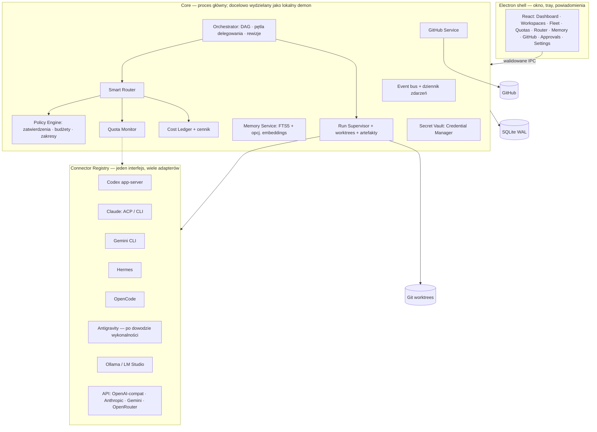

# Agenting OS — Plan v3 („Control Center”)

*by AI Evolution Polska · wersja planu: v3.0 · data: 2026-10-19 · zastępuje Master Plan v2.1 / 2026-10-19 z paczki „Architecture & Hermes Build Pack”*

> **Jedno zdanie:** jeden pulpit na Windows, w którym podłączasz *swoje* subskrypcje, lokalne modele i klucze API, wybierasz głównego agenta dla workspace’u, wpisujesz zadanie raz, a system rozdziela pracę między agentów, pilnuje limitów, kosztów i pamięci, i niczego ryzykownego nie robi bez Twojej zgody.

---

## 0. Najważniejsza decyzja: rozwijamy to, co już działa

Stary plan zakładał budowę od zera (Fastify + przeglądarka). Tymczasem **Agenting OS 0.4.0 już istnieje** (Electron + React + SQLite, 43/43 testów, `github.com/aievolutionpl/agenting-os`) i ma twarde fundamenty, których nie wolno wyrzucić:

- izolowane Git worktrees, nieedytowalne artefakty diff + SHA-256, zatwierdzenie z wygasaniem, „apply” jako fast-forward dokładnie zatwierdzonego commita,
- supervisor procesów (terminy, lease’y, anulowanie, odzyskiwanie po restarcie),
- adaptery: Codex app-server, ACP v1, MCP stdio,
- pamięć projektowa FTS5 z proweniencją, workflow, wersjonowane skille, izolowana przeglądarka per projekt, PL/EN, dark/light.

**Plan v3 = ewolucja 0.4.0 → 1.0**, nie rewrite. Hermes może zmienić dowolną część stosu, ale tylko przez ADR z dowodami (rozdz. 16).

## 1. Audyt stanu obecnego (luki względem Twojej wizji)

Zweryfikowane 2026-10-19 w kodzie 0.4.0 i na Twoim komputerze.

| Obszar | Dziś (0.4.0) | Czego brakuje do wizji |
|---|---|---|
| Agenci | Na sztywno `codex` i `claude` (schemat DB, `ProviderSetup`, `adapters.ts`) | Rejestr łączników: Gemini CLI, Antigravity, Hermes, OpenCode, lokalne LLM, API — dodawane bez zmiany schematu |
| Master Agent | Jedno pole `master` w projekcie, tylko codex/claude, nie deleguje | Wybór master agenta per workspace i per zadanie; pętla delegowania z egzekwowaniem polityk po stronie Agenting OS |
| Zadania | Zadanie ma jednego implementera i jednego reviewera | Graf zadań (DAG), równoległe kroki, zależności, rewizje z limitem, wielu agentów nad jednym celem |
| Router | Brak (agenta wybiera człowiek) | Router: twarde filtry → ranking → wyjaśnienie wyboru → fallback zgodny z polityką |
| Limity/quota | Brak; sondy tylko `--version`/`auth status`; quota jawnie „unknown” | Monitor quota per subskrypcja: dokładne / szacowane / nieznane, czas pobrania, reset |
| Koszty | Brak | Cennik API, budżet runa i workspace’u, osobno „koszt abonamentu (sunk)” vs „wydatek API” |
| Subskrypcje | Ręczna konfiguracja ścieżki exe | Kreator „Połącz subskrypcję”: wykryj CLI → zaloguj (oficjalnie) → zdiagnozuj → pokaż stan |
| GitHub | Tylko lokalny Git | `gh`/GitHub App: PR, status CI, review, issues; nigdy auto-merge do chronionej gałęzi |
| Dashboard | Lista projektów/zadań + panele | Premium pulpit: flota agentów, limity, koszty, aktywność, zatwierdzenia na jednym ekranie |
| Ustawienia | Język, motyw, dostawcy | Pełne centrum ustawień (rozdz. 11.3) |
| Pamięć | Per projekt, FTS5 | 4 poziomy zakresu, współdzielenie między agentami przez kontrolowane „handoff”, TTL/zastąpienie, widoczność i usuwanie |
| Pakowanie | Instalator NSIS niepodpisany | Podpis, test instalacji/odinstalowania, auto-update (później) |
| Izolacja obcych procesów | ACP/MCP to zaufane programy bez sandboxa | Opcjonalna izolacja OS (np. Job Objects/AppContainer) dla niezaufanych łączników |

**Stan Twojego PC (wykryty 2026-10-19):** zainstalowane `codex`, `claude`, `gemini`, `hermes`, `gh`, `git`, `node 26`, `pnpm`, `python 3.13`. **Brak:** `opencode`, `agy` (Antigravity), `ollama`; LM Studio nie odpowiada na `localhost:1234`. Wniosek: R0 (rozdz. 15) od razu testuje 4 prawdziwe łączniki; OpenCode, Antigravity i lokalne LLM wymagają instalacji lub oznaczenia `unsupported/needs-install`.

## 2. Zasady niezmienne (Hermes ich nie poluzuje sam)

1. **Brak obchodzenia limitów.** Żadnej rotacji kont, współdzielenia tokenów OAuth przez nieoficjalne bramki, kopiowania plików sesji ani „unlimited”. Subskrypcje to osobne pule z własnymi warunkami; używamy wyłącznie oficjalnych CLI/protokołów/API.
2. **Brak = brak danych.** Nieznany limit pokazujemy jako `unknown` z powodem, nigdy jako zmyślony licznik.
3. **Półautonomia:** system sam planuje, koduje lokalnie i testuje w worktree. **Pyta przed:** wdrożeniem, merge/push do chronionej gałęzi, zakupem lub podniesieniem limitu wydatków, operacjami niszczącymi, publikacją danych, użyciem sekretów poza zakresem, zmianą ustawień zabezpieczeń.
4. **Lokalnie najpierw.** Brak konta hostowanego, telemetrii i chmurowej bazy. Dane w `userData` + `AGENTING_DATA_DIR`.
5. **Sekrety** tylko w Windows Credential Manager / DPAPI; nigdy w SQLite jawnym tekstem, logach, promptach, pamięci.
6. **Izolacja pamięci:** użytkownik → workspace → projekt → zadanie; każdy rekord ma źródło, zakres, datę.
7. **Egzekwowanie po stronie aplikacji.** Master Agent *proponuje*; Agenting OS *decyduje* o routingu, budżecie i zatwierdzeniach. Agent nie może sam podnieść sobie uprawnień.
8. **Uczciwe statusy.** Adapter ma stan: `ready | needs-auth | needs-install | experimental | unsupported | quota-unknown | degraded`. „Connected” wolno pokazać tylko po udanym teście.
9. **Licencje:** każdy wzięty kod → SHA, licencja, ścieżki, wpis w `THIRD_PARTY_NOTICES`. Żadnych kopii cudzych layoutów.

## 3. Architektura docelowa

**Granice odpowiedzialności** (jeden właściciel danych na komponent): Policy = reguły i zatwierdzenia; Router = wybór; Quota = pomiary limitów; Cost = pieniądze; Memory = wiedza; Supervisor = procesy i pliki; Orchestrator = plan i stan zadania.

**Kierunek techniczny (do potwierdzenia ADR-em w R0):**
- Wydzielić z `src/main` pakiet `core` bez zależności od Electrona (czysty TS), z cienką warstwą IPC. Cel: testy bez okna i możliwość lokalnego demona + CLI `agenting` później. Nie robić tego na siłę, jeśli koszt przewyższa zysk.
- Monorepo pnpm (`apps/desktop`, `packages/core`, `packages/connectors`, `packages/ui`, `packages/contracts`) — dopiero gdy dodamy drugiego konsumenta `core` (demon/CLI). Do tego czasu zostać przy obecnym układzie.
- Zdarzenia: append-only tabela `events` + strumień do UI; wszystko odtwarzalne po restarcie (już działa w 0.4).
- SQLite: kolejne migracje zachowujące dane (wzorzec z 0.4); `node:sqlite` lub `better-sqlite3` — zostaje to, co działa.

## 4. Centrum połączeń — „podłącz swoje subskrypcje”

Cel: nowy użytkownik w ≤5 minut ma podłączone wszystko, co ma.

### 4.1 Model pojęć (nie mieszać)
`Provider` (firma) → `Account` (login/klucz) → `Entitlement` (plan/subskrypcja) → `Model` → `Connector` (sposób uruchomienia: ACP, CLI, API, local).

### 4.2 Macierz łączników — fala 1

| Łącznik | Tryb dostępu | Logowanie | Źródło limitów | Stan startowy |
|---|---|---|---|---|
| Codex | `codex app-server` (już jest) | przycisk „Zaloguj” → przeglądarka, profil należący do aplikacji | odczyt konta/limitów z app-server — **R0 sprawdza, które pola faktycznie wraca** | zainstalowany u Ciebie → `ready` po teście |
| Claude Code | ACP v1 (zgodny serwer) lub tryb nieinteraktywny CLI (`-p`/stream-json) — **R0 wybiera wspierany i stabilny** | oficjalne `claude` login | tylko oficjalne źródła; w przeciwnym razie `quota-unknown` | zainstalowany → test |
| Gemini CLI | tryb ACP/nieinteraktywny, jeśli wspierany | oficjalne logowanie Google / klucz API | oficjalne nagłówki/endpoint lub `unknown` | zainstalowany → test |
| Hermes | CLI/ACP agenta Nous (`hermes`) | wg dokumentacji | zależy od dostawcy modelu pod spodem | zainstalowany → test |
| OpenCode | CLI/serwer, dowolni dostawcy | wg dokumentacji | per dostawca | brak → „zainstaluj” |
| Antigravity | **tylko po dowodzie**, że istnieje oficjalny, stabilny tryb headless/ACP | — | — | `unsupported` do czasu dowodu; zakaz hacków |
| Lokalne LLM | Ollama (`/api`), LM Studio (OpenAI-compat `/v1`) | brak | VRAM/RAM/obciążenie z systemu, nie „tokeny” | brak serwera → „zainstaluj/uruchom” |
| API | OpenAI-compat, Anthropic, Google, OpenRouter | klucz w Credential Managerze | liczniki użycia z odpowiedzi + cennik; limity z nagłówków | opcjonalne |

> Model bez harnessu narzędziowego (sam czat) **nie dostaje** roli wykonawcy kodu — dostaje role `reviewer`/`summarizer`/`researcher`. Zdolności są deklarowane w `CapabilityProfile` i potwierdzane testem.

### 4.3 Kreator „Połącz” (jeden schemat dla każdego łącznika)
1. **Wykryj** (read-only): ścieżka, wersja, czy `--help` ma wymagane flagi.
2. **Zaloguj** — otwiera oficjalny proces logowania; aplikacja nie dotyka haseł ani plików sesji.
3. **Test dymny**: krótkie zadanie bez zapisu (np. „odpowiedz OK”), z limitem czasu; wynik zapisany jako dowód z czasem.
4. **Zdolności**: co potrafi (edycja plików, shell, MCP, delegowanie, tryb read-only).
5. **Limity**: jakie pola quota są dostępne i z jakiego źródła.
6. **Zgoda**: jawne „Pozwalam Agenting OS uruchamiać ten program w workspace’ach X, Y”.
7. Karta łącznika pokazuje: stan, wersję, ostatni test, plan/entitlement, quota (z etykietą pewności), koszt dzisiaj, błędy.

### 4.4 Zdrowie łączników
Okresowy lekki healthcheck (bez zużywania limitu), wykrywanie wygasłego logowania, aktualizacji CLI i zmiany protokołu; po awarii łącznik wpada w `degraded` i router go omija.

## 5. Workspace i Master Agent

- **Workspace** = folder projektu + repo GitHub + pamięć + polityka (budżet, zatwierdzenia) + zestaw dostępnych agentów + domyślny Master Agent.
- **Wybór Master Agenta** na dwóch poziomach: domyślny workspace’u i nadpisanie per zadanie. Opcje: Codex / Claude Code / Gemini / Hermes / OpenCode / lokalny / API.
- **Tryby pracy:** *Solo* (jeden agent, bez delegowania), *Zespół* (master planuje, workerzy wykonują, reviewer z innego dostawcy), *Wyścig* (ten sam krok u 2–3 agentów, wygrywa najlepszy diff po testach — za zgodą na koszt), *Tylko-do-odczytu* (research/audyt).
- **Master bez zdolności delegowania:** jeśli runtime nie umie delegować, Agenting OS pełni rolę orkiestratora, a „master” jest planistą i recenzentem. UI mówi to wprost (nie udajemy).
- **„Użyj wszystkich subskrypcji do jednej pracy”:** orkiestrator rozdziela kroki DAG-a między łączniki wg routera (rozdz. 7), żeby wyczerpywać różne pule równomiernie, nie przekraczając żadnej.

## 6. Orkiestrator zadań

**Cykl życia:** `draft → planned → awaiting-approval(plan) → running → review → awaiting-approval(apply) → applied | rejected | failed | cancelled`.

**Pętla delegowania (egzekwowana w aplikacji):**
1. Master dostaje cel + zamrożony kontekst (pamięć wybrana przez użytkownika, podgląd przed startem — już jest w 0.4).
2. Master zwraca *plan* (DAG kroków: opis, zależności, wymagane zdolności, szacowany rozmiar, ryzyko).
3. Policy Engine waliduje plan (budżet, ryzyka, niedozwolone akcje). Użytkownik zatwierdza plan, jeśli polityka tego wymaga.
4. Dla każdego gotowego kroku Router wybiera łącznik; Supervisor uruchamia w osobnym worktree.
5. Wynik kroku → artefakt (diff + hash + log + testy). Krok „review” idzie do innego dostawcy niż autor.
6. Rewizje ograniczone (domyślnie 2). Po limicie → człowiek.
7. Scalenie wyników wielu worktrees do gałęzi zadania; konflikty → krok naprawczy lub człowiek.
8. Zatwierdzenie → „apply” dokładnie zatwierdzonego commita (mechanizm z 0.4) → opcjonalnie PR.

**Pauza/wznowienie/anulowanie** na każdym kroku; interrupted run zachowuje worktree (już jest).

## 7. Smart Router

**Wejście:** krok (zdolności, rozmiar, ryzyko, wrażliwość danych), workspace policy, stan flotę.
**Algorytm:**
1. *Twarde filtry:* łącznik `ready`; ma wymagane zdolności; dozwolony w workspace; dane wrażliwe nie wychodzą do niedozwolonego dostawcy; jest zapas quota/budżetu; nie jest w cooldownie.
2. *Ranking (ważony, wagi w ustawieniach):* jakość historyczna dla tego typu kroku (z własnych wyników), wolna część quota (wyrównywanie zużycia między subskrypcjami), koszt krańcowy (abonament = 0 krańcowego, API = cena), opóźnienie, różnorodność (reviewer ≠ autor), ryzyko awarii.
3. *Wyjaśnienie:* każda decyzja zapisuje „dlaczego ten, dlaczego nie tamci” (widoczne w UI i w dzienniku).
4. *Fallback:* przy 429/limicie → cooldown i następny kandydat; **fallback na płatne API tylko jeśli polityka i budżet na to pozwalają i jest zgoda**; nigdy cichy.
5. *Uczenie:* proste, przejrzyste statystyki (success rate, mediana czasu, kosztu per typ kroku) — bez czarnej skrzynki.

**Presety polityk:** *Oszczędny* (najpierw lokalne/abonament), *Zbalansowany*, *Najszybszy*, *Najlepsza jakość*, *Ręczny* (zawsze pytaj).

## 8. Monitor limitów i koszty

### 8.1 Znormalizowany `QuotaSnapshot`
`{ accountId, scope: provider|model|plan, unit: percent|tokens|requests|messages|usd|time, used?, limit?, remaining?, resetAt?, window: 5h|daily|weekly|monthly|rolling, confidence: exact|estimated|unavailable, source: official-api|cli|response-headers|local-counter|manual, observedAt, staleAfter, note }`

- Natywne jednostki dostawcy; nie przeliczamy „na tokeny”, jeśli dostawca tego nie podaje.
- Wykrywanie resetu, przeterminowania (`stale`), błędów (429/401) → jawny stan, nie ostatnia stara liczba.
- **Źródła:** najpierw to, co daje sam łącznik (np. odczyt limitów z app-server, nagłówki odpowiedzi API); lokalny licznik własnych uruchomień jako `estimated`. Narzędzia społecznościowe (OpenQuota, CC Switch) — wolno *czytać ich wzorce*, wolno użyć kodu po audycie licencji i regulaminu dostawcy; nigdy ich metod opartych na wyciąganiu tokenów z cudzych sesji.
- Widok: pasek per subskrypcja, historia, prognoza „starczy do resetu / nie starczy”, alert przy progu (np. 80%).

### 8.2 Koszty
- **Cennik** modeli API jako edytowalna tabela z datą i źródłem (aplikacja nie zgaduje cen; brak ceny = wykonanie wymaga ręcznego limitu).
- **Ledger:** każdy run zapisuje tokeny/czas/koszt API lub „zużycie abonamentu” (osobna kolumna, nie w USD).
- **Budżety:** limit na krok, run, workspace/dzień/miesiąc; po przekroczeniu — stop i pytanie. Twardy sufit globalny.
- **Raport:** „ile kosztowały Cię API”, „ile pracy wykonały abonamenty”, „co zaoszczędził lokalny model”.

## 9. Pamięć współdzielona

- **Zakresy:** `global(user) → workspace → project → task`. Rekord: treść, typ (fakt/decyzja/konwencja/wynik/preferencja), źródło (kto/który run/plik), data, TTL, `supersedes`, widoczność (które agenty mogą czytać).
- **Wspólna dla agentów:** po każdym kroku Agenting OS (nie sam agent) proponuje wpisy z wyniku; użytkownik zatwierdza automatycznie lub ręcznie wg polityki. Agent dostaje *tylko wybrany, zamrożony kontekst* — nie ma dostępu do całej bazy.
- **Wyszukiwanie:** FTS5 (jest) → opcjonalne embeddingi lokalne (Ollama) po pomiarze zysku; graf czasowy (Graphiti) dopiero, gdy FTS przestanie wystarczać.
- **Bezpieczeństwo:** brak przenoszenia między workspace’ami bez wyraźnej akcji; wykrywanie sekretów przed zapisem; widoczność, edycja, usuwanie, eksport; ochrona przed prompt injection (treści z internetu/zewnętrzne oznaczone jako niezaufane, nie wykonują instrukcji).
- **Handoff między agentami:** zwięzłe „karty przekazania” (cel, stan, decyzje, pliki, następny krok) zapisywane jako artefakt zadania.

## 10. GitHub

- Oficjalne `gh` (masz zainstalowane) lub GitHub App/OAuth z minimalnymi zakresami; token w Vault.
- Funkcje: powiązanie workspace ↔ repo, lista issues → zadanie jednym kliknięciem, gałąź zadania, PR z opisem generowanym z artefaktu, status CI, komentarze review, porównanie diffów kilku agentów, aktualizacja PR po rewizji.
- **Zakazy:** auto-merge do chronionej gałęzi, force-push, zapis na `main` bez potwierdzenia. Każdy `push`/PR przechodzi przez Approval.

## 11. UI/UX

### 11.1 Charakter
Czysty, spokojny, premium; dark-first + light; siatka 8 px; jedna akcentowa barwa; gęstość „compact/comfortable”; ikony z etykietami; ruch oszczędny. Branding **„by AI Evolution Polska”** subtelnie (stopka sidebaru, About, ekran startowy) — logo nie dominuje. Czcionki i ikony tylko z jasną licencją. Minimum szerokości 360 px (już wymóg w 0.4), WCAG AA, pełna obsługa klawiatury, paleta poleceń `Ctrl+K`.

### 11.2 Nawigacja i ekrany
1. **Overview** — „kokpit”: aktywne zadania, flota (kto pracuje/wolny/ma problem), limity (paski), koszt dziś/miesiąc, oczekujące zatwierdzenia, ostatnia aktywność. Jedno wejście „Nowe zadanie”.
2. **Workspaces** — lista + kreator (folder, GitHub, master, polityki).
3. **Task Studio** — pole zadania, wybór trybu (Solo/Zespół/Wyścig/Read-only), master, podgląd kontekstu, szacunek kosztu/limitów **przed** startem, przycisk Start.
4. **Run / Task Graph** — żywy DAG, strumień zdarzeń, diff per krok, testy, rewizje, „dlaczego ten agent”.
5. **Agent Fleet** — karty łączników ze stanem, zdolnościami, testami, kosztem dziś; przycisk „Połącz/Napraw”.
6. **Subscriptions & Quotas** — pasek na subskrypcję, reset, prognoza, pewność danych, historia.
7. **Router & Policies** — presety, wagi, reguły (np. „dane klienta X tylko lokalnie”), podgląd symulacji „co by wybrał”.
8. **Costs** — ledger, budżety, cennik, raporty.
9. **Memory** — przeglądarka z filtrami zakresu, źródłem, TTL; edycja/usuwanie; „co dostał agent w tym runie”.
10. **GitHub** — repo, issues, PR, CI.
11. **Approvals** — kolejka ze szczegółami „co dokładnie się stanie” (diff, komenda, koszt); zatwierdź/odrzuć/zatwierdź-i-zapamiętaj regułę (tylko dla niskiego ryzyka).
12. **Activity & Audit** — niezmienny dziennik zdarzeń, filtry, eksport.
13. **Extensions** (jest: skille, MCP) — z oceną ryzyka.
14. **Settings** (11.3).

### 11.3 Centrum ustawień (rozszerzone — Twój wymóg „więcej ustawień”)
- **Konta i połączenia:** lista łączników, dodaj/napraw/odłącz, wybór wersji CLI, zgody per workspace, klucze API (Vault), test połączenia.
- **Agenci:** domyślny master, role (planista/wykonawca/reviewer/badacz), limity równoległości per łącznik, timeouty, tryby (read-only domyślny).
- **Router:** preset, wagi, listy dozwolonych/zabronionych par agent↔workspace, polityka dla danych wrażliwych, cooldowny.
- **Limity i alerty:** progi (np. 80/95%), powiadomienia Windows, tryb „chroń subskrypcję X” (rezerwa %), odświeżanie quota.
- **Koszty:** budżety, waluta, cennik API, sufit globalny, zachowanie po przekroczeniu.
- **Zatwierdzenia:** poziom autonomii (Ręczny / Półautonomiczny / Szerszy z listą wyjątków), czas wygasania, które klasy akcji wymagają zgody (deploy, push, koszty, usuwanie, sekrety, sieć).
- **Pamięć:** zasady autozapisu, TTL domyślny, wykrywanie sekretów, embeddingi (wł./wył.), eksport/usuwanie.
- **GitHub:** konto, zakresy, szablony PR/gałęzi, ochrona gałęzi, reguły CI.
- **Bezpieczeństwo:** zaufane programy (ACP/MCP), foldery dozwolone, zakazane ścieżki, siatka sieciowa (allow-list domen), wymuszanie worktree, tryb izolacji OS.
- **Wygląd:** motyw, gęstość, język PL/EN, akcent, skalowanie.
- **Dane i kopie:** lokalizacja danych, kopia zapasowa/przywracanie, retencja logów, eksport.
- **Diagnostyka:** „Doctor” (sprawdza wszystko jednym klikiem), logi, pakiet zgłoszenia błędu bez sekretów.
- **Aktualizacje:** kanał, ręczna kontrola (auto-update dopiero po podpisaniu).
- **Zaawansowane:** flagi eksperymentalne (jawnie oznaczone), ścieżki narzędzi, zmienne środowiskowe łączników (bez wartości sekretnych w UI).

### 11.4 Stany i mikro-reguły
Pusty stan zawsze mówi „co dalej”; każdy błąd ma akcję naprawczą; nigdy zielony „Connected” bez testu; dane demo wyłącznie w trybie *Demo* z widocznym znacznikiem; kolor nigdy jedynym nośnikiem informacji.

## 12. Bezpieczeństwo (uzupełnienie istniejących zabezpieczeń 0.4)

- Model zagrożeń: złośliwy repozytorium/prompt injection, złośliwy MCP/ACP, wyciek sekretów do logów/pamięci, ucieczka agenta z worktree, nadmierne koszty, podszycie się pod zatwierdzenie.
- **Policy Engine** jako jedyne miejsce decyzji „wolno/pytaj/zakaz”; testy jednostkowe na każdą klasę akcji.
- Zatwierdzenia wiązane kryptograficznie z dokładną akcją (hash artefaktu/komendy) i wygasające (mechanizm jest).
- Redakcja sekretów w strumieniu i logach (rozszerzyć wykrywacz), zakaz czytania typowych plików sekretów przez agentów (`.env`, klucze SSH, magazyny przeglądarki).
- Sieć: domyślnie bez wychodzącego ruchu z kroków read-only, jeśli łącznik to umożliwia; allow-lista dla reszty.
- Łączniki niezaufane: opcjonalny sandbox OS; do tego czasu wyraźne ostrzeżenie „zaufany program lokalny”.
- Łańcuch dostaw: pin wersji, `npm audit`, skan licencji w CI, brak `postinstall` z obcych paczek bez przeglądu (zauważone: 2 pakiety ze skryptami instalacyjnymi wymagają jawnej zgody — uporządkować `allowScripts`).

## 13. Wykorzystanie istniejących repozytoriów (nie budujemy od zera)

Zasada: **referencja → adapter → mała kopia z licencją → zależność**, zawsze po audycie SHA i licencji. Referencje klonować do `references/` (poza buildem, w `.gitignore`), niczego z nich nie uruchamiać bez przeglądu.

| Repo | Do czego zajrzeć | Sposób użycia |
|---|---|---|
| `agentclientprotocol/typescript-sdk`, `codex-acp`, `claude-agent-acp` | Protokół agentów | Zależność / adapter (część już zaimplementowana własnym kodem — porównać i uprościć, jeśli SDK jest lepsze) |
| `generalaction/emdash`, `stablyai/orca` | Równoległe sesje, wykrywanie CLI, worktrees, UX | Inspiracja + pojedyncze funkcje po audycie |
| `paperclipai/paperclip` | Budżety, zatwierdzenia, delegowanie | Wzorce; nie przejmować całego control plane |
| `farion1231/cc-switch` | Rejestr dostawców, konfiguracje CLI | Wzorce konfiguracji; kod tylko izolowany |
| `deviffyy/OpenQuota` | Odczyt i normalizacja limitów | Czytać wzorce; użyć tylko zgodnych z regulaminem czytników |
| `getzep/graphiti` | Pamięć czasowa | Opcja w fazie późnej, po pomiarze |
| `langfuse/langfuse` | Ślady/ocena | Opcjonalnie; nie wymagane lokalnie |
| `NousResearch/hermes-agent`, `anomalyco/opencode` (sprawdzić aktualny adres), Gemini CLI | Tryby uruchamiania | Dokumentacja → adapter |
| `router-for-me/CLIProxyAPI`, `0xtbug/zero-limit` | Bramki OAuth | **Tylko badanie.** Żadnego automatycznego użycia sesji OAuth (rozdz. 2.1) |

R0 weryfikuje: istnienie, aktywność, licencję **na pobranym commicie**, wsparcie Windows, skrypty instalacyjne, telemetrię. Wynik: `docs/audit/OSS_DECISIONS.md`.

## 14. Kontrakty danych (szkic — Hermes finalizuje w `packages/contracts`)

`Connector{id, kind, command|endpoint, version, state, capabilities[], lastTest}` ·
`Account{id, connectorId, label, plan, authState}` ·
`QuotaSnapshot{…rozdz. 8.1}` · `ModelCapability{modelId, tools, context, costPerMTok?, localOnly}` ·
`Workspace{id, root, repo?, masterDefault, policyId, allowedConnectors[]}` ·
`Task{id, workspaceId, goal, mode, master, state, budget}` · `Step{id, taskId, dependsOn[], needs[], risk, state, connectorId?, worktree?}` ·
`Run{id, stepId, attempt, startedAt, endedAt, usage, costApi?, subUse?}` · `Artifact{id, runId, diffSha256, files[], tests}` ·
`Approval{id, class, actionHash, expiresAt, decision, decidedBy}` · `MemoryRecord{id, scope, kind, content, source, ttl, supersedes?, visibility[]}` ·
`RoutingDecision{stepId, candidates[], chosen, reasons[]}` · `Event{seq, ts, type, refs, payloadHash}`

Migracje: zachować dane 0.4 (projects→workspaces, `master` ∈ rozszerzony zbiór, tasks→tasks+steps).

## 15. Governance audytu (Twój wymóg: audyty muszą zrobić agenci)

### 15.1 Role niezależnych audytorów
Każdy audyt wykonuje **inny dostawca niż autor kodu** (np. kod pisze Codex → audytują Claude i Gemini; Hermes koordynuje, nie ocenia siebie).

| Audyt | Pytanie | Dowód |
|---|---|---|
| Bezpieczeństwo/Compliance | Czy da się obejść zatwierdzenia, wyciec sekret, uciec z worktree? | testy ataków + raport |
| Architektura/Runtime | Spójność granic, odporność na restart, wyścigi | testy, przegląd ADR |
| Produkt/UX | Czy nowy użytkownik połączy subskrypcje w ≤5 min? Dostępność | nagrania przejść, screenshoty, WCAG |
| Licencje/OSS | Każdy kod obcy ma SHA, licencję, notice | `OSS_DECISIONS.md`, skan |
| Koszty/Quota | Czy kwoty i limity nie kłamią? Budżety twarde? | testy symulacyjne, porównanie z panelami dostawców |
| Adversarial QA | Znajdź sposób, by system skłamał lub zrobił coś bez zgody | raport prób |

### 15.2 Bramki
Audyt na końcu **każdej fazy** i przed wydaniem. Raport w `docs/audit/<faza>/<rola>.md`: werdykt (pass/pass-z-uwagami/fail), znaleziska z wagą (krytyczne/wysokie/średnie/niskie), dowód powtarzalny, rekomendacja. **Krytyczne/wysokie blokują fazę**; poprawki weryfikuje ten sam audytor. Jeśli nie ma dostępnych niezależnych agentów — zgłoś blokadę, nie symuluj audytu.

## 16. Swoboda ulepszania (kluczowa instrukcja dla agenta)

Agent budujący **ma obowiązek** zaproponować i może wdrożyć lepsze rozwiązanie, jeśli jest prostsze, szybsze, tańsze lub bezpieczniejsze: zmiana stosu, bazy, kolejki, układu UI, kolejności faz, repozytorium bazowego, a nawet tego planu. Warunki:
1. ADR (`docs/adr/ADR-NNN.md`): problem, alternatywy, dowód (benchmark/test/prototyp), wpływ na koszt/bezpieczeństwo/czas, rollback.
2. Zmiany bezpieczeństwa, zatwierdzeń, sekretów, granic pamięci, licencji, budżetu i wyboru Master Agenta **nie są poluzowywane bez pytania użytkownika**.
3. Zmiany wprowadza w małych krokach, z testami; niszczące migracje tylko z kopią zapasową.
4. Jeśli plan jest błędny lub przestarzały — poprawia plan (nowa wersja w `docs/plan-v3/CHANGELOG.md`), nie obchodzi go po cichu.

## 17. Mapa drogowa (od 0.4.0 do 1.0)

Każda faza kończy się: działającym przyrostem, testami, zrzutami prawdziwego UI, audytem (15) i raportem „co działa naprawdę / czego nie sprawdzono / decyzje dla użytkownika”.

| Faza | Zakres | Kryterium wyjścia |
|---|---|---|
| **R0 — Audyt (tylko czytanie + małe testy)** | Rozdz. 1 zweryfikowane; spike’i: Codex i Claude (prawdziwe zadanie), Gemini, Hermes; odczyt quota z Codex; inwentarz repo/licencji; ADR architektury; decyzja co z rozdz. 3 | Raport R0 zatwierdzony przez Ciebie |
| **0.5 — Connector Registry + Connection Hub** | Rejestr łączników, migracja schematu, kreator „Połącz”, Fleet, Doctor, Gemini + Hermes adaptery, Credential Manager | 4 łączniki z realnym testem dymnym; brak fałszywego „Connected” |
| **0.6 — Quota & Costs** | `QuotaSnapshot`, czytniki per łącznik, historia, alerty, cennik API, ledger, budżety | Wartości zgodne z panelami dostawców lub `unknown` z powodem |
| **0.7 — Orkiestrator + Router** | DAG, tryby Solo/Zespół/Wyścig, Master per workspace/zadanie, Router + wyjaśnienia, polityki | 2 różni agenci wspólnie robią 1 zadanie na testowym repo; reviewer ≠ autor |
| **0.8 — Dashboard premium + Ustawienia** | Overview, Task Studio, Graph, Quotas, Costs, pełne Settings, paleta poleceń, powiadomienia | Test użyteczności: nowy użytkownik łączy subskrypcje ≤5 min; WCAG AA |
| **0.9 — Pamięć + GitHub** | 4 zakresy, handoff, TTL, widok pamięci; `gh`: issues→zadanie, PR, CI | Brak wycieku między workspace’ami (test); PR na testowym repo za zgodą |
| **1.0 — Hardening i dystrybucja** | Łączniki OpenCode / lokalne LLM / API, Antigravity (tylko jeśli dowód), sandbox OS, podpisany instalator, test instalacji/upgrade/uninstall, dokumentacja | Pełny audyt 15.1 bez krytycznych/wysokich |

## 18. Testy i dowody

- Jednostkowe: Policy Engine, Router (deterministyczne scenariusze), Quota (reset, stale, 429), Cost (budżet), Memory (zakresy).
- Integracyjne: prawdziwy Git + SQLite (jak dziś), fixture’y protokołów, **plus** opcjonalne testy na prawdziwych CLI (oznaczone, uruchamiane świadomie, bez płatnych wywołań domyślnie).
- E2E (Electron + Playwright lub dotychczasowy smoke): E01 brak CLI → instrukcja, nie „Connected”; E02 zalogowany Codex → test dymny; E03 niezalogowany Claude → `needs-auth`, kolejka zablokowana, brak cichego API; E04 master=Claude, worker=Codex → DAG→artefakt→review; E05 dwa worktrees, jeden pada → brak scalenia; E06 odrzucony deploy → niewykonany, widoczny w audycie; E07 nieznana cena API → odmowa do ustawienia limitu; E08 źródło quota zwraca 429 → cooldown, brak zmyślonych liczb; E09 próba wycieku pamięci między workspace’ami → odmowa; E10 restart w środku runa → odzyskanie bez powtórzenia akcji.
- Każdy przyrost: `typecheck`, `npm test`, smoke Electron, kontrasty, `npm audit`, skan licencji.

## 19. Pierwsze trzy zadania po akceptacji planu

1. R0 zgodnie z rozdz. 17 (czytanie, inwentarz, 4 spike’i łączników, ADR) — bez nowych funkcji.
2. Migracja do Connector Registry bez zmiany zachowania (wszystkie 43 testy zielone) + test regresji.
3. Kreator „Połącz” dla Codex i Claude jako wzorzec dla pozostałych.

## 20. Otwarte decyzje dla Ciebie (zatwierdź lub zmień)

1. Czy docelowo **Electron zostaje** (rekomendacja: tak, bo działa i jest przetestowany), czy planujesz też wersję przeglądarkową/demon?
2. Poziom autonomii domyślny: *Półautonomiczny* (rekomendacja) vs bardziej zachowawczy na start.
3. Priorytet łączników po Codex/Claude: Gemini i Hermes (zainstalowane) → potem OpenCode i Ollama (do zainstalowania).
4. Czy Antigravity ma być w 1.0, czy tylko „gdy będzie oficjalny tryb headless”.
5. Twój budżet miesięczny na API (sufit globalny w ustawieniach).
